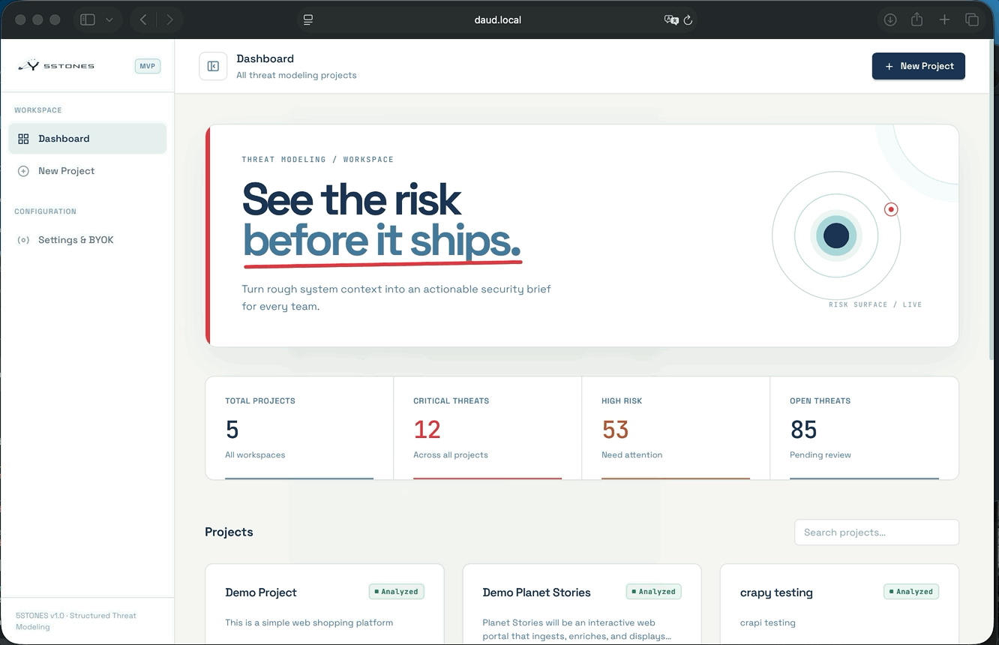
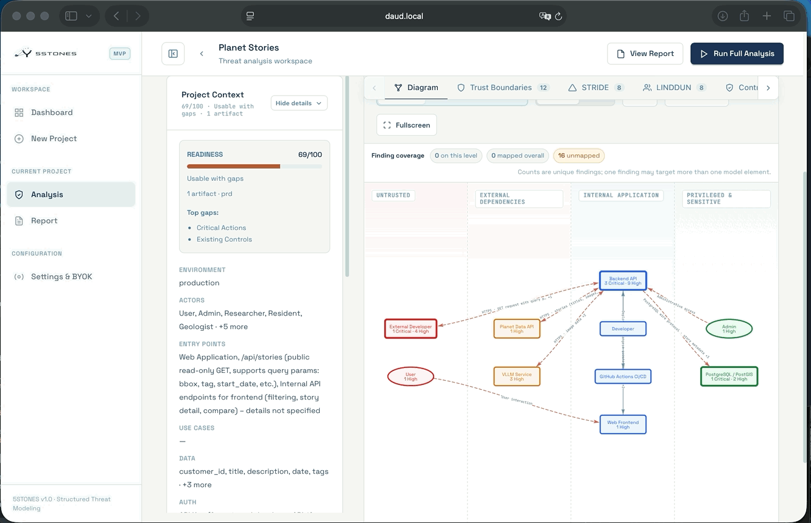
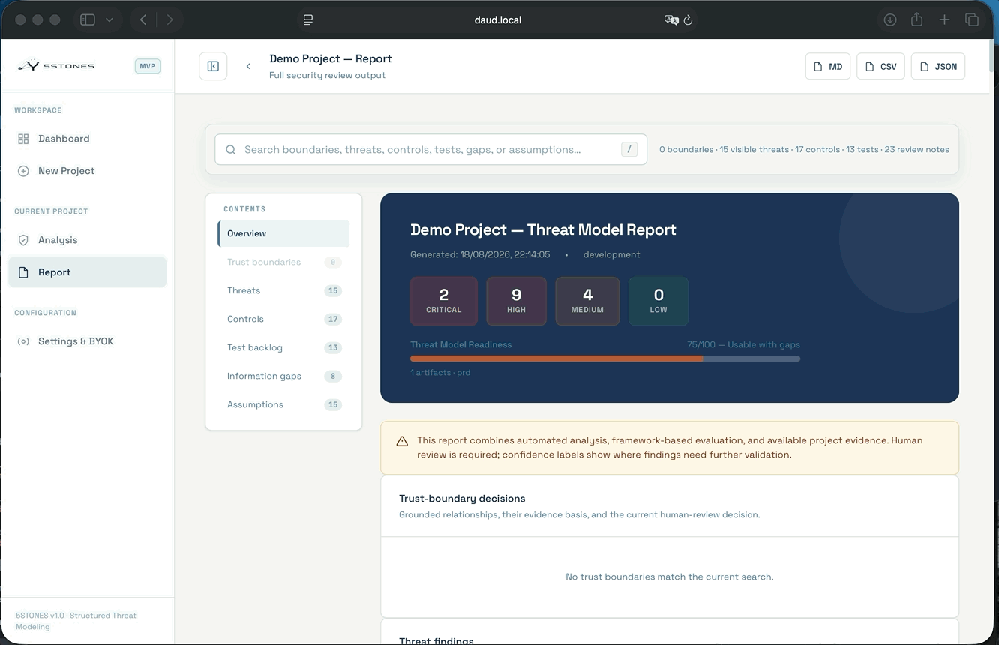

<div align="center">
  

  # 5STONES

  ### See the risk before it ships.

  A structured security review workspace for teams that need clarity before they ship.

  <p>
    <a href="#quick-start">Quick start</a> ·
    <a href="#product-tour">Product tour</a> ·
    <a href="#analysis-providers">Analysis providers</a> ·
    <a href="#security-notes">Security notes</a>
  </p>
</div>

5STONES turns the system context you already have a PRD, API specification, database schema, or rough description into a clear, review-ready security dossier. It brings architecture context, trust-boundary decisions, STRIDE and LINDDUN findings, control mappings, test scenarios, evidence, and open questions into one supporting document for engineering, security, and QA teams.

## Product tour

<table>
  <tr>
    <td width="33%" align="center"><strong>Dashboard</strong><br /><sub>Track projects and risk posture</sub></td>
    <td width="33%" align="center"><strong>Analysis diagram</strong><br /><sub>Explore components and trust zones</sub></td>
    <td width="33%" align="center"><strong>Security report</strong><br /><sub>Turn findings into action</sub></td>
  </tr>
  <tr>
    <td></td>
    <td></td>
    <td></td>
  </tr>
</table>

## Why 5STONES?

- **Start with incomplete information.** Import what exists and make gaps explicit instead of waiting for perfect documentation.
- **Ground findings in context.** Review trust boundaries, evidence, confidence, and assumptions before acting on a result.
- **Give every role a next step.** Developers get controls and test scenarios; security teams get threat classification; QA gets an actionable backlog.
- **Keep the workflow flexible.** Use the built-in analysis engine, a connected provider, or a local model while keeping the review structure consistent.

## How it works

```text
Context → Parse & reconcile → Review trust boundaries → Analyze → Act
  PRD       OpenAPI/Postman     STRIDE + LINDDUN       Controls   Tests
  Schema    Markdown/CSV        Evidence & assumptions  Gaps      Reports
```

## Quick start

### 1. Install dependencies

```bash
python -m venv .venv
source .venv/bin/activate    # macOS/Linux
pip install -r requirements.txt
```

### 2. Configure the environment

```bash
cp .env.example .env
# Edit .env and set your provider values.
```

For a connected provider, configure `OPENAI_API_KEY`, `OPENAI_BASE_URL`, and `OPENAI_MODEL`. For local inference, use the local endpoint settings shown in `.env.example`.

Project-scoped workspace isolation is available as a configurable MVP guard. Set
`WORKSPACE_AUTH_REQUIRED=true`, configure `WORKSPACE_AUTH_TOKENS_JSON` as a
workspace-to-token JSON map, and send `X-Workspace-ID` plus `Authorization:
Bearer ...` on project-scoped requests. The default remains disabled for local
single-user development; production deployments should replace this adapter
with the application's IdP/JWT authorization layer.

### 3. Run the server

```bash
python -m backend.main
```

Open **http://127.0.0.1:8000** in your browser.

## What it does

| Capability | Status |
|---|---|
| Project management | ✅ |
| Artifact upload and structured parsing | ✅ |
| Evidence-backed trust-boundary review | ✅ |
| STRIDE threat generation | ✅ |
| LINDDUN privacy analysis | ✅ |
| Control mapping from built-in catalog | ✅ |
| Test scenario generation | ✅ |
| Connected analysis provider configuration | ✅ |
| Local analysis runtime | ✅ |
| Markdown, CSV, and JSON export | ✅ |
| Audit logging | ✅ |

## Analysis providers

The review workflow can use any OpenAI-compatible endpoint or a local inference server:

| Provider | Base URL |
|---|---|
| OpenAI | `https://api.openai.com/v1` |
| Azure OpenAI | `https://<resource>.openai.azure.com/openai/deployments/<model>` |
| OpenRouter | `https://openrouter.ai/api/v1` |
| Ollama | `http://localhost:11434/v1` with `OPENAI_API_KEY=ollama` |
| LM Studio | `http://localhost:1234/v1` |

## Supported input formats

| Input | Formats |
|---|---|
| Product requirements | Plain text, Markdown, PDF, DOCX |
| API contracts | OpenAPI / Swagger YAML or JSON |
| API collections | Postman JSON, HAR |
| Data models | SQL or text database schema |
| API inventory | CSV |

## Design principles

**Work with incomplete information.** Real threat modeling rarely starts with a complete picture. 5STONES surfaces confidence scores and missing information alongside every finding.

**Make assumptions visible.** If the analysis infers something it was not told, that assumption is recorded, reviewable, and editable.

**Produce role-aware output.** A finding is only useful when the right person can act on it. Every report connects threats to controls, owners, evidence, and executable tests.

## Security notes

- Keep secrets in `.env` or a managed secret store. Never commit real API keys, local settings, audit logs, generated reports, or runtime caches.
- Use a strong, unique `APP_SECRET_KEY` for every environment.
- The included server is intended for local development/MVP use. Add authentication, authorization, restricted CORS, rate limiting, and provider URL allowlisting before exposing it publicly.

## The name

5STONES is named after the principle that a small, well-aimed effort built on what you already have is more effective than a perfect tool you never use.
