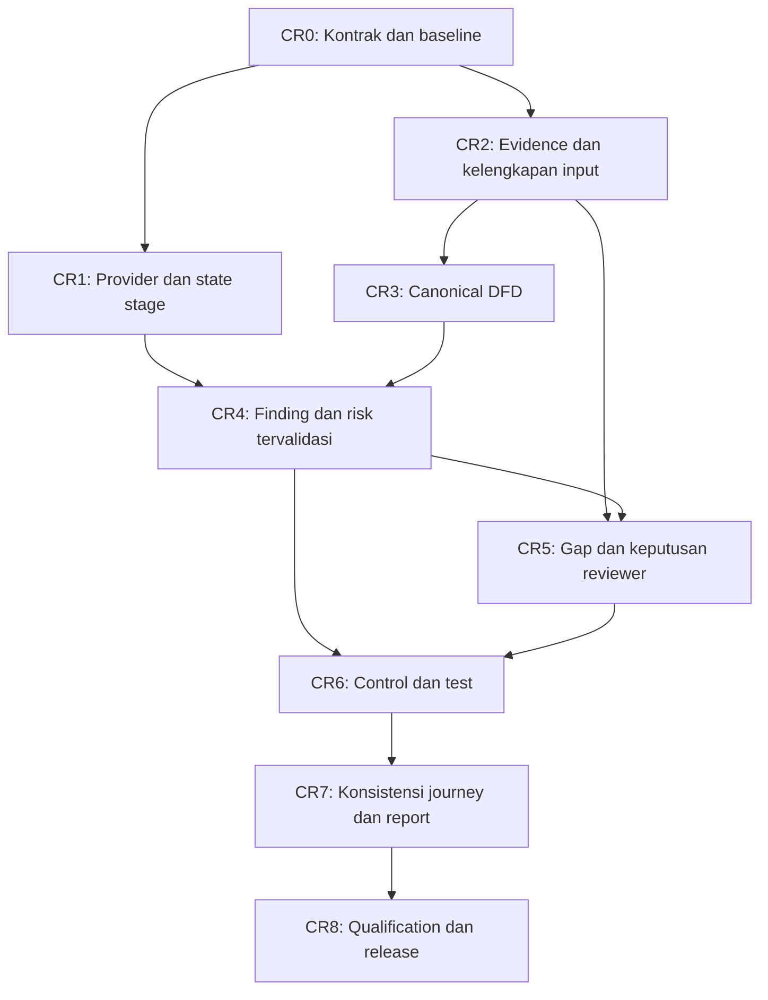

# Alignment Plan — DFD dan Threat Analysis

## Baseline

- Acuan: `DFD_Feature_AI_Agent_Prompt.md`
- Status project saat ini: **grounded threat-modeling MVP dengan DFD visualization**.
- Target akhir: **semantic DFD modeling feature** yang menjadi source of truth untuk canvas, inventory, export, STRIDE, dan LINDDUN.
- Verifikasi branch saat ini: 240 test Python, regression JavaScript, Playwright Analyze-click/DFD/report, dan golden-corpus offline lulus untuk kontrak lokal. Namun E2E sembilan PRD pada 2026-09-24 menemukan seluruh STRIDE/LINDDUN memakai fallback karena provider timeout; karena itu branch **belum lulus release gate threat-modeling live** walaupun ingestion/DFD smoke-test berjalan.
- Branch enhanced/revamp: `codex/dfd-threat-model-alignment`.
- Checkpoint fondasi: `77db35f Add canonical DFD semantic model foundation`.
- Audit integrasi historis: **2026-09-20**, terhadap commit `4bb1a5d` dan report project `81a087d2-b46b-40f7-ba58-bdc315a6ae0c` revision 3. Audit kualitas terbaru: **2026-09-24**, berupa E2E sembilan PRD pada `tests/prd_corpus/`; gunakan bagian **PRD Corpus Recovery Plan** sebagai sumber prioritas aktif. Status selesai pada F01–F14/M0–M9/RI0–RI11 adalah bukti kontrak lokal, bukan pengganti kelulusan E2E provider dan usefulness gate.

## Goal

Align project dengan dokumen acuan, dengan fokus pada:

1. Canonical semantic DFD yang tervalidasi dan tersimpan.
2. Trust zone, ownership, scope, exposure, logical boundary, dan crossing yang benar.
3. Evidence, assertion, unknown, conflicting information, question, dan revision lifecycle.
4. STRIDE/LINDDUN yang menganalisis model DFD yang sama dan memiliki traceability ke node/flow/boundary/data.
5. UI DFD yang editable, dapat direview, disimpan, diekspor, dan dapat ditelusuri ke threat.
6. Isolation, redaction, schema validation, dan proteksi untrusted document.

## Audit regresi integrasi — 2026-09-20

### Kesimpulan dan scope

**Belum siap dinyatakan selesai end-to-end.** Perubahan validasi, snapshot, projection, dan ingestion mempunyai kontrak lokal yang diuji, tetapi acceptance visual/progress/ingestion lintas modul masih terbuka. Aktivitas RI0 sudah menutup recovery dan konsistensi publish state pada jalur implementasi saat ini; beberapa defect lain berasal dari perubahan lebih awal (khususnya M5), bukan hanya commit ingestion terakhir.

Audit ini mencakup kode dan Git diff, enam report lokal, browser Playwright pada project terdampak, serta reproduksi helper/pipeline dengan stub di memori. Provider eksternal tidak dipanggil ulang; pemeriksaan progress memakai request Promise yang ditahan di browser. Fit direproduksi melalui `diagramNetwork.fit()` yang dipakai tombol, tanpa jalur autosave. Belum ada patch runtime/recovery data dalam audit ini.

### Bukti project terdampak

- Project: `81a087d2-b46b-40f7-ba58-bdc315a6ae0c`; run `9e79b724-3715-4dbf-82a2-09a9b2b113f0`, `2026-09-20T09:55:58Z`–`09:56:58Z`.
- Run input DFD revision 2 → final revision 3; canonical berisi 21 nodes, 7 flows, 4 zones, 1 boundary. Build ulang dengan kode/current input yang sama menghasilkan revision 3 dan hash identik; tidak terbukti ada revision churn setiap rerun pada snapshot ini.
- Enam finding lama (3 STRIDE + 3 LINDDUN, analyzed revision 1, tanpa semantic hash) ada di `analysis_quarantine`: `stale_analysis_revision` + `missing_or_stale_dfd_semantic_hash`. Dua record tambahan menyimpan `provider_contract_invalid`.
- STRIDE/LINDDUN terbaru berstatus `invalid`, bukan `valid_empty` atau fallback. Durasi masing-masing 28.363/26.024 detik. Controls/Tests `pending/not_run`; koleksi lama tetap menyimpan 8 controls dan 6 tests.
- API/UI: 0 active threats, 8 controls terlihat, 0 tests terlihat meskipun 6 masih tersimpan. UI menulis “Threat review is clear” dan banner mengklaim “Stages using baseline results”. Angka nol ini bukan assessment aman/no-candidate.
- Keempat zone tersedia tetapi setelah frame render semuanya `display:none`. Seluruh 21 visual nodes tidak membawa `zone_ids`.
- Fit mempertahankan posisi node; bounding box `P2 Backend (FastAPI) /api/stories` beririsan dengan `P11 public-facing read-only GET endpoint (/api/stories)`.

### Finding integrasi dan acceptance remediation

RG10/RG11 dan visibility lintas fitur RG12 **diremediasi pada jalur implementasi RI3**; RG05–RG07 serta export diagram RG12 pada RI2, RG01/RG04 pada RI1, dan RG02/RG03/RG08/RG09 pada RI0. Bukti pada tabel berikut adalah kondisi saat audit awal, bukan defect yang masih terbuka pada kode saat ini. Gate end-to-end live-provider/multi-project tetap terbuka. “Reproduksi” berarti teramati pada browser/data atau fixture di memori; “inspeksi” berarti jalur kode terkonfirmasi, tetapi dampak produksi spesifik belum diuji.

| ID / prioritas | Finding, bukti, dan dampak | Target perbaikan / acceptance |
|---|---|---|
| RG01 · P1 · reproduksi | **Progress meloncat ke fase terakhir.** [analysis.js](frontend/js/analysis.js:1025) menjalankan `setActiveStep()` untuk semua fase sebelum menunggu satu POST. Playwright: 6 steps aktif sekaligus, label langsung `Phase 6 of 6 · Evidence review`, progress `0% est.`. F08 commit `b01ad64` menghapus request-per-stage tanpa mengganti progress transport. Backend baru menyimpan hasil stage di akhir run. | Pertahankan satu run/snapshot dengan progress per-stage aktual melalui polling/SSE/job state. Hanya stage yang sedang berjalan aktif; completed/error/blocked/skipped berbeda. Reload/retry harus menunjukkan state server. Acceptance: tahan STRIDE dan buktikan UI berhenti di STRIDE sementara fase berikutnya queued. |
| RG02 · P0 · reproduksi | **Hasil lama hilang dari workflow sebelum penggantinya sukses.** [analysis.py](backend/routers/analysis.py:606) memindahkan stale/legacy findings ke quarantine sebelum mengambil prior framework snapshot. Jika provider invalid, prior active snapshot sudah kosong. Enam finding masih bisa dipulihkan dari JSON tetapi UI tidak menyediakan daftar history/quarantine. Bucket recovery dibatasi 100 record. | Pisahkan hasil current, stale historical, dan malformed quarantine; pertahankan snapshot hasil/review terakhir sampai pengganti tervalidasi. Legacy yang belum terbukti current tetap terlihat sebagai needs-revalidation, tidak dikirim ke downstream sebagai fakta current. Acceptance: upgrade + DFD revision change + provider invalid tetap menyajikan 6 historical findings beserta tests/review dan alasan stale. History tidak boleh hilang karena batas rolling error log. |
| RG03 · P0 · reproduksi | **Status gagal ditampilkan seperti hasil baseline/bersih, collections tidak konsisten.** [analysis.js](frontend/js/analysis.js:985) melabeli setiap `ok=false` sebagai baseline; [api.js](frontend/js/api.js:136) menyembunyikan tests tanpa active parent. Project ini menampilkan 0 threats/0 tests, tetapi 8 controls lama masih terlihat dan guidance “Threat review is clear”. | UI/summary harus membedakan failed, blocked, valid-empty, fallback, stale, dan current. Tests/controls lama terlihat dalam historical snapshot yang sama. Acceptance: invalid STRIDE/LINDDUN tidak pernah menghasilkan pesan review clear atau baseline tanpa baseline aktual. |
| RG04 · P0 · bukti failure + inspeksi budget | **Generation tidak seimbang dan akar error provider tidak dapat diaudit.** Prompt aktual yang ditangkap tanpa memanggil provider: STRIDE 81,179 karakter, LINDDUN 89,653 karakter; output hardcoded 4,000/3,000 token. Coverage dan rich threat schema dibebankan ke satu respons. Kedua service tidak meminta response metadata; catch router menyimpan error string tetapi membuang `exc.code`/`response_metadata`. | Batch berdasarkan graph interaction/coverage dengan bounded effective budget, simpan finish reason/usage/parse reason/attempt, pertahankan coverage yang deferred. Acceptance: provider truncate/prose/empty/valid-empty terpisah di API/UI; retry sesuai penyebab. **Truncation adalah dugaan penyebab, belum dapat dinyatakan penyebab pasti run ini karena raw response/metadata tidak tersimpan.** |
| RG05 · P1 · reproduksi | **Kotak zone hilang karena contract visual node rusak.** M5 commit `eca0ea7` mengganti pembacaan membership dari canonical nodes menjadi `diagramNetwork.body.data.nodes`; `nodeRows` tidak menyalin `zone_ids`. [analysis.js](frontend/js/analysis.js:2692) kemudian menemukan 0 anggota dan menyembunyikan semua kotak. Nama exposure seperti public/internal juga perlu dibedakan dari nama trust zone. | Projection harus menjaga membership canonical/collapsed; render update setelah fit/zoom/pan memakai ukuran node dan transform yang benar. Acceptance: empat zone terlihat setelah animasi selesai, cocok dengan membership, tetap benar saat collapse/expand/resize/export. Jangan mengembalikan klasifikasi public/internal dengan menebak dari tipe node. |
| RG06 · P1 · reproduksi | **Fit tidak menyelesaikan overlap.** Fit hanya mengubah viewport; layout memakai spacing tetap 200/220 dan tinggi 112/115, sedangkan node dapat lebih lebar/tinggi. Saved layout selalu dipakai jika seluruh koordinat ada, tanpa collision check. Nested subgroup offset `groupIndex * 270` mengabaikan lebar subgroup sebelumnya. | Layout menghitung bounding box label/node dan ukuran nested group; sediakan auto-layout terpisah dari fit-to-view dengan semantics yang jelas. Acceptance: nol node overlap untuk long labels/nested zones/current project, edge labels terbaca, saved layout bisa direflow secara eksplisit. |
| RG07 · P1 · reproduksi + inspeksi | **Projection menghilangkan flow semantics dan metadata collapsed node.** [analysis.js](frontend/js/analysis.js:2717) menggabungkan semua flow dengan source–destination sama bahkan tanpa zone collapsed. Fixture read HTTPS + write HTTP menjadi 1 edge dan hanya membawa protocol/crossings flow pertama. `_collapsedZoneId` juga tidak dibawa ke `nodeRows`, padahal click handler memerlukannya. | Flow terpisah tetap punya stable ID/metadata; hanya aggregate pada grouping eksplisit, dengan semua constituent refs dapat diinspeksi. Collapsed node membuka inspector zone. Acceptance: kedua flow dan finding masing-masing dapat dipilih; collapse→inspect→expand menjaga protocol/crossing/count. |
| RG08 · P1 · reproduksi | **Dashboard/project summary bisa tertimpa state lama.** Pipeline menyimpan project dengan risk/completeness terbaru, lalu wrapper `run_full_analysis()` menyimpan kembali objek project yang dibaca sebelum pipeline. Fixture in-memory: report total 0, final saved project total 6. [analysis.py](backend/routers/analysis.py:444), [analysis.py](backend/routers/analysis.py:1033). | Satu owner commit untuk project/report state atau merge field status ke latest persisted project. Acceptance: dashboard, project API, report, dan hasil run konsisten setelah success/warning/failure. |
| RG09 · P0 · inspeksi | **Snapshot belum melindungi concurrent edits/partial commit.** `_ACTIVE_ANALYSIS_RUNS` hanya mengunci analysis dalam satu process. DFD/review/source edit tidak ikut lock; canonical sudah disimpan sebelum provider selesai dan final report ditulis tanpa compare-current-revision. Failure dapat meninggalkan canonical baru dengan report lama; successful final write dapat menimpa edit/review yang terjadi selama await. | Compare-and-swap revision/source hash saat publish, atomic snapshot persistence atau run-scoped staged results, shared locking yang sesuai deployment. Acceptance: edit DFD/review/upload saat provider ditahan menghasilkan conflict/rebase yang jelas; keputusan reviewer tidak tertimpa. |
| RG10 · P1 · reproduksi + inspeksi | **F14 coverage belum menjamin end-to-end ingestion.** Fixture teks 136,017 karakter dipotong extractor menjadi 120,000; tail hilang tetapi parser melaporkan `complete`, deferred 0. `{}` dari provider juga dianggap processed/complete. Fallback dengan satu keyword/PII flag sudah dianggap processed walaupun detail lain tidak terambil. PDF hanya 80 halaman dan DOCX hanya 20 tabel tanpa omission locator dalam manifest. | Manifest dimulai dari file extraction, mencakup omitted page/table/char ranges; validasi output chunk; bedakan attempted/read/extracted/partial/deferred. Acceptance: tail yang tidak terambil selalu punya alasan/locator deferred; `{}` bukan complete extraction. |
| RG11 · P1 · inspeksi | **Upload ulang dokumen lama tidak mendapat perbaikan ingestion; processing belum dibatasi per-run.** [artifacts.py](backend/routers/artifacts.py:189) mengembalikan duplicate berdasarkan content hash/type sebelum mengecek parser version/coverage. Project terdampak masih memakai `structured-api-v1` tanpa manifest. Parser baru memanggil AI serial untuk tiap heading/chunk, masing-masing dengan formatting retry, tanpa total deadline/call budget/resume. | Reparse/upgrade source secara eksplisit ketika parser contract berubah, dengan source revision/hash dan reviewer protection. Bounded ingestion budget + deferred/resumable chunks. Acceptance: reupload legacy source dapat memperoleh coverage baru dan failure provider tidak mengulang request tak terbatas sepanjang dokumen. |
| RG12 · P1 · reproduksi + inspeksi | **Visibility/export tidak memakai semantics yang sama.** Fixture `analysisVisibility()` menyembunyikan same-zone finding ketika semua boundary ditolak, walaupun finding itu tidak bergantung pada boundary. Markdown export memakai raw collections (6 tests pada project ini), sementara UI menyembunyikannya. PNG hanya mengambil canvas; kotak zone adalah DOM terpisah sehingga tidak ikut PNG. | Filter berdasarkan explicit dependencies per finding, shared current/history/export projection; export diagram menyertakan zones dan metadata revision. Acceptance: reject boundary tidak menghapus same-zone threats; UI/report/export punya count/status konsisten dan PNG/SVG menampilkan zone yang sama. |

### Urutan milestone pemulihan

| Milestone | Scope | Status / exit criteria |
|---|---|---|
| RI0 — Recovery dan konsistensi state | RG02, RG03, RG08, RG09; buka kembali acceptance C0/F01/F02/F08 | **Selesai untuk jalur recovery/publish yang diimplementasikan.** Snapshot tervalidasi ditangkap sebelum quarantine, hasil lama dipulihkan sebagai `historical`, invalid/blocked tidak disebut baseline, downstream tanpa finding tervalidasi diblokir, project state digabung dari snapshot terbaru, report revision/DFD conflict dilindungi sebelum publish, dan storage write dibuat atomic. Acceptance multi-process/job cancellation tetap dicatat sebagai hardening lanjutan. |
| RI1 — Generation dan progress aktual | RG01, RG04; buka kembali acceptance C1/C5/F03/F04/F08 | **Selesai pada jalur implementasi dan simulasi provider.** Satu POST/run dengan progress per-stage yang dipersist dan dipoll, reload/retry mengikuti run baru; STRIDE/LINDDUN dibagi per interaksi DFD dengan manifest coverage/deferred dan metadata/error provider. Acceptance live-provider/release gate tetap terbuka. |
| RI2 — DFD projection/layout/export | RG05, RG06, RG07, bagian diagram RG12; buka kembali acceptance M5/C6 | **Selesai untuk UI DFD dan uji visual lokal.** Zone memakai membership dan bounding box node aktual; Fit hanya viewport, Reflow menghitung ulang posisi; flow paralel dan collapsed inspector tetap terpisah/tertelusur; PNG/SVG view menyertakan zone. Release gate multi-project tetap terbuka. |
| RI3 — Ingestion dan visibility lintas fitur | RG10, RG11, bagian filtering RG12; buka kembali acceptance F14/C5/C6 | **Selesai pada kode dan fixture lokal; release gate terbuka.** Manifest mencatat bagian yang grounded, empty/unverified/deferred, omission halaman PDF/tabel DOCX/rentang karakter, serta source hash/revision. Reupload source lama/tidak lengkap memproses ulang chunk yang belum terverifikasi dengan checkpoint berbasis hash, limit 40 chunk-attempt dan 120 detik. Same-zone/unlinked finding tidak disembunyikan berdasarkan kemiripan teks boundary; UI/report dan export JSON/Markdown/CSV default memakai dependensi eksplisit dan summary terlihat. `scope=all` mempertahankan opsi export raw. |
| RI4 — Latensi threat modeling dan konsistensi output | Run PRD lambat, output Controls terpotong, finding current hilang saat warning | **Selesai pada implementasi dan simulasi UI; provider nyata belum diverifikasi.** STRIDE/LINDDUN: 2 flow/batch, maksimum 8 batch, 3 paralel, 1 retry format, 35 detik/batch dan 85 detik/framework; output diminta maksimum 3 kandidat + 6 coverage ringkas. Hasil batch sukses tetap current jika batch lain timeout/truncated, sisanya deferred. Controls/Tests memakai katalog applicability + template per threat/DFD secara deterministik, tanpa prompt AI monolitik; status `partial` berarti review manual, bukan retry provider. Recovery hanya mengembalikan snapshot historis saat hasil pengganti benar-benar invalid/blocked/fallback. |
| RI5 — Kualitas test scenario dan integritas control mapping | Langkah Tests sama untuk ancaman berbeda; test meminjam control milik threat lain saat mapping `unassigned` | **Selesai pada kode, proyeksi report read-only, dan simulasi UI; review domain/provider nyata tetap terbuka.** Katalog mendapat control terkurasi untuk AI egress, presisi lokasi, dan pemisahan identifier dengan guard konteks. Scenario disclosure/linkability memakai mekanisme ancaman, data/path, dan target DFD; kasus tanpa detail testable atau tanpa control yang benar-benar memetakan `threat_id` diblokir. Normalisasi menolak foreign key control lintas threat, termasuk respons AI/legacy yang salah. |
| RI6 — Threat model dari informasi minimum | Flow legacy tanpa locator tidak terlihat; kontrol lintas-domain dan tes pembayaran salah; completion disalahartikan sebagai validasi | **Implementasi dan E2E Hacktiv8 selesai; sign-off DFD tetap pending.** Legacy flow menjadi kandidat berprovenans inference, status kualitas run dibedakan dari sukses eksekusi, kontrol payment/log/location memakai guard domain, skenario payment linkability lintas merchant dapat diuji, dan Context diagram memfokuskan connected graph dengan toggle isolated. Exit sign-off: verifikasi locator/trace tiga flow, review dua boundary, jelaskan hubungan data store dan node terisolasi, serta lengkapi privacy metadata. |
| RI7 — Unified readiness/sign-off gate · P0 | Skor input yang tinggi dapat terlihat seperti threat model siap; status run, project, report, export, DFD review, finding, control, dan test belum memiliki satu keputusan release | **Selesai pada kode dan regression lokal.** Gate `signoff-gate-v1` memisahkan input completeness dari keputusan sign-off dan mewajibkan tujuh komponen: input context, DFD, stage validity, framework coverage, threat review, control disposition, dan verification plan. Keputusan yang sama diproyeksikan ke run/report/project/dashboard/export dan dihitung ulang setelah edit DFD, boundary, threat, control, atau konteks project. Valid-empty dua framework tetap sah; missing/failed upstream tidak disamarkan sebagai valid-empty. |
| RI8 — Grounded finding states dan absence-of-evidence guard · P0 | Provider/report lama dapat menyatakan kontrol tidak ada hanya karena PRD tidak menyebutnya, lalu menampilkan Critical/High seperti vulnerability terkonfirmasi | **Selesai pada kode dan E2E lokal.** Finding memakai state `grounded`, `hypothesis`, `needs_context`, `reviewed`, atau `verified`; scenario evidence dipisah dari explicit control-gap evidence. Klaim kontrol hilang/tidak efektif tanpa bukti langsung menjadi `needs_context`, `risk_level=Unknown`, dan tidak masuk severity count. Status Verified memerlukan evidence ref, metode verifikasi, dan hasil `confirmed`; provider tidak dapat self-verify. Normalisasi read-time melindungi report legacy tanpa rerun. |
| RI9 — Primary DFD interaction enforcement dan context-ref separation · P0 | Threat dapat lolos hanya dengan node/boundary/data-object target; auto-retrieved context ditulis ke `evidence_refs` dan dapat terlihat seperti evidence yang diklaim untuk scenario | **Selesai pada kode dan E2E lokal.** Setiap candidate baru wajib menunjuk tepat satu canonical flow melalui `primary_interaction_ref`; primary di luar generation batch, non-flow, missing, atau ambiguous ditolak. DFD context, scenario evidence, context-only evidence, control-gap evidence, dan verification evidence dipisah. Legacy hanya dimigrasikan bila satu flow dapat ditentukan tanpa ambiguity; selain itu risk deferred dan reviewer memilih flow melalui Analysis UI. |
| RI9.1 — Flow-only deferred/retry semantics · P0 regression | Node/data-object/zone yang tidak terhubung ikut masuk `deferred_refs`, membuat STRIDE dan LINDDUN selalu partial dan menawarkan retry yang tidak akan menyelesaikan DFD gap | **Selesai pada kode, legacy projection, dan E2E lokal.** Hanya canonical flow yang belum diproses/gagal menjadi retryable `deferred_refs`; context terisolasi masuk `non_interaction_refs` dan tetap ditangani DFD readiness/coverage. Batch tanpa flow tidak memanggil provider. Legacy manifest data-only dinormalisasi read-only dari partial menjadi complete/valid-empty tanpa menutupi DFD blocker. |

    * ✅ Tambahkan `truncated_chars` metadata
    * ✅ Perbaiki error handling di `chat_complete_json`
    * ✅ Tune param batch `MAX_BATCH_OUTPUT_TOKENS: 4096`, `FLOWS_PER_BATCH: 1`
    * ✅ Fix hard-coded `max_tokens` limit in `control_service.py` (6000) and `test_service.py` (5000)
    * ✅ Live verified full analysis with DFD (STRIDE, LINDDUN, Controls, Tests runs without `truncated_json`)

Gate release untuk seluruh milestone: jalankan skenario legacy + new project; full analysis → failure → retry → review/edit → export; tahan request saat tiap phase untuk menguji progress; cek counts API/UI/export, saved review, live rendered zone geometry, collision, dan provider error metadata. Existing unit suite tetap dipakai, tetapi tidak menggantikan acceptance tersebut.

### RI1 — implementation record dan batas verifikasi

- Progress `GET /api/projects/{id}/analyze/progress` menyimpan state `queued/active/completed/warning/blocked/skipped`, waktu dan error tiap stage per run. UI polling 650 ms hanya menandai stage yang benar-benar aktif; reload memulihkan fase dan elapsed time dari server, retry stage membuat run baru melalui jalur yang sama. Progress bar memakai jumlah fase yang telah selesai, bukan persentase perkiraan provider.
- STRIDE/LINDDUN memakai irisan graph (maksimum 8 batch, 2 flow per batch, 2 call paralel, 2.200 output token per call). Setiap batch menyimpan scope, prompt size, finish reason, usage, parse/attempt metadata, valid-empty atau error code. Referensi yang tidak diproses/failed dicatat `deferred_refs`; referensi bersama yang sudah diproses batch sukses tidak dianggap deferred. Hasil batch valid dipertahankan bila batch lain gagal; retry format karena output limit meminta JSON lebih pendek, dan retry fase penuh tersedia tanpa menyamarkan invalid/prose/truncated/empty sebagai hasil valid.
- Verifikasi: 154 Python tests, JavaScript visibility regression, syntax/diff checks. Playwright dengan POST provider yang ditahan menunjukkan hanya STRIDE aktif, fase berikut queued, 16% untuk 1 dari 6 fase, satu POST; reload run yang masih berjalan memulihkan STRIDE dan 33% untuk 1 dari 3 fase. API progress lokal merespons 200 dan browser console 0 error. Provider berbayar tidak dipanggil; kualitas finding serta throughput batch pada provider nyata masih perlu uji release.
- Batas: retry kini pada tingkat fase (membangun ulang semua batch), belum resume hanya batch gagal. Progress JSON tidak memiliki worker lease/cancellation; restart process ketika POST berjalan bisa meninggalkan status `running` sampai run baru dimulai. Ini hardening operasi lanjutan, bukan klaim bahwa job async telah dibangun.

### RI2 — implementation record dan batas verifikasi

- Projection visual membawa `zone_ids`, `_collapsedZoneId`, dan constituent flow IDs/metadata sampai ke node/edge renderer. Flow source–target sama tidak digabung tanpa collapse; saat collapse, agregasi hanya mewakili endpoint yang diproyeksikan, dengan protocol/crossing/evidence setiap flow bisa dibuka lewat inspector. Inspector zone menampilkan jumlah member/flow serta tautan ke flow internal dan crossing.
- Geometry kotak zone dihitung dari bounding box node vis-network dan transform canvas→DOM, termasuk parent/child zone; pembaruan mengikuti frame render, animasi Fit, pan/zoom, dan resize. Layout Reflow memakai dimensi perkiraan label, kelompok zone yang terhubung ditempatkan di sekitar hub, dan collision aktual dibenahi setelah render. Fit hanya mengubah viewport; posisi sintetis `dfd-group-*` tidak ditulis ke view canonical.
- Export PNG dan SVG dari toolbar menangkap **current visible viewport** yang sama, termasuk zone dan revision. SVG view berisi zone vector + canvas graph yang tertanam sebagai raster agar hasil visual konsisten; endpoint `/dfd/export?format=svg` tetap tersedia sebagai export canonical full-model vector, bukan viewport snapshot. JSON export tetap canonical full model. Bila dibutuhkan SVG viewport yang seluruh graph-nya vector-editable, itu hardening export tersendiri.
- Verifikasi: 154 Python tests, dua JavaScript regression (`test_analysis_visibility.js`, `test_ri2_dfd_visual.js`), syntax/diff checks, dan Playwright headless pada project terdampak tanpa menyimpan perubahan DFD. Context DFD 21 nodes/7 flows/4 zones: keempat zone terlihat, **0 node overlap** sebelum/sesudah Fit, Reflow, dan pada 390×844; pan menggeser kotak zone; collapse 16 member Application menjadi satu group yang membuka inspector; flow paralel API/HTTP punya ID, kurva, dan detail inspector terpisah; PNG/SVG terunduh, SVG membawa empat zone serta metadata flow/revision; 0 page error.
- Batas: Fit adalah overview seluruh graph sehingga label bisa mengecil pada graph padat; zoom tetap diperlukan untuk membaca detail. SVG view raster-backed seperti dijelaskan di atas. Pada titik RI2, RG12 untuk filtering finding dan kesetaraan UI/report/Markdown export masih terbuka; bagian itu ditangani dalam RI3.

### RI3 — implementation record dan batas verifikasi (2026-09-21)

- File extraction memberi hash file asli dan `extraction_omissions` dengan locator terstruktur untuk PDF halaman >80, DOCX tabel >20, dan teks setelah karakter 120.000. HAR/JSON generik tidak lagi memotong list/nilai diam-diam sebelum batas karakter. Manifest generic menurunkan status menjadi `partial`/`deferred` bila ada omission; `{}`, `has_pii` saja, atau klaim AI tanpa excerpt/endpoint yang cocok dengan chunk tidak diklaim `complete`. UI memperlihatkan locator dan alasan unresolved.
- OpenAPI/Postman yang diproses deterministik juga mendapat manifest `complete`, sehingga parser version baru + manifest kosong hanya menyebabkan satu kali upgrade. Identitas file memakai SHA-256 file asli, bukan hanya 120.000 karakter awal; reparse menyimpan revision/artifact ID baru dan mempertahankan source lama sebagai inactive, tanpa mengganti identifier historisnya. Checkpoint per chunk hanya dipakai ulang saat hash chunk cocok dan status `processed`; bagian lain dicoba lagi pada reupload. Setiap parse membatasi 40 chunk-attempt, 30 detik per chunk, 120 detik total. Helper provider dapat melakukan sampai dua retry format internal per chunk; batas waktu tetap berlaku.
- Proyeksi visibility memakai hanya `trust_boundary_ids` eksplisit. Finding same-zone, kontrol/pertanyaan tanpa relasi, dan hasil historis yang tidak bergantung boundary tetap terlihat saat boundary ditolak. Markdown/CSV/JSON default memakai koleksi visible; risk summary dihitung ulang setelah filtering; `scope=all` tersedia untuk export raw. Test Python memeriksa count dan isi export, JavaScript memeriksa UI helper, Playwright memeriksa report count dan warning ingestion pada browser fixture.
- Verifikasi lokal: 168 Python tests, `test_analysis_visibility.js`, `test_ri2_dfd_visual.js`, Playwright `test_ri3_browser.js`, dan `git diff --check` lulus. Tes Playwright memakai fixture API/DOM tanpa menulis project production; tidak memanggil provider eksternal. Dua file tes RI3 baru di-force-add karena folder `tests/` di-ignore; perubahan worktree lain tidak di-stage/commit.
- Batas: tidak ada OCR untuk PDF hasil scan; halaman tanpa teks tidak dinyatakan evidence terverifikasi. Source lebih besar dari batas upload tetap ditolak; omission PDF/DOCX memerlukan dokumen yang dipecah untuk menutup coverage. Checkpoint disimpan bersama source sehingga ukuran metadata meningkat dan membutuhkan monitoring pada dokumen besar. Kesetaraan proyeksi JS/Python masih dijaga oleh tes fixture (belum satu implementasi lintas bahasa). Provider nyata, reupload dokumen lama pada project produksi, concurrent reviewer edits, dan export multi-project tetap memerlukan release gate terpisah.

### RI4 — bukti akar masalah, implementasi, dan batas verifikasi (2026-09-21)

- Run terdampak `db8fbf2b-7393-462b-98bf-675e4482a4ed` pada project `11c22c23-7517-4fd5-944a-a38f53cd7768`: STRIDE 153,997 detik, LINDDUN 105,553 detik, Controls 43,254 detik, Tests 47,412 detik. STRIDE/LINDDUN masing-masing melakukan 12 batch; STRIDE 49 kandidat dan 9 retry format, LINDDUN 39 kandidat. Prompt Controls 87.090 token dan Tests 98.830 token; Controls tiga kali mencapai batas output 4.096 token dan fallback. Report akhir menyimpan 0 current threat / 2 historical karena recovery memakai `ok=false` dari warning untuk menimpa hasil assessment yang sebenarnya `complete`. Ini bukti dari metadata report lokal, bukan inferensi tentang provider pada run lain.
- Batching kini memasangkan dua interaksi dan meminta hanya kandidat bernilai tinggi dengan coverage terbatas; batch yang gagal/timeout dicatat `deferred_refs`, bukan menggugurkan seluruh framework. Timeout maksimal 35 detik/batch dan 85 detik/framework membatasi fase; satu retry format per batch. Kontrol dari katalog diloloskan hanya bila kategori **dan konteks** relevan (contoh: control webhook/amount tidak dipasang pada registration Tampering). Katalog bundled tersedia saat `DATA_DIR` menunjuk volume terpisah. Skenario tes per threat membawa nama target DFD, `related_control_id`, langkah, ekspektasi, serta status belum dieksekusi/blocked sesuai applicability.
- Proyeksi read-only dari DFD run terdampak ke batcher baru: 8 batch mencakup kedelapan flow, `deferred_refs=0` karena batas jumlah batch, dan konteks batch terbesar 4.414 karakter. Ini menguji cakupan dan ukuran input, **bukan** durasi/validitas output provider nyata.
- Evidence-gap generation dibatasi 20 detik dengan satu retry format. UI membedakan hasil katalog/template dari AI, menampilkan review manual (tanpa tombol retry provider yang sia-sia) untuk mapping/scenario parsial, dan menggunakan estimasi fase versi RI4 agar riwayat durasi lama tidak menyesatkan ETA.
- Playwright mengunggah PRD sintetis lewat UI dan mengeklik Analyze pada server/data terisolasi dengan provider lokal tiruan. Skenario normal: 3 flow DFD, 2 current threat (STRIDE/LINDDUN), 2 mapped control, 2 linked test, `completed`, tidak ada panggilan provider Controls/Tests, prompt maksimum 10.172 karakter. Skenario batch STRIDE terpotong: hasil `partial` dengan deferred refs, tetapi current threat, control, dan test tetap terbit; run `completed_with_warnings`. Skenario STRIDE ditahan 1,2 detik menunjukkan hanya STRIDE aktif dan LINDDUN masih queued di UI. Durasi simulasi normal ~0,2 detik setelah klik **bukan** prediksi latensi provider nyata. Suite Python 176 test lulus. Batas lanjutan: uji model nyata pada PRD multi-flow dan evaluasi kualitas/security review manusia; DFD >16 flow tetap deferred secara eksplisit; katalog/template perlu pengayaan terkurasi untuk domain baru.

### RI5 — kualitas verifikasi dan applicability control (2026-09-21)

- Run lokal `19e313f8-2345-4850-8989-73bc4406db34` menunjukkan Controls `partial` dalam 0,009 detik: 3 control `unassigned` untuk AI egress, precise-location linkability, dan identifier linkage. Tests lama salah menautkan ketiganya ke `CAT-ctrl-004` milik threat lain melalui kecocokan nama global. Ini adalah kesalahan foreign key dan status applicability, bukan kegagalan provider.
- Katalog menambah `ctrl-017` AI egress, `ctrl-018` location precision, dan `ctrl-019` identifier separation. Guard konteks menolak mapping control domain-spesifik hanya berdasarkan kategori. Proyeksi **read-only** ketiga threat run tersebut sekarang memberi satu control yang relevan per threat; tidak mengubah report produksi tersimpan.
- Generator dan normalizer Tests mengizinkan `related_control_id` hanya bila control berstatus mapped **dan** memuat `threat_id` skenario. Jika tidak ada control terkait, test `blocked` dengan alasan review, bukan diberi control lain atau ditandai executable. Disclosure/linkability diuji menurut channel (recipient, log, external AI), data, source/destination, dan target DFD; mekanisme yang tidak cukup spesifik juga diblokir. Setup pada kategori lain memakai path/asset threat agar kasus berbeda tidak sekadar mengulang teks template.
- Proyeksi read-only seluruh 48 threat pada report terdampak menghasilkan 48 scenario, 0 control unassigned, 0 scenario blocked, dan 0 kelompok langkah identik; **ini bukan bukti bahwa setiap test sudah dieksekusi atau semua rekomendasi benar secara domain**. Suite Python 181 test dan Playwright Analyze-click normal/truncated/slow/quality lulus. Fixture quality: 4 current threat, 4 control (3 mapped + 1 sengaja unassigned), 4 test (1 blocked), Controls/Tests `partial` ditampilkan dengan benar. Provider nyata dan review manusia tetap gate release; rerun analisis diperlukan agar project lama menyimpan hasil baru.

### RI6 — threat model dari informasi minimum (2026-09-21)

- Audit Hacktiv8 Commerce menemukan tiga `extracted_data_flows` lama yang berisi source, destination, payload, dan protocol, tetapi semuanya dibuang karena tidak memiliki `evidence_refs`/`artifact_ids`. Adapter sekarang mempertahankannya sebagai **candidate inference** dengan referensi stabil `legacy-flow:{index}`, locator `extracted_data_flows[index]`, confidence Low, dan pertanyaan review bersama. Provenans secara eksplisit menyatakan bahwa claim parser lama bukan kutipan PRD. Label generik `Sistem` dipertahankan sebagai process tersendiri; ia tidak diam-diam dianggap identik dengan `Backend`.
- Validitas eksekusi dan validitas sign-off dipisahkan. Run dapat menyelesaikan semua fase tetapi berstatus `completed_with_warnings`, `review_required=true`, `retryable=false`, dan `quality_gate.signoff_ready=false` bila unified gate belum terpenuhi. UI menulis “Analysis generated · sign-off review required”, tidak menawarkan retry provider untuk masalah review, dan tidak lagi menampilkan notice stale lama setelah run tervalidasi.
- Guard control diperketat: log masking memerlukan channel log/telemetry dan indikasi exposure data; location precision memerlukan lokasi/geolocation/coordinate/fuzzing atau map-view yang spesifik; payment control baru hanya berlaku pada kategori disclosure/linkability dan konteks gateway/provider/merchant. Risiko payment-linkability mendapat skenario dua merchant dengan capture payload, perbandingan identifier/token, dan percobaan korelasi lintas merchant. Regression memastikan kata “map buying patterns”, audit logging, atau external payment notice tidak memicu control spesialis yang salah.
- Context DFD menampilkan connected topology terlebih dahulu: empat node dan tiga directed flow di tiga zone, dengan tombol `Show unconnected (9)` untuk seluruh 13 node. `Fit` menghasilkan nol overlap; mode expanded tetap 13 node/3 flow/nol overlap dan memperlihatkan zone Data Store yang belum terhubung. Gap tersebut tetap muncul di readiness, tidak disembunyikan oleh proyeksi visual.
- Playwright live-provider benar-benar mengeklik **Run Full Analysis** pada project `Hacktiv8 Commerce`, run `b29c8f40-ae79-4dee-8081-2b835f77aa4e`: sekitar 70 detik, enam fase aktual terlihat, 13 nodes/3 connected flows/4 zones/2 candidate boundaries, 15 STRIDE + 15 LINDDUN, 15 mapped controls, dan 30 applicable scenarios. Tidak ada foreign-key control yang rusak, duplicate step group, page error, atau console error. Browser juga memverifikasi 4-node focused Fit dan 13-node expanded Fit tanpa overlap. Suite akhir: **185 Python tests**, RI2 layout regression, analysis visibility regression, JS syntax, dan `git diff --check` lulus.
- **Batas sign-off:** structural DFD valid, tetapi topology/knowledge masih partial dan reviewer pending. Tiga flow harus dikonfirmasi dengan locator PRD atau runtime trace; dua boundary harus direview; hubungan Data Store dan sembilan node terisolasi perlu dibuktikan atau didefer dengan alasan; privacy metadata perlu dilengkapi. Sampai itu selesai, 30 finding adalah backlog threat-modeling provisional/needs-review, bukan klaim bahwa arsitektur produksi telah tervalidasi.

### RI7 — unified readiness/sign-off gate (2026-09-21)

- `compute_signoff_readiness()` menghasilkan kontrak deterministik `signoff-gate-v1`. Skor **Input Context Completeness** tetap ditampilkan sebagai kualitas input dan tidak lagi diberi label “Threat Model Readiness”. Sign-off hanya `ready` bila input cukup, canonical DFD siap/reviewed, seluruh stage core current dan tervalidasi, coverage STRIDE/LINDDUN lengkap, semua finding memiliki disposition, mitigasi mempunyai control mapping, dan setiap threat non-accepted memiliki verification scenario yang executable atau alasan `not_applicable`.
- Gate tidak menganggap analysis selesai sebagai approval. Result partial/fallback/preserved/stale/recovery, pertanyaan DFD terbuka, boundary candidate, finding Open/Needs Info, control disposition yang hilang, serta test blocked/tidak lengkap semuanya menjadi blocker eksplisit. Risiko yang secara eksplisit `Accepted` tidak dipaksa memiliki control/test. Dua framework yang berhasil dengan hasil `valid_empty` menghasilkan Controls/Tests `valid_empty`, bukan dependency failure.
- Satu keputusan disinkronkan ke `report.quality_gate`, `analysis_run.quality_gate`, `review_required`, project `signoff_ready/signoff_status`, dashboard, report, Analysis banner, dan Markdown/JSON export. Report menampilkan status ketujuh komponen dan seluruh blocker (empat pertama langsung, sisanya expandable). Project list/detail menghitung ulang gate memakai konteks project terbaru sehingga edit setelah analisis tidak meninggalkan badge lama; report/export juga memakai konteks serta canonical DFD terbaru. Mutasi DFD/proposal, trust boundary, threat, dan control menghitung ulang gate sebelum report disimpan.
- Verifikasi: **198 Python tests** termasuk 13 regression gate (all-ready, DFD/open question/boundary, partial/preserved stage, lifecycle disposition, accepted risk, blocked test, valid-empty, determinisme, sinkronisasi run/report, serta konteks project/report terbaru); regression JavaScript visibility/layout dan syntax checks lulus. Playwright fixture report lulus. Playwright Hacktiv8 Commerce memverifikasi dashboard `Review required`, report `Not ready`, Analysis `sign-off review required`, `Input 87/100`, keputusan API project/report identik, dan nol page error. Analyze-click E2E tetap menghasilkan 2 threat, 2 mapped control, 2 linked test dengan progress stage valid; status warning berasal dari quality gate, bukan retry provider.
- Kondisi Hacktiv8 saat ini secara benar `not_ready`: input context 87/100 sudah Ready, tetapi DFD, framework coverage, review 30 threat, dan control disposition masih blocker. Gate ini membuat keputusan tersebut terlihat dan konsisten; gate tidak mengklaim bahwa review manusianya sudah selesai.

### RI8 — grounded finding states dan absence-of-evidence guard (2026-09-21)

- Kontrak finding sekarang membedakan `grounded`, `hypothesis`, `needs_context`, `reviewed`, dan `verified`. Semua output provider dimulai sebagai unreviewed `threat_scenario`; provider tidak boleh menentukan sendiri status reviewed/verified atau `vulnerability_status`. `scenario_evidence_refs` membuktikan konteks scenario, sedangkan `control_gap_evidence_refs` hanya diterima bila evidence langsung secara eksplisit menyatakan/menunjukkan kondisi kontrol. Kalimat “not documented”, “not mentioned”, atau tidak adanya kontrol di PRD tidak memenuhi syarat tersebut.
- Guard server mendeteksi klaim negatif seperti no/without/missing/disabled control. Tanpa explicit control-gap evidence, klaim asli dipertahankan untuk audit sebagai `unverified_claim`, deskripsi diberi prefix `Hypothesis requiring evidence`, state menjadi `needs_context`, review status `Needs Info`, confidence Low, `risk_level=Unknown`, dan scenario impact asli disimpan terpisah. Risk summary hanya menghitung severity scenario yang layak dinilai; menambahkan count grounded/hypothesis/needs-context/reviewed/verified dan tidak menyebut scenario sebagai vulnerability.
- Status `Verified` memerlukan evidence ID valid, `verification_method` (`runtime_test`, `code_review`, atau `configuration_review`), dan `verification_result=confirmed`. Label Verified legacy tanpa kontrak tersebut diturunkan menjadi Reviewed/Needs Info dengan `verification_state=insufficient_evidence`. Provider generation selalu di-reset ke Open/hypothesis/not-verified sebelum evidence resolution.
- Normalisasi diterapkan setelah generation/recovery reconciliation dan saat project/report/export dibaca, sehingga data legacy aman tanpa rerun provider. Dashboard, Analysis, Report, Markdown, CSV, dan JSON memakai summary/state yang sama. UI menampilkan badge state, `Risk deferred · scenario impact …`, warning bahwa control gap belum terbukti, original unverified claim yang expandable, serta menonaktifkan Verified sampai kontrak evidence lengkap.
- Proyeksi read-only Hacktiv8 Commerce mengubah 29 dari 30 scenario menjadi `needs_context`, menyisakan 1 grounded scenario, 1 scored High, 0 Critical, dan **0 verified vulnerability**. Sebanyak 26 klaim negatif mendapat absence-of-evidence guard; tiga privacy scenario lain deferred karena lifecycle/privacy context belum lengkap. Tidak ada report produksi yang ditulis oleh proyeksi ini.
- Verifikasi: **207 Python tests**, termasuk sembilan regression RI8 untuk provider self-verification, omission vs explicit direct gap evidence, risk summary, legacy read, dan verification contract; JavaScript syntax/visibility/layout regression lulus. Playwright Hacktiv8 memverifikasi state 29/1, severity 0 Critical/1 High, warning evidence guard, risk deferred, Verified disabled, dan nol page error. Playwright RI3 report serta RI4 Analyze-click E2E tetap lulus.

### RI9 — primary DFD interaction enforcement dan context refs (2026-09-21)

- Kontrak generation mewajibkan satu `primary_interaction_ref` berupa canonical DFD flow. Validator menolak node/boundary/data object sebagai primary, flow di luar interaction batch, serta candidate multi-flow tanpa pilihan primary. `affected_refs` tetap dipertahankan sebagai kompatibilitas, tetapi dinormalisasi menjadi primary flow ditambah `dfd_context_refs`; fingerprint finding juga memasukkan primary flow agar scenario serupa pada interaksi berbeda tidak ter-dedupe.
- Reference role dipisahkan: `scenario_evidence_refs`/`evidence_refs` hanya berisi evidence yang secara eksplisit diklaim mendukung scenario; hasil retrieval otomatis masuk `context_evidence_refs` dan tidak dapat membuat scenario grounded. `control_gap_evidence_refs` dan `verification_evidence_refs` tetap memiliki kontrak terpisah. UI dan Markdown/CSV/JSON export menampilkan primary flow, DFD context, scenario evidence, dan review context secara terpisah.
- Report legacy dimigrasikan read-only hanya bila `affected_refs` menunjuk tepat satu canonical flow. Heuristic `target_refs` tidak mengalahkan canonical affected ref; missing/stale/ambiguous mapping menjadi `needs_context`, `risk_level=Unknown`, dan sign-off blocker. Analysis UI menyediakan selector canonical flow, sedangkan PATCH API memvalidasi bahwa pilihan benar-benar flow pada revision saat ini dan memperbarui target propagation/risk/gate.
- Proyeksi read-only Hacktiv8 Commerce: **23 mapped, 5 ambiguous, 2 missing**. Seluruh evidence lama pada report tersebut berasal dari generic auto-retrieval sehingga kini menjadi context-only; tidak ada scenario yang dipromosikan sebagai grounded hanya karena konteks tersebut. Rerun dengan kontrak prompt RI9 atau review evidence diperlukan untuk grounding. Playwright memverifikasi primary-flow chips, selector, unresolved warning, pemisahan evidence, dan nol page error.
- Verifikasi: **218 Python tests**, termasuk sebelas regression RI9 untuk node-only/multi-flow/out-of-batch rejection, DFD/evidence separation, legacy migration/ambiguity, typed target ordering, dan PATCH remediation; JavaScript syntax, visibility/layout regression, `git diff --check`, serta Playwright Hacktiv8 lulus.

### RI9.1 — flow-only deferred/retry semantics (2026-09-22)

- Root cause pada `Planet Stories` terkonfirmasi: sepuluh `deferred_refs` STRIDE/LINDDUN semuanya data object yang tidak terhubung ke flow. Provider sudah menyelesaikan seluruh interaction batch, tetapi manifest lama menyamakan graph-completeness gap dengan pekerjaan provider yang gagal sehingga UI menawarkan retry permanen.
- Builder kini membuat batch hanya dari canonical flow. Scope node/data object/zone/boundary tetap dikirim sebagai context untuk flow terkait, tetapi hanya `flow_refs` yang dapat menjadi deferred/retryable. Referensi terisolasi disimpan sebagai `non_interaction_refs` dan tetap terlihat melalui DFD validation serta framework coverage. Model tanpa flow menghasilkan valid-empty secara deterministik tanpa provider call; sign-off tetap diblokir oleh DFD readiness.
- Normalisasi read-time memperbaiki report legacy: deferred non-flow dipindahkan ke `non_interaction_refs`; partial diubah menjadi complete/valid-empty hanya bila tidak ada failed/unprocessed flow. Failed flow tetap partial dan retryable. Warning stage/run ikut diselaraskan sehingga tombol Retry tidak muncul untuk gap yang harus diperbaiki pada DFD.
- Verifikasi: **223 Python tests**, termasuk lima regression untuk isolated context, successful assessment, no-flow provider skip, legacy data-only reclassification, dan failed-flow preservation. Playwright `Planet Stories` memverifikasi STRIDE/LINDDUN `complete`, `deferred=[]`, `non_interaction=10`, run `retryable=false`, retry button tersembunyi, dan nol page error.

### RI10 — deterministic, auditable risk methodology · P0 (2026-09-22)

- Satu engine versioned `dfd-risk-v1.0` sekarang menjadi pemilik severity. Provider hanya dapat mengirim `provider_risk_level` sebagai estimate advisory; perubahan estimate provider tidak mengubah skor/final level untuk fakta DFD yang sama. Input calculation dipin ke primary flow, DFD revision/semantic hash, threat category, klasifikasi data, endpoint exposure/scope, trust-boundary crossing, authentication context, explicit control-gap evidence, dan confirmed verification evidence.
- Metode memakai inherent-risk matrix 5×5 yang eksplisit: impact × likelihood menghasilkan skor 1–25 dengan band Low 1–5, Medium 6–11, High 12–19, Critical 20–25. Setiap finding menyimpan factor name/value/score/source, uncertainty, score, inherent/final level, rationale, methodology version, dan deterministic input fingerprint. Existing/recommended control tidak menurunkan likelihood secara otomatis; residual risk belum dihitung sebelum implementasi dan efektivitas kontrol memiliki evidence.
- State finding tetap menjadi gate epistemik: `grounded`, `reviewed`, atau `verified` dapat memiliki final assessed risk; `hypothesis` hanya memiliki scenario estimate dan tidak masuk severity summary; `needs_context`, mapping missing/stale, atau primary flow yang tidak ada pada revision aktif menghasilkan final `Unknown/deferred`. Read-time normalization memigrasikan report lama ke kontrak yang sama.
- Reviewer dapat mengubah final level hanya pada finding yang layak dinilai, dengan alasan minimal sepuluh karakter. API membuat timestamp/reviewer/history sendiri, mengabaikan audit metadata buatan client, mempertahankan inherent calculation, dan mencatat perubahan pada audit event. Override dapat di-clear dan riwayat keputusan tetap tersimpan serta dipertahankan pada rerun finding yang fingerprint-nya sama.
- Priority control dan verification test selalu diproyeksikan dari hasil risk engine yang sama; nilai provider disimpan terpisah sebagai `provider_priority`. Analysis UI dan Report menampilkan calculation/factors/uncertainty/fingerprint, provider estimate, override rationale, serta editor override. Markdown, CSV, dan JSON membawa version, skor, impact/likelihood, source, rationale, fingerprint, dan override.
- Verifikasi: **232 Python tests** termasuk sembilan regression risk untuk determinisme/provider independence, matrix provenance, hypothesis/deferred semantics, override, downstream priority, dan export audit; seluruh suite lulus. JavaScript syntax, visibility, RI2 visual regression, dan `git diff --check` lulus. Playwright Analyze-click menghasilkan 3 flow, 4 current threat scenario, 2 mapped controls, dan 4 linked tests; STRIDE/LINDDUN/Controls/Tests complete, risk audit tampil di UI, priority source konsisten, serta tidak ada page error atau console error tak terduga.

### RI11 — golden-corpus quality evaluation · P1 (2026-09-22)

- Corpus versioned `threat-model-golden-v1` menyediakan enam kasus synthetic/non-production: STRIDE registration tampering, LINDDUN recipient disclosure, payment linkability, location linkability, disclosure mechanism yang harus blocked, serta negative case untuk document omission. Label mengikat framework/category/semantic terms ke primary DFD flow, expected control edges, expected test applicability, minimum steps, dan mechanism terms. Validator menolak duplicate case/finding ID, dangling flow label, mapping ke finding yang tidak dikenal, threshold invalid, corpus tanpa positive finding, atau corpus tanpa negative case.
- Evaluator `golden-evaluator-v1.0` menghitung micro-averaged unsupported-finding rate, finding precision/recall, mapping precision/recall lintas finding→flow/control→finding/test→finding, executable-test rate, dan blocked-test accuracy. Recall wajib mencegah output kosong lulus dengan unsupported rate nol. Laporan menyimpan per-case missing/unsupported findings, asserted unsupported count, mapping false positives/negatives, alasan test tidak executable, STRIDE/LINDDUN/negative slices, threshold decision, corpus hash, candidate hash, dan deterministic evaluation fingerprint.
- Test executability mensyaratkan applicability yang tepat, setup bermakna, minimal langkah sesuai label, tidak ada duplicate/generic placeholders, mechanism-specific action, assertive expected result, execution evidence, primary-flow target, serta control yang benar-benar memetakan threat. Kasus insufficient information harus `Blocked` dengan alasan, bukan diberi langkah generik yang tampak executable.
- Baseline offline menjalankan control catalog dan test generator saat ini atas labelled candidate findings tanpa menulis project/report produksi. CLI `python -m backend.services.golden_corpus_service` exit non-zero saat threshold gagal; `--reports` menerima redacted report snapshots per `case_id` untuk qualification provider/model dan `--output` menyimpan audit JSON. Bundled result bukan bukti live provider lolos; release provider tetap harus memakai snapshot output provider terhadap label yang direview independen.
- Gate awal menemukan mapping precision **0.8571** dan test executability **0.75**: PII minimization salah terhubung ke Tampering karena kata PII, Input Validation salah terhubung ke privacy disclosure yang mekanismenya unknown, dan evaluator assertion tidak mengenali inflected rejection wording. Applicability guard sekarang membatasi kedua control menurut kategori/konteks; expected payment mapping mengakui generic identifier-separation dan payment-specific control yang sama-sama valid; blocked privacy case ditambahkan. Baseline akhir: unsupported rate 0.0, precision/recall finding 1.0/1.0, mapping precision/recall 1.0/1.0, executable-test rate 1.0, blocked accuracy 1.0.
- Verifikasi: **240 Python tests** termasuk delapan regression corpus untuk schema/coverage, passing baseline, asserted unsupported finding, empty-output anti-gaming, wrong primary flow, false control edge, generic test failure, serta missing/invalid snapshot. Full CLI gate, Python compile, JSON parse, JavaScript regressions, dan `git diff --check` lulus. Playwright Analyze-click pascaperubahan guard tetap menghasilkan 3 flow, 4 current threats, 2 mapped controls, 4 linked tests, seluruh core stage complete, dan tanpa page/console error tak terduga.

## PRD Corpus Recovery Plan — 2026-09-24

### Tujuan dan keputusan baseline

Plan ini adalah sumber kerja aktif untuk menutup gap dari simulasi E2E sembilan PRD. Bukti baseline berada di:

- `tests/prd_corpus/e2e_results.json` — hasil terstruktur dan project/run ID;
- `tests/prd_corpus/e2e_report.md` — interpretasi hasil dan release decision;
- `tests/prd_corpus/manifest.json` — expected entity, threat topic, dan deferred topic;
- `tests/prd_corpus/README.md` — komposisi corpus serta cara menggunakannya.

Baseline saat ini **FAIL untuk sign-off threat modeling** dan **PASS terbatas untuk ingestion/DFD smoke test**:

| Indikator | Baseline | Arti |
|---|---:|---|
| Weighted expectation match | 78,4% | Indikator sampling, bukan skor keamanan atau tanda siap rilis |
| Validated STRIDE | 0/9 | Seluruh case kehilangan assessment STRIDE tervalidasi |
| Validated LINDDUN | 0/9 | Seluruh case kehilangan assessment privacy tervalidasi |
| Run dengan warning | 9/9 | Pipeline selesai secara teknis, tetapi kualitas hasil tidak complete |
| Sign-off ready | 0/9 | Benar untuk baseline ini; blocker harus tetap terlihat |
| DFD expected-entity recall | 100% | Presence baik, tetapi precision, dedupe, topology, dan boundary belum dinilai |
| Threat-topic recall rata-rata | 60,6% | Cakupan scenario belum memadai karena fallback |
| Deferred-topic recall rata-rata | 40% | Gap pada PRD half/incomplete belum ditanyakan secara spesifik |
| Ingestion coverage rata-rata | 95,9% | Hampir lengkap, tetapi unread/unverified section masih harus eksplisit |

Output tidak boleh disebut berguna hanya karena object berhasil dibuat. Dalam plan ini, **useful output** berarti:

1. Setiap finding mengikat satu canonical primary DFD interaction pada revision aktif, memakai kategori STRIDE/LINDDUN yang valid, dan membedakan evidence, inference, assumption, serta unknown.
2. Tidak adanya informasi menjadi pertanyaan/deferred gap, bukan vulnerability atau klaim kontrol tidak ada.
3. Risk dinilai oleh metode deterministik hanya saat evidence cukup; selain itu statusnya `Unknown/deferred` tanpa severity menyesatkan.
4. Control mempunyai applicability rationale, hubungan ke finding dan DFD, owner/status, bukti implementasi yang dibutuhkan, serta cara verifikasi.
5. Test mempunyai target, precondition, langkah spesifik terhadap mekanisme ancaman, expected result yang assertive, bukti eksekusi, dan hubungan finding/control/DFD yang dapat ditelusuri.
6. Progress, warning, fallback, partial result, retry, dan sign-off merepresentasikan state backend sebenarnya. Pipeline yang selesai dengan fallback tidak boleh tampil sebagai assessment complete.
7. Reviewer dapat mengetahui tindakan berikutnya tanpa membaca raw response atau menebak penyebab blocker.

### Traceability finding ke remediation

| ID | Finding E2E | Dampak | Remediation owner |
|---|---|---|---|
| EC01 · P0 | Provider timeout menyebabkan STRIDE/LINDDUN tervalidasi 0/9 | Threat, control, dan test tidak mewakili cakupan PRD | CR1, CR4 |
| EC02 · P0 | Fallback tetap menghasilkan threat/control/test dan run tampak selesai | False confidence; user sulit membedakan baseline dari assessment | CR1, CR7 |
| EC03 · P0 | DFD recall 100%, tetapi 21–61 node per case dan precision belum diukur | Duplicate/inferred node dapat mencemari finding dan risk | CR3, CR8 |
| EC04 · P0 | Deferred-topic recall hanya 40% | PRD incomplete tampak lebih siap dari kondisi sebenarnya | CR2, CR5 |
| EC05 · P0 | Completeness hampir selalu 75 untuk complete, half, dan incomplete | Readiness input tidak diskriminatif | CR2 |
| EC06 · P1 | Control/test structurally valid tetapi hanya 2–3 control dan 2 test dari fallback | Output terlihat actionable tetapi coverage tidak terbukti | CR6 |
| EC07 · P1 | Request report pertama menghasilkan expected 404 di console | State project baru tampak error dan mengganggu observability | CR7 |
| EC08 · P1 | Metrik agregat mencampur recall, coverage, fallback, dan kualitas output | Skor 78,4% mudah disalahartikan sebagai efektivitas/security score | CR0, CR8 |

### Urutan eksekusi dan dependency

Urutan pengerjaan default: **CR0 → CR1 → CR2 → CR3 → CR4 → CR5 → CR6 → CR7 → CR8**. Nomor/action ID yang sudah ada dipertahankan agar pekerjaan dapat dirujuk tanpa penomoran ulang.

Dependency teknis yang wajib dipenuhi ditunjukkan di bawah. CR1 dan CR2 boleh dikembangkan paralel setelah kontrak CR0 tersedia; integrasi CR3 menunggu output CR2, dan CR4 menunggu CR1 serta CR3. Pekerjaan fixture, observability, dan UI consumer dilakukan pada setiap milestone; CR7 adalah pemeriksaan konsistensi akhir seluruh workspace.

### Kontrak bersama agar perubahan tetap sinkron

Kontrak berikut harus ditetapkan dalam CR0, lalu diwujudkan oleh milestone pemilik. Gunakan field/model existing bila sudah sesuai; nama paket di tabel adalah deliverable, bukan perintah membuat service baru.

| Paket / pemilik | Isi wajib | Consumer dan kegunaannya |
|---|---|---|
| Evaluation contract / CR0 | Versi corpus/evaluator, label dan denominator, konfigurasi run, provenance, aturan pass/fail | Semua CR memakai pembanding yang sama; CR8 mengambil keputusan release |
| Stage result / CR1 | Stage/batch ID, requested/assessed/failed/deferred flow refs, attempt, outcome, error reason, timing, provenance hasil | CR4 merge hanya kandidat valid; CR6 menahan downstream invalid; CR7 menampilkan progress/retry |
| Evidence package / CR2 | Source ID/revision/hash, locator, extraction status, assertions, conflicts, completeness dimensions, candidate gap | CR3 membangun graph; CR4 memakai evidence; CR5 mengelola gap |
| Canonical model snapshot / CR3 | Node/flow/boundary/data refs, semantic hash/revision, evidence links, validation issues, alias mapping | CR4 menentukan scope; CR5 menunjuk objek terdampak; CR6/CR7 menelusuri target |
| Finding package / CR4 | Stable finding identity, framework/category/mechanism, primary flow, grounding state, risk audit, coverage | CR5 membuat evidence request; CR6 menentukan applicability; CR7 merangkum risk |
| Decision/gap package / CR5 | Gap ID, dependency refs, owner/state, evidence jawaban, rationale/history, sign-off effect | CR6 menentukan executable/blocked; CR7 menyajikan next action; CR2–CR4 menerima perubahan relevan |
| Action package / CR6 | Control/test IDs, finding/flow/gap refs, applicability, owner/status, steps/assertions/evidence, blocked reason | CR7 menyajikan Action Plan dan report; CR8 menilai usefulness |
| Readiness/report projection / CR7 | Run/revision identity, current/historical counts, assessed/deferred risk, blockers, next action, approval metadata | Seluruh halaman/export memakai keputusan yang sama; CR8 membandingkan UI/API/export |

Aturan integrasi lintas milestone:

1. Identitas bersama memuat `project_id`, `run_id`, source revision/hash, dan DFD revision/semantic hash sesuai tahap. Jangan menempelkan revision baru pada hasil lama tanpa revalidasi.
2. Pisahkan status eksekusi stage, state pengetahuan finding, status review, serta sign-off. CR0 menetapkan mapping ke enum existing; CR1/CR4/CR5 mengimplementasikannya dan CR7 hanya memproyeksikan.
3. Setiap perubahan producer disertai pembaruan consumer yang terkena, migration/read normalization bila diperlukan, serta satu tes producer → consumer. Pemilik perubahan wajib menyelesaikan dampaknya sebelum handoff.
4. CR2 menghasilkan candidate gap berbasis evidence; CR5 memiliki dedupe, assignment, dan lifecycle gap. CR4/CR6 mengirim dependency/reason ke kontrak gap yang sama, bukan membuat queue terpisah.
5. Perubahan evidence/DFD menandai turunan terkait sebagai stale. Successful cached batch hanya dipakai ulang bila input fingerprint, model/prompt/schema version, dan dependency masih cocok.
6. Accepted assumption/deferred decision tidak mengubah informasi unknown menjadi fakta, tidak membuat kontrol verified-effective, dan tidak melewati blocker wajib tanpa aturan keputusan yang terdokumentasi.
7. Baseline memakai timeout provider **8 detik/call**. Hasil 0/9 membuktikan kegagalan pada konfigurasi tersebut; belum membuktikan akar masalah provider atau konfigurasi release. CR1 wajib membandingkan konfigurasi identik dan konfigurasi release yang dicatat terpisah.
8. Threshold kualitas/latency pada plan adalah **target internal yang diusulkan**, bukan sertifikasi industri. CR0 membekukan definisi dan denominator; perubahan target berikutnya harus disertai alasan dan versi evaluator.

### Entry gate, handoff, dan completion gate

Status pengerjaan: `TODO → IN_PROGRESS → HANDOFF_READY → COMPLETE`; gunakan `BLOCKED` dengan dependency/action ID yang belum terpenuhi. `HANDOFF_READY` mengizinkan consumer mulai integrasi setelah kontrak dan fixture lolos. `COMPLETE` mensyaratkan acceptance lokal, tes consumer langsung, dan catatan bukti. Kelulusan release penuh tetap menunggu CR8.

| Milestone | Entry gate / input wajib | Handoff ke milestone berikutnya | Bukti sebelum COMPLETE |
|---|---|---|---|
| CR0 | Baseline dan manifest sembilan PRD tersedia | Versioned metric/schema contract, fixture success/failure, baseline immutable → seluruh CR | Evaluator menolak baseline invalid; consumer schema bisa membaca fixture |
| CR1 | Kontrak stage/error/provenance CR0 HANDOFF_READY | Bounded provider execution, validated batch result, retry/resume manifest → CR4 dan CR7 | Repro timeout/partial/truncated, preserve/retry test, live smoke pada DFD terkontrol; full-corpus quality menunggu CR8 |
| CR2 | Kontrak evidence/gap/metric CR0 HANDOFF_READY | Evidence package + candidate gap + breakdown completeness → CR3 dan CR5 | Locator/omission/reparse/calibration tests; CR3 dapat membaca package tanpa kehilangan evidence |
| CR3 | Evidence package CR2 HANDOFF_READY | Revisioned canonical graph + primary flow set + semantic issues → CR4 | Precision/dedupe/topology check dan CR4 batch-input test dari graph aktual |
| CR4 | CR1 dan CR3 HANDOFF_READY | Validated findings + coverage + risk + unresolved evidence dependencies → CR5/CR6 | Grounding/primary-flow/risk tests; CR5/CR6 menolak invalid refs dan fallback sebagai assessment current |
| CR5 | CR2 dan CR4 HANDOFF_READY | Resolved/open/deferred decisions + dependency invalidation → CR6/CR7 | Answer → selective revalidation → preserved unrelated review; CR6 membaca blocked reasons yang sama |
| CR6 | CR4 dan CR5 HANDOFF_READY | Applicable controls + executable/blocked tests + trace links → CR7 | Mapping/executability tests dan UI/API trace round-trip |
| CR7 | CR1–CR6 COMPLETE | Konsisten API/UI/export/readiness + journey evidence → CR8 | New/partial/retry/stale/review states sama di enam workspace; CR8 smoke harness lolos |
| CR8 | CR0–CR7 COMPLETE pada candidate commit/config yang sama | Qualification report, before/after comparison, release decision | Seluruh release gate lulus dengan evidence live, fixture, browser, dan reviewer |

### Langkah pengerjaan tiap milestone

Urutan langkah berikut merinci action ID yang sudah ada. Bila fungsi existing memenuhi kebutuhan, tambahkan bukti regresi dan perbaiki hanya gap yang terbukti; jangan membangun ulang modul hanya karena checkbox masih TODO.

#### CR0 — Menyamakan definisi sebelum mengubah pipeline

Goal hasil: semua milestone menghasilkan data yang dapat dinilai dengan aturan dan provenance yang sama.

1. Baca baseline per case, petakan EC01–EC08 ke action ID, lalu simpan commit/config/source hash awal (**A01**).
2. Definisikan label, numerator/denominator, matching semantik, unknown/not-measured, dan aturan valid-empty; pisahkan quality metric dari execution metric (**A02–A03**).
3. Tetapkan schema paket bersama dan contoh success, partial, timeout, missing-evidence, historical; dokumentasikan mapping field existing (**A01, A04**).
4. Buat evaluator deterministik dengan JSON/Markdown output dan fail-closed verdict. Label evaluasi tidak boleh dikirim sebagai prompt atau aturan runtime khusus case (**A05**).
5. Jalankan evaluator pada baseline: verdict harus gagal dengan alasan framework invalid. Serahkan kontrak/fixture ke CR1 dan CR2.

#### CR1 — Memulihkan generation tanpa kehilangan hasil

Goal hasil: execution provider dapat dipantau, dibatasi, diulang selektif, dan menghasilkan data stage yang dipercaya.

1. Reproduksi konfigurasi timeout 8 detik dan ukur request/batch pada DFD kecil yang terkontrol. Bandingkan dengan konfigurasi release terpisah sebelum menyimpulkan akar masalah (**A01**).
2. Catat prompt size/token budget, concurrency, timeout layer, response metadata, serta error classification (**A01–A02**).
3. Perbaiki batching, output schema, deadline, dan retry sesuai bukti; uji malformed/truncated/timeout/rate-limit (**A02–A04, A07**).
4. Persist successful batch dan input fingerprint; retry hanya failed/unprocessed batch yang masih relevan (**A03, A06**).
5. Hubungkan stage outcome/fallback ke consumer dan progress UI; uji reload dan failure setelah sebagian batch sukses (**A05–A07**).
6. Serahkan stage-result fixture dan live-smoke artifact ke CR4. Target latensi/full-corpus diukur ulang di CR8 setelah graph dan prompt final.

#### CR2 — Menghasilkan evidence yang lengkap dan kelengkapan input yang masuk akal

Goal hasil: CR3 menerima informasi bersumber jelas, sementara informasi yang belum diketahui tetap terlihat.

1. Ambil satu complete, half, dan incomplete PRD; petakan section/locator ke required-information dimensions (**A01**).
2. Periksa file → extraction → chunk → assertion; perbaiki silent omission, false complete, dan kehilangan source revision (**A03, A06**).
3. Hitung per-dimension completeness dari evidence; keluarkan candidate gap dengan source/object link dan dampak analisis (**A02, A04**).
4. Uji dokumen panjang, conflicting evidence, reupload identik, source berubah, serta section deferred. Jangan mengarang flow untuk menaikkan score (**A03, A06**).
5. Kalibrasikan corpus berdasarkan evidence dimensions dan serahkan package ke CR3; serahkan candidate gap schema ke CR5 (**A05**).

#### CR3 — Membentuk graph yang layak menjadi dasar analisis

Goal hasil: setiap flow yang diserahkan ke CR4 memiliki identitas, endpoint, evidence, serta boundary semantics yang konsisten.

1. Susun label expected/optional/inferred/forbidden entity, flow, dan boundary secara independen dari output aplikasi (**A01–A02**).
2. Normalisasi alias/identity; review pasangan yang harus merge dan yang wajib tetap terpisah karena tenant/environment/owner berbeda (**A03**).
3. Klasifikasikan endpoint dan bentuk flow hanya dari evidence atau explicit assumption/proposal. Simpan unknown sebagai gap (**A04–A05**).
4. Validasi topology, store/external classification, crossing, duplicate, dan isolated zone; hubungkan issue ke candidate gap CR5 (**A06**).
5. Uji edit/merge/defer → revision change → finding stale; pastikan canvas/inventory/export dan CR4 batcher memakai graph yang sama (**A07**).
6. Serahkan snapshot graph + primary interaction set + precision/recall report ke CR4. Hubungan yang belum diketahui tidak boleh diciptakan untuk membuat diagram terlihat terhubung.

#### CR4 — Menghasilkan finding grounded dan risk yang dapat diaudit

Goal hasil: CR5/CR6 menerima finding dan coverage yang valid terhadap DFD aktif, beserta alasan uncertainty.

1. Bentuk applicability/scope dari primary interaction set CR3, lalu bangun batch memakai execution contract CR1 (**A01, A05**).
2. Validasi candidate terhadap primary flow, evidence role, mechanism, category, dan snapshot revision sebelum merge (**A02**).
3. Dedupe mechanism yang sama, terapkan grounded/deferred state, lalu hitung risk hanya pada finding yang memenuhi kontrak (**A03–A04**).
4. Rekonsiliasi seluruh requested flow/category pair menjadi assessed/not-applicable/deferred/failed; jangan menyimpulkan valid-empty hanya dari finding count nol (**A05**).
5. Nilai domain slices dan missed topics dengan label independen. Topic yang butuh informasi tambahan boleh menjadi evidence request; jangan dipaksakan sebagai vulnerability (**A06–A07**).
6. Serahkan finding package dan coverage ke CR5/CR6; buktikan fallback/stale/malformed tidak dipakai downstream sebagai assessment current.

#### CR5 — Menutup gap dengan keputusan yang memperbarui dependency

Goal hasil: user mengetahui informasi yang harus dilengkapi, dan jawabannya memperbarui bagian analisis yang tepat.

1. Gabungkan candidate gap CR2, semantic issue CR3, dan evidence dependency CR4 dengan stable identity (**A01–A02**).
2. Tambahkan owner/state/object/next action dan workflow answer/defer/accept assumption beserta history (**A03, A05**).
3. Terapkan answer → evidence revision → affected DFD/finding revalidation; pertahankan keputusan pada objek yang tidak terdampak (**A04**).
4. Uji round-trip satu gap auth/idempotency dan satu privacy/retention; lihat perubahan readiness dan downstream blocked reason (**A04–A05**).
5. Serahkan decision package ke CR6. Loop kembali ke CR2/CR3/CR4 terjadi saat runtime karena evidence berubah; loop ini tidak mengubah urutan milestone implementasi.

#### CR6 — Mengubah finding menjadi pekerjaan engineering yang bisa diuji

Goal hasil: control dan test menyatakan apa yang perlu diterapkan/diperiksa, terhadap target mana, dan bukti keberhasilannya.

1. Filter input menggunakan validitas CR4 dan keputusan CR5; pertahankan baseline/historical label dan explicit blocked reason (**A01**).
2. Map control memakai category + mechanism + asset/flow; simpan applicability, owner, implementation guidance, evidence requirement, dan status (**A02–A03, A07**).
3. Susun scenario spesifik: setup, target, steps, assertion, evidence, cleanup; missing prerequisite menghasilkan blocked test (**A04**).
4. Periksa duplicate/generic steps dan salah foreign key; jalankan mapping/executability evaluator, termasuk negative examples (**A05**).
5. Sambungkan control → finding → DFD → test dan arah sebaliknya, lalu serahkan action package serta UI trace evidence ke CR7 (**A06**).

#### CR7 — Menyatukan seluruh hasil ke journey yang mudah diikuti

Goal hasil: status, jumlah, blocker, dan next action konsisten pada setiap halaman untuk run/revision yang sama.

1. Inventaris consumer Overview/Model/Findings/Action Plan/Evidence/Report serta export; cocokkan semuanya dengan kontrak CR0–CR6 (**A02**).
2. Tangani project baru `not_started`, progress aktual, partial/fallback, retry, stale, dan preserved result dengan label yang disepakati (**A01, A03, A07**).
3. Urutkan next-action queue menurut dependency: source → DFD → framework → gap decision → action plan → sign-off (**A04**).
4. Rekonsiliasi assessed/deferred/historical counts dan provenance; cek warning tidak hilang pada navigasi maupun export (**A05–A06**).
5. Jalankan browser journey create → run → failure → retry → review → reload → export dan uji signed report tetap immutable. Serahkan artifact UI/API/export ke CR8.

#### CR8 — Membuktikan aplikasi siap digunakan pada corpus

Goal hasil: keputusan release memiliki bukti yang dapat direproduksi untuk kualitas output, reliability, dan usability.

1. Pin candidate commit, config/model, schema/evaluator/corpus versions; pastikan CR0–CR7 COMPLETE (**A02, A04**).
2. Jalankan deterministic failure fixtures dan baseline comparison sebelum live run. Siapkan project namespace dan artifact directory baru (**A02–A05**).
3. Jalankan sembilan PRD lewat Playwright Chromium dari create/upload sampai report; capture progress, console/API errors, trace links, timing, dan final snapshots (**A01, A03**).
4. Evaluasi kualitas per case dan aggregate. Laporkan sample size/timing setiap run; ulangi qualification dengan config sama untuk memeriksa stabilitas, jangan menyingkirkan failed run dari denominator (**A04–A05**).
5. Uji keyboard/responsive state aktual, lalu reviewer expert dan product/engineering menilai usefulness serta task completion (**A06–A07**).
6. Jika gagal, buka action pada milestone pemilik, catat dampak pada consumer, lalu rerun test terkait dan release gate. Jika seluruh gate lulus, simpan qualification report dan approval history.

### Paket serah terima dan pencegahan regresi

Setiap handoff dicatat di bagian milestone terkait dengan format berikut; path artifact baru dipilih saat implementasi dan tidak dianggap sudah tersedia.

| Field handoff | Isi yang wajib dicatat |
|---|---|
| Status / action | Milestone, action ID selesai/pending, owner pelaksana dan reviewer |
| Identitas | Commit serta worktree diff bila belum commit, versi schema/config/corpus/evaluator |
| Producer → consumer | Paket input/output, field berubah, consumer yang sudah di-update |
| Bukti | Command/check, hasil, fixture/snapshot/report path, metric sebelum/sesudah |
| Batasan | Gap tersisa, action owner, dampak pada downstream dan sign-off |
| Keputusan | HANDOFF_READY/COMPLETE/BLOCKED, alasan, timestamp; milestone berikutnya yang boleh dimulai |

Pemeriksaan setiap handoff mengikuti urutan: **tes modul berubah → tes consumer langsung → smoke journey terkait → catat hasil**. Bila kontrak upstream berubah setelah consumer selesai, buka kembali acceptance consumer yang terdampak. Jangan menandai seluruh milestone selesai ulang tanpa mengecek revision dan dependency.

Contoh sinkronisasi: perubahan alias di CR3 menggabungkan dua node dan mengubah flow refs. CR3 harus menyediakan mapping/proposal serta revision baru; CR4 memvalidasi ulang primary interaction; CR5 mempertahankan history dengan ref yang valid; CR6 merekonsiliasi control/test; CR7 menampilkan stale/preserved sampai hasil baru valid. Reviewer decision tidak boleh berpindah otomatis ke objek yang ambigu.

Langkah berikutnya setelah CR0 COMPLETE adalah **CR1-A01** dan **CR2-A01**. CR1 mengukur reliability provider pada DFD terkontrol; CR2 memetakan evidence/completeness pada corpus. Keduanya memakai kontrak CR0 dan dapat berjalan paralel sesuai entry gate di atas.

### CR0 — Metric contract dan reproducible baseline · P0

Goal: setiap run sebelum/sesudah perubahan dapat dibandingkan tanpa skor yang menyembunyikan kegagalan framework.

- [x] **CR0-A01** Tambahkan schema/version pada manifest dan result (`corpus_version`, `evaluator_version`, application commit, provider/model, timeout/retry/batch settings, source hash, DFD revision, run ID).
- [x] **CR0-A02** Pisahkan metrik menjadi ingestion coverage, DFD recall, DFD precision, duplicate rate, topology validity, framework validity, finding precision/recall, deferred recall, control mapping precision/recall, dan test executability.
- [x] **CR0-A03** Hapus satu angka overall dari release decision atau labeli jelas sebagai sampling score. Framework validity 0 harus memaksa verdict `invalid`, berapa pun skor komponen lain.
- [x] **CR0-A04** Simpan raw provider metadata yang aman: attempt, latency, HTTP/provider status, finish reason, token usage, parse outcome, truncation flag, batch references, dan redacted response hash. Jangan menyimpan secret atau source text sensitif.
- [x] **CR0-A05** Buat command evaluator tunggal yang menghasilkan JSON machine-readable, Markdown summary, dan exit code non-zero saat gate gagal.

Acceptance:

- Dua eksekusi terhadap snapshot input/config yang sama menghasilkan evaluation fingerprint identik.
- Result tanpa STRIDE atau LINDDUN tervalidasi tidak mungkin mendapat verdict pass.
- Laporan menyebut denominator dan alasan item excluded/deferred; tidak ada persentase tanpa jumlah absolut.
- Baseline 2026-09-24 tetap immutable; hasil sesudah perbaikan disimpan sebagai artifact terpisah, bukan overwrite.

Implementation record CR0 (2026-09-24):

- Contract `tests/prd_corpus/metric_contract.json` menetapkan target result `prd-corpus-e2e-v2`, menerima `prd-corpus-e2e-v1` hanya sebagai legacy, menetapkan 12 metrik wajib, 11 field provenance, threshold, dan fail-closed rules.
- Evaluator `backend/services/prd_corpus_evaluator.py` menghasilkan JSON/Markdown, source hashes, evaluation fingerprint yang tidak dipengaruhi waktu/output path, case provenance, safe provider metadata projection, metric numerator/denominator, serta gate dengan alasan per metric. Legacy percentage-only fields tidak menjadi measured quality metric.
- Baseline `tests/prd_corpus/e2e_results.json` tetap tidak diubah. Evaluasi baseline menghasilkan framework diagnostic `0/9`, `legacy_input=true`, gate `FAIL`, dan exit code `1`; output dapat dibuat dengan command di README corpus.
- v2 validation memaksa root/case provenance dan explicit metric counts. Ini membuat CR1/CR2 memiliki kontrak producer yang jelas sebelum emitter E2E diperbarui.
- Evidence: `python3 -m unittest discover -s tests` (**253 passed**), `py_compile`, CR0 CLI fail-closed assertion, dan `git diff --check` lulus. CR0 COMPLETE untuk kontrak/evaluator; release tetap `not_ready` sampai producer v2 dan CR1/CR2 memenuhi gate.

### CR1 — Provider reliability, bounded generation, dan honest fallback · P0

Goal: framework menghasilkan structured response yang tervalidasi dalam budget wajar, dan failure tidak disamarkan sebagai hasil final.

- [x] **CR1-A01** Instrument per-batch latency serta akar timeout untuk memisahkan connect/read timeout, rate limit, truncation, malformed JSON, schema violation, dan application deadline.
- [x] **CR1-A02** Terapkan adaptive batching berdasarkan jumlah/kompleksitas canonical flow dan prompt-token estimate; jangan mengirim node/data yang tidak relevan terhadap batch.
- [x] **CR1-A03** Batasi concurrency, total stage deadline, retry count, dan retry hanya untuk failed flow refs. Hasil batch valid harus dipertahankan saat batch lain gagal.
- [x] **CR1-A04** Gunakan strict structured-output contract dan validasi per batch. Repair hanya untuk formatting yang dapat diperbaiki; semantic-invalid response tidak boleh dipromosikan.
- [x] **CR1-A05** Pisahkan state `valid`, `valid_empty`, `partial`, `fallback`, `invalid`, `timed_out`, dan `blocked` pada stage/run/report. Fallback diberi label baseline/hypothesis dan tidak masuk validated coverage.
- [x] **CR1-A06** Retry stage memakai cached successful batches dan idempotency key; tidak mengulang ingestion, DFD review, atau flow yang sudah valid.
- [x] **CR1-A07** Tambahkan local deterministic provider fixture untuk success, partial, timeout, truncated, malformed, valid-empty, dan mixed-batch agar reliability bisa diuji tanpa provider eksternal.

Acceptance:

- Exit lokal CR1: seluruh failure/partial/retry contract tests lulus, live smoke pada DFD terkontrol menghasilkan structured output, dan CR4 dapat mengonsumsi successful batch serta explicit failed/deferred refs.
- Qualification di CR8: target final corpus 9/9 STRIDE dan 9/9 LINDDUN dengan outcome tervalidasi. Pada incomplete input, outcome `needs_context`/deferred yang benar dan beralasan adalah hasil valid; assessment coverage/final risk tetap dilaporkan terpisah. Provider fallback/timeout tidak dihitung sebagai validasi berhasil.
- Target performance CR8: P95 masing-masing framework ≤60 detik dan P95 full core analysis ≤180 detik pada konfigurasi release. Core analysis diukur dari Analyze diterima sampai terminal run state, tidak termasuk upload/ingestion; durasi ingestion tetap dilaporkan terpisah. Budget, sample size, percentile method, dan failed/censored run dicatat pada report.
- Timeout satu batch mempertahankan batch valid, menyebut flow refs yang deferred, dan menyediakan retry tepat pada batch tersebut.
- Fallback aktif selalu membuat sign-off `not_ready`; UI/report/export tidak memakai kata complete/clear untuk stage tersebut.
- Tidak ada unstructured/truncated response yang masuk current finding collection.

Implementation record CR1 (2026-09-24):

- `backend/services/threat_batch_service.py` sekarang membentuk batch berdasarkan canonical flow, mengisolasi flow dengan context besar, membatasi concurrency ke 3, stage budget ke 85 detik, batch budget ke 35 detik, output budget ke 3072 token, dan satu retry selektif per batch.
- Setiap batch menyimpan `input_fingerprint`/`idempotency_key`, flow refs, prompt/context estimate, attempt count, retry count, duration, provider metadata yang sudah di-sanitize, error kind/code, serta validated output untuk selective stage retry. Raw prompt/response tidak masuk metadata audit.
- Error state dibedakan menjadi `valid`, `valid_empty`, `partial`, `invalid`, `timed_out`, dan `unavailable`; timeout terminal dipertahankan sebagai `timed_out` pada stage, sedangkan provider unavailable dapat memakai fallback eksplisit. Valid batch tidak hilang ketika batch lain truncated, rate-limited, malformed, atau timeout.
- Retry stage hanya memakai cache bila framework, DFD snapshot, effective prompt/model/context, output budget, dan batch fingerprint sama. Perubahan model, evidence context, prompt, atau canonical DFD otomatis membuat cache miss.
- `backend/services/deterministic_threat_provider.py` menyediakan fixture offline untuk success, partial/mixed, timeout, truncated, malformed, rate-limited, dan valid-empty. Fixture tidak pernah dipilih sebagai provider runtime.
- Consumer route STRIDE/LINDDUN menerima `prior_generation_manifest`; downstream tetap menjalankan `validate_generated_threats`/`validate_coverage`, sehingga batch output yang semantic-invalid tidak dipromosikan ke current findings.
- Evidence: `python3 -m unittest tests.test_ri1_generation_progress tests.test_ri4_core tests.test_ri0_recovery` (**27 passed**), `python3 -m unittest discover -s tests` (**261 passed**), `py_compile`, dan `git diff --check` lulus.
- Keputusan: **HANDOFF_READY**, bukan COMPLETE. CR4/CR7 sudah dapat mengonsumsi manifest dan state batch; live smoke pada provider release/DFD terkontrol dan pengukuran P95 full corpus tetap harus dilakukan pada CR8 karena environment ini tidak memiliki provider runtime yang dapat diverifikasi.

### CR2 — Ingestion coverage dan completeness calibration · P0

Goal: kualitas input dinilai dari evidence yang benar-benar dibaca dan kebutuhan threat model, bukan panjang dokumen atau keberhasilan upload.

- [x] **CR2-A01** Definisikan required-information dimensions: actors/roles, assets/data classification, primary flows, trust zones/external parties, authN/authZ, lifecycle/retention/deletion, failure/abuse behavior, operational owner, regulatory constraints, dan verification evidence.
- [x] **CR2-A02** Hitung completeness per dimension dengan locator/evidence refs; unknown tanpa evidence tidak boleh mendapat kredit.
- [x] **CR2-A03** Kaitkan unread, omitted, `processed_unverified`, conflicting, dan deferred section ke score serta blocker yang dapat ditindaklanjuti.
- [x] **CR2-A04** Buat pertanyaan gap spesifik berdasarkan product archetype dan DFD interaction, bukan daftar generik. Setiap pertanyaan mempunyai owner, linked object, reason, next action, serta effect-on-analysis.
- [x] **CR2-A05** Tambahkan calibration test corpus agar ordering median `complete > half > incomplete` stabil, tanpa menjadikan label file sebagai input scoring.
- [x] **CR2-A06** Pertahankan source revision/hash dan reparse hanya section yang berubah atau belum tervalidasi.

Acceptance:

- Ingestion coverage ≥98% untuk corpus; setiap bagian yang tidak dibaca mempunyai locator, reason, state, dan retry/defer action.
- Candidate deferred-topic recall ≥85% per corpus dan ≥80% pada setiap incomplete case; CR5 menguji bahwa candidate yang sama tetap dapat ditemukan dan ditindaklanjuti setelah dedupe/UI projection.
- Complete, half, dan incomplete tidak lagi berkumpul pada nilai 75; evaluator membuktikan ordering berdasarkan evidence dimensions.
- Tidak ada incomplete fixture yang sign-off ready sebelum blocker wajib di-resolve atau di-accept secara eksplisit.
- Omission setelah batas karakter/halaman/tabel selalu terlihat; `{}` atau fallback parser tidak pernah dihitung sebagai complete extraction.

Implementation record CR2 (2026-09-24):

- `backend/services/completeness_service.py` menetapkan `completeness-v2` dengan 10 dimension required-information: actors/roles, assets/classification, primary flows, trust zones/external parties, authentication/authorization, lifecycle/retention/deletion, failure/abuse behavior, operational owner, regulatory constraints, dan verification evidence.
- Setiap dimension menyimpan state, score/weight/earned, evidence refs, locator, missing signals, owner, linked object, next action, dan effect-on-analysis. Placeholder `Unknown`, `N/A`, `TBD`, dan omission tidak mendapat kredit.
- Completeness mengeluarkan `ingestion_coverage` dan `source_manifest` per artifact: source revision/hash, parser version, processed/read/validated characters, fallback/unverified/deferred counts, unread sections, conflicts, owner, linked object, dan reparse action.
- Gap generation menambahkan deferred topics berbasis sinyal produk/flow yang teramati, termasuk webhook signature/replay/DLQ, payment idempotency/fraud/provider incident owner, tenant isolation/deletion propagation, AI provider terms/tool approval, serta biometric deletion/certificate rotation. Semua tetap evidence gaps, bukan vulnerability.
- Parser tidak lagi menganggap seluruh deterministic fallback sebagai `complete`; fallback menjadi `processed_fallback`, `partial`, `unverified`, dan resumable. Empty, unverified, omitted, deferred, dan conflict tetap terlihat.
- `parser_service` mempertahankan checkpoint dengan source content hash. `artifacts` router dapat memakai checkpoint dari revision sebelumnya yang memiliki parser version sama; section yang byte-identical tidak dipanggil ulang walaupun chunk ID bergeser karena section baru disisipkan.
- Fixture `tests/prd_corpus/completeness_calibration.json` dan `tests/test_cr2_completeness.py` membuktikan ordering complete > half > incomplete, no-credit untuk unknown, actionable gap contract, unread visibility, fallback honesty, targeted deferred topics, dan cross-revision checkpoint reuse.
- Evidence lokal: `python3 -m unittest tests.test_cr2_completeness tests.test_ingestion_coverage` (**17 passed**), `python3 -m unittest discover -s tests` (**269 passed**), `py_compile`, dan `git diff --check`.
- Keputusan: **HANDOFF_READY**, bukan COMPLETE. Producer/consumer contract sudah dapat dipakai CR3/CR5; coverage ≥98%, deferred-topic recall corpus, dan calibration pada seluruh 9 PRD harus dibuktikan melalui qualification CR8 dengan hasil v2, bukan baseline legacy.

### CR3 — Canonical DFD precision dan semantic quality gate · P0

Goal: DFD bukan hanya menemukan semua istilah, tetapi menghasilkan graph minimal, tidak duplikat, terhubung, dan layak menjadi dasar analisis.

- [x] **CR3-A01** Tambahkan expected canonical entity/flow/boundary labels serta allowed aliases pada corpus; bedakan required, optional, inferred-allowed, dan forbidden hallucination.
- [x] **CR3-A02** Ukur node/flow precision, duplicate semantic-node rate, isolated-node rate, unresolved alias rate, valid endpoint rate, boundary-crossing accuracy, dan data-store/external-system classification.
- [x] **CR3-A03** Perkuat alias normalization memakai type, environment, tenant, owner/control party, endpoint, dan evidence locator agar semantic duplicate menyatu tanpa menggabungkan entity yang berbeda.
- [x] **CR3-A04** Klasifikasikan source/destination endpoint ke process, actor, store, atau external system sebelum flow dibuat; flow tanpa endpoint/evidence menjadi proposal/deferred, bukan canonical fact.
- [x] **CR3-A05** Buat primary interaction set yang ringkas per feature. Context/inventory entity boleh ada, tetapi tidak otomatis menjadi input semua framework batch.
- [x] **CR3-A06** Jalankan semantic validation untuk duplicate, orphan/isolated zone, missing cross-zone flow, boundary crossing mismatch, unlabeled direction, missing data object, serta unsupported inferred relationship.
- [x] **CR3-A07** Review UI harus menunjukkan alasan merge/split, evidence, confidence, affected findings, dan opsi accept/edit/defer sebelum sign-off.

Acceptance:

- Expected entity recall ≥95%, canonical node/flow precision ≥90%, semantic duplicate rate ≤5%.
- Tidak ada zone terisolasi atau boundary tanpa interaction kecuali memiliki explicit deferred reason dan owner.
- Setiap analyzed flow mempunyai source, destination, direction, purpose/data, protocol bila diketahui, zone membership, crossing result, dan evidence/assumption state.
- Node-count inflation pada PRD sederhana terdeteksi oleh evaluator dan tidak dapat lolos hanya karena recall 100%.
- DFD revision/hash yang dipakai finding sama dengan canvas, report, dan export.

Implementation record CR3 (2026-09-25):

- `backend/models/dfd.py` sekarang mempersist `grounding_status`/reason dan endpoint classification pada flow, deferred interaction manifest, primary interaction IDs per feature, alias mapping, semantic issue, metric counts, dan `dfd-quality-v1` quality snapshot. Field baru memiliki default/migration sehingga snapshot DFD lama tetap dapat dibaca.
- `backend/services/dfd_quality_service.py` menjadi deterministic semantic gate. Ia menghitung node/flow precision proxy, duplicate rate, isolated node/zone, unresolved alias, valid endpoint/direction, evidence coverage, endpoint classification, boundary-crossing accuracy, primary coverage, dan deferred count. Ia juga menghasilkan issue dengan code, severity, owner, affected refs, evidence refs, reason, dan next action.
- Trust topology sekarang mengeluarkan `deferred_flows` untuk endpoint yang hilang atau evidence locator/revision yang tidak tersedia. Legacy flow tetap visible sebagai candidate untuk backward-compatible review, tetapi diberi `grounding_status=candidate` dan tidak menjadi primary framework input.
- Alias resolver mempertahankan type dan identity context (environment, tenant, ownership, control party, explicit endpoint identity). Alias dengan konteks kompatibel digabung; konteks yang berbeda menghasilkan canonical node terpisah dan alasan `kept_separate`. Evidence locator dipertahankan sebagai provenance, bukan dipakai untuk membuat node baru per paragraf.
- `build_threat_batches()` hanya menerima primary, grounded flow. Node/data/zone terisolasi dan candidate/deferred flow tetap terlihat melalui DFD quality/readiness, tetapi tidak memicu provider call atau retry palsu.
- `format_dfd_analysis_context()` membawa primary set, quality metrics, grounding status, endpoint classification, dan deferred interaction ke consumer controls/tests. Model workspace menampilkan semantic quality, primary/deferred count, issue reason, affected references, serta inventory item deferred yang dapat dibuka ke question review.
- Fixture `tests/prd_corpus/dfd_quality_contract.json` menetapkan label required/optional/inferred/forbidden dan alias policy; `tests/test_cr3_dfd_quality.py` mencakup endpoint defer, candidate exclusion, alias context split, explicit metric counts, dan primary-set traceability.
- Evidence lokal: `python3 -m unittest tests.test_cr3_dfd_quality` (**5 passed**), `python3 -m unittest discover -s tests` (**274 passed**), `py_compile`, dan `git diff --check` lulus.
- Keputusan: **HANDOFF_READY**, bukan COMPLETE. CR4 sudah dapat membaca primary interaction set dan semantic quality snapshot; qualification precision/recall pada sembilan PRD, edit/merge/defer browser evidence, serta final release gate tetap menunggu CR8.

### CR4 — Validated STRIDE/LINDDUN coverage dan grounded finding quality · P0

Goal: setiap canonical interaction dinilai secara relevan, tanpa generic duplicate atau vulnerability yang tidak didukung evidence.

- [x] **CR4-A01** Bentuk framework applicability matrix per interaction/node/store/boundary/data lifecycle; category not-applicable harus memiliki rationale deterministik.
- [x] **CR4-A02** Validasi exact primary flow, category, affected refs, mechanism, precondition, impact, evidence/context refs, uncertainty, dan DFD revision sebelum merge.
- [x] **CR4-A03** Dedupe menggunakan framework + category + primary flow + mechanism + affected asset, bukan kemiripan judul saja.
- [x] **CR4-A04** Pisahkan `grounded`, `hypothesis`, `needs_context`, `reviewed`, dan `verified`; negative control claim hanya boleh grounded dari evidence langsung.
- [x] **CR4-A05** Coverage manifest mencatat assessed, not-applicable, deferred, failed, dan unprocessed flow/category pair agar output kosong tidak lolos.
- [x] **CR4-A06** Tambahkan domain slices untuk identity/payment, healthcare, SaaS multi-tenant, public-service biometric, wallet, AI-agent/tool use, dan webhook/event processing.
- [x] **CR4-A07** Lengkapi expected topic yang hilang pada baseline: credential theft/fraud/auditability, consent/video privacy, inventory race, shared-link/malware/admin abuse, role escalation, provider impersonation/threshold auditability, transaction integrity, agent over-trust, dan queue poisoning.

Acceptance:

- Exit lokal CR4: validator/coverage/grounding/risk dan tes consumer CR5/CR6 lulus pada snapshot DFD CR3; target 9/9 kedua framework dibuktikan pada qualification CR8. Tidak ada silent unprocessed interaction; explicit missing-context assessment dapat sah tanpa menjadikan final risk scored atau sign-off ready.
- Finding precision ≥90%, recall ≥85%, unsupported-finding rate ≤5%, dan duplicate scenario rate ≤5% terhadap label corpus yang direview.
- Absence of evidence tidak pernah menghasilkan scored vulnerability; item tersebut tampil sebagai specific evidence request.
- Semua scored finding mempunyai canonical primary flow, evidence yang cukup, deterministic risk fingerprint, dan methodology version.
- Valid-empty hanya sah bila applicable coverage lengkap dan tidak ada failed/deferred pair.

Implementation record CR4 (2026-09-25):

- `backend/services/finding_quality_service.py` menambahkan `cr4-applicability-v1` manifest. Manifest memisahkan scope `primary_interaction` dari konteks DFD dan mencatat `assessed`, `not_applicable`, `deferred`, `failed`, `unprocessed`, serta alasan/rationale dan revision/hash pada setiap pasangan element/category.
- Pipeline STRIDE/LINDDUN sekarang membangun dan menyimpan `analysis_coverage_manifest` sebelum framework snapshot diteruskan. Summary lama tetap dipertahankan untuk kompatibilitas, tetapi `complete`, `insufficient_information`, dan retry/sign-off dibatasi oleh pasangan primary interaction yang benar-benar diproses. `valid_empty` tidak dapat menjadi bukti sign-off bila coverage masih deferred/unprocessed.
- `validate_and_dedupe_findings()` menerapkan `cr4-grounded-finding-v1`, exact primary interaction scope, evidence sufficiency, quality revision/hash, `downstream_eligible`, dan state normalization. Finding tanpa primary flow current tetap terlihat sebagai `needs_context`, tetapi tidak menjadi foreign key controls/tests.
- Fingerprint threat diubah ke semantic identity framework + category + primary flow + mechanism + affected asset. Deduplikasi tidak lagi memakai kemiripan title/deskripsi; duplicate disimpan di `analysis_quarantine` dengan `duplicate_finding_fingerprint` untuk audit.
- Scored/grounded state memerlukan direct evidence dari catalog; cited context atau omission tidak dipromosikan menjadi vulnerability. Hypothesis tetap dapat dipakai untuk review, tetapi risk final tetap `Unknown`/`scenario_only`.
- `validate_coverage()` sekarang menerima status eksplisit `assessed`, `not_applicable`, `deferred`, `failed`, dan `unprocessed` selain kontrak legacy, tanpa menghapus compatibility status lama.
- Fixture `tests/prd_corpus/cr4_domain_slices.json` mencakup delapan domain sampling dan sembilan expected topic (identity/payment, healthcare, multi-tenant SaaS, biometric public service, wallet, AI/tool use, webhook/event, serta fraud/auditability, privacy, race, escalation, provider, transaction integrity, over-trust, queue poisoning).
- Evidence lokal: `python3 -m unittest discover -s tests` (**279 passed**), targeted CR4/grounding/risk tests (**60 passed**), `py_compile`, dan `git diff --check` lulus. Target precision/recall provider nyata dan 9/9 PRD tetap menjadi gate CR8.
- Keputusan: **HANDOFF_READY**, bukan COMPLETE. CR5/CR6 dapat memakai finding package dan coverage manifest; qualification provider, kalibrasi domain, serta browser review terhadap deferred/duplicate state masih menunggu CR8.

### CR5 — Deferred gap dan reviewer decision workflow · P0

Goal: minim information menghasilkan daftar keputusan yang tajam, bukan generic finding atau pertanyaan yang tidak membantu.

- [x] **CR5-A01** Map missing dimension ke interaction/asset/category terdampak dan jelaskan keputusan apa yang tidak bisa dibuat.
- [x] **CR5-A02** Gabungkan pertanyaan semantik duplikat; jangan membuat pertanyaan yang sama dari STRIDE, LINDDUN, control, dan test secara terpisah.
- [x] **CR5-A03** Sediakan state `open`, `assigned`, `answered`, `accepted_assumption`, `deferred`, dan `obsolete`, lengkap dengan owner, due/next action, evidence, serta history.
- [x] **CR5-A04** Answer/add-evidence harus melakukan invalidation selektif: hanya DFD/finding/control/test yang bergantung pada gap tersebut yang stale atau rerun.
- [x] **CR5-A05** Tambahkan rule untuk deferred topics yang missed pada baseline, termasuk key/certificate rotation, break-glass owner, deletion propagation, idempotency, provider terms, human approval, tenant isolation, DLQ ownership, dan schema versioning.

Acceptance:

- Deferred-topic recall mencapai target CR2 tanpa pertanyaan generic berulang.
- Setiap unresolved item mempunyai owner/state/linked object/next action/effect-on-signoff.
- Resolusi satu gap memperbarui dependency terkait tanpa menghapus reviewer decision lain.
- Reviewer dapat membedakan “informasi belum ada”, “assumption diterima”, dan “risiko terbukti” dari list maupun report.

Implementation record CR5 (2026-09-25):

- Ditambahkan `backend/services/deferred_decision_service.py` sebagai canonical decision register `cr5-deferred-decision-v1`. Register menggabungkan candidate dari completeness/missing-info, assumptions, DFD questions/deferred interactions/semantic issues, `needs_context` findings, unassigned controls, blocked tests, serta rule topic berbasis konteks project.
- Setiap decision memiliki stable fingerprint/id, `source_refs`, `linked_refs`, `dependency_refs` untuk DFD/threat/control/test, owner, state/status, due date, next action, evidence refs, effect-on-analysis, effect-on-signoff, source presence, dan reviewer history. Pertanyaan yang sama lintas producer digabung dan refs/dependency-nya di-union.
- Status reviewer menerima `open`, `assigned`, `answered`, `accepted_assumption`, `deferred`, dan `obsolete`, serta alias kompatibel `Resolved`/`Accepted assumption`/`Closed`. State canonical diproyeksikan kembali ke legacy `missing_info`/`assumptions` agar report/export lama tidak melihat state berbeda.
- `PATCH /api/projects/{project_id}/decisions/{decision_id}` dan endpoint evidence lama memakai workflow yang sama. Update keputusan melakukan selective invalidation: hanya finding, control, test, atau DFD-linked consumer yang ditandai `analysis_state=stale`, dengan `analysis_stale.stages`, reason, actor, timestamp, dan impact manifest; decision lain tidak dihapus.
- `compute_signoff_readiness` merekonsiliasi register pada salinan report sehingga report legacy yang hanya memiliki gap/assumption tetap fail-closed tanpa mutasi saat evaluasi. Unresolved `open`/`assigned`/`deferred` memblokir sign-off; `accepted_assumption`/`answered`/`obsolete` tetap tercatat tanpa false “no risk”.
- UI Evidence menampilkan canonical decision register bila tersedia, dengan filter state/owner/type, linked object, next action, answer/accepted rationale, source provenance, dan save decision. Rule coverage menargetkan key/certificate rotation, break-glass owner, deletion propagation, idempotency/replay, provider terms, human approval, tenant isolation, serta DLQ/schema ownership.
- Evidence lokal: `python3 -m unittest discover -s tests` (**286 passed**), targeted CR5/API/sign-off tests (**7 passed**), `py_compile`, dan `node --check frontend/js/api.js frontend/js/evidence.js` lulus. Provider recall/calibration dan full browser qualification tetap menjadi gate CR8.
- Keputusan: **HANDOFF_READY**, bukan COMPLETE. CR6/CR7 dapat mengonsumsi decision/dependency package; acceptance deferred-topic recall pada seluruh corpus, live provider, dan release journey masih menunggu CR8.

### CR6 — Control recommendation dan executable test usefulness · P1

Goal: downstream recommendation hanya muncul dari finding yang valid dan dapat langsung dipakai engineering/security team.

- [x] **CR6-A01** Gate generation: finding fallback/invalid tidak boleh menghasilkan mapped control/test sebagai current assessment; hanya boleh tampil sebagai baseline suggestion terpisah.
- [x] **CR6-A02** Control mapping wajib menyimpan applicability rationale, mitigated mechanism, linked finding/flow, implementation owner/status, evidence requirement, implementation guidance, dan verification method.
- [x] **CR6-A03** Cegah cross-domain keyword mapping; gunakan category + mechanism + asset/data + flow context serta explicit negative guards.
- [x] **CR6-A04** Test generator wajib menghasilkan unique setup, target, steps, expected result, evidence to collect, cleanup, dan blocked reason bila informasi belum cukup.
- [x] **CR6-A05** Tambahkan duplicate/generic-step detector lintas scenario. Langkah “capture payload, compare fields” tidak boleh dipakai untuk threat yang mekanismenya berbeda tanpa detail target dan assertion.
- [x] **CR6-A06** Tampilkan trace chain Control → Finding → Primary DFD flow → Test secara dua arah di API/UI/export.
- [x] **CR6-A07** Bedakan recommendation, implemented, verified-effective, accepted-risk, not-applicable, dan unassigned applicability decision.

Acceptance:

- Control mapping precision ≥95% dan recall ≥90% pada corpus.
- Executable-test rate ≥90%; blocked-test accuracy 100% untuk case minim informasi.
- Tidak ada test duplicate dengan target/mechanism/steps/expected result identik untuk finding berbeda.
- Semua executable test mempunyai minimal satu evidence artifact yang harus dikumpulkan dan pass/fail oracle yang jelas.
- Jumlah control/test tidak dijadikan kualitas; coverage terhadap validated findings dan applicability yang menjadi gate.

Implementation record CR6 (2026-09-25):

- Ditambahkan `backend/services/action_quality_service.py` sebagai quality gate deterministik `cr6-action-quality-v1`. Gate memvalidasi target, precondition, langkah unik dan non-generic, expected-result oracle, evidence yang harus dikumpulkan, threat/control reference, serta primary DFD interaction ketika model memilikinya.
- Finding fallback, invalid, stale, historical, preserved-result, failed, blocked, timed-out, not-run, atau unsupported tidak lagi menjadi input current controls/tests. Finding tersebut tetap dipertahankan sebagai baseline suggestion atau review-only dengan alasan downstream yang dapat diaudit.
- Test quality diberi fingerprint dan metadata schema; semantic duplicate, placeholder/generic sequence, disclosure scenario tanpa target/field/assertion, dan skenario yang tidak dapat dieksekusi diubah menjadi `Blocked` dengan `quality_issues` dan blocked reason yang eksplisit.
- Control mapping kini menyimpan applicability rationale, mitigated mechanism, linked finding/flow, owner/status, evidence requirement, implementation guidance, verification method, dan normalized `recommendation_status`. Lifecycle dibedakan antara recommended, needs-review, planned, implemented, verified-effective, accepted-risk, not-applicable, dan unassigned.
- Control enrichment dan test normalization memaksa trace ke primary interaction serta menyediakan `linked_finding_ids` dan typed DFD target refs. Action Plan menampilkan trace serta menyediakan review applicability dan lifecycle recommendation tanpa menganggap jumlah control/test sebagai bukti kualitas.
- Ditambahkan `tests/test_cr6_action_quality.py` untuk fallback/invalid gate, metadata mapping, primary-flow trace, lifecycle validation, duplicate detection, dan generic disclosure guard. Golden corpus offline juga kembali lulus setelah expected-result matcher menerima oracle seperti `rejects`.
- Evidence teknis: `python3 -m unittest discover -s tests` (**291 passed**), targeted CR6/RI5/DFD tests (**58 passed**), `node --check frontend/js/action-plan.js frontend/js/evidence.js`, dan `git diff --check` lulus. Tidak ada test yang dihapus untuk membuat gate hijau.
- Keputusan: **HANDOFF_READY**, bukan COMPLETE. Precision/recall ≥95/90 pada provider/corpus penuh, live-provider qualification, dan release journey tetap menjadi gate CR8; fallback fixture tidak dihitung sebagai bukti live-provider.

### CR7 — Run state, report, dan UX truthfulness · P0

Goal: pengguna selalu melihat status aktual, keterbatasan hasil, dan tindakan berikutnya secara konsisten.

- [x] **CR7-A01** Project baru tanpa report mengembalikan typed `not_started`/empty readiness response atau frontend menangani 404 yang diharapkan tanpa console error.
- [x] **CR7-A02** Satukan stage state dari backend ke Overview, Findings, Action Plan, Evidence, Report, project list, dan export. Tidak ada perhitungan status berbeda di client.
- [x] **CR7-A03** Gunakan label `Completed`, `Partial`, `Fallback`, `Failed`, `Blocked`, dan `Needs review` secara konsisten. `completed_with_warnings` harus menjelaskan warning scope.
- [x] **CR7-A04** Consolidated blocker/next-action queue mengurutkan provider retry, DFD review, evidence gap, unassigned control, blocked test, dan sign-off decision berdasarkan dependency.
- [x] **CR7-A05** Jangan tampilkan “0 risk/no threat/clear” bila denominator belum dinilai, framework fallback, atau finding deferred.
- [x] **CR7-A06** Report/export menampilkan provider/model/config, corpus/source manifest, DFD revision/hash, coverage denominator, fallback flag, unresolved blockers, risk methodology, dan approval history.
- [x] **CR7-A07** Retry mempertahankan validated/current result dan posisi review; reload/browser back tidak mengubah selected run/filter/object.

Acceptance:

- New-project journey tidak menghasilkan expected-error 404 pada console.
- Untuk baseline timeout, pengguna melihat `Not ready — framework validation failed/fallback active`, bukan analysis complete.
- Status dan count API, enam workspace, report, serta JSON/Markdown/CSV export identik untuk run/revision yang sama.
- Dalam ≤10 detik pengguna dapat menyebut stage aktif, hasil yang masih dipercaya, blocker, dan satu next action.
- Tidak ada result lama hilang atau dipromosikan menjadi current saat retry gagal.

Implementation record CR7 (2026-09-25):

- Ditambahkan `backend/services/run_state_service.py` sebagai canonical read-model `analysis-state-v1`. Projection ini menggabungkan `analysis_run`, persisted progress, `ai_status`, recovery/stale marker, trusted-result scope, quality gate, blocker, dan next-action queue tanpa memutasi report.
- Project baru kini mengembalikan typed empty report dengan `analysis_status=not_started`, `analysis_run.status=not_started`, `quality_gate.signoff_ready=false`, dan action `run_analysis`. Endpoint report/export tidak lagi memunculkan expected 404 sebagai console error pada first load.
- Project list/detail, progress endpoint, report endpoint, JSON/Markdown/CSV export, serta workflow navigator menggunakan state yang sama. Stage map membedakan queued, active/running, completed, partial, fallback, failed, blocked, stale, preserved, dan not started.
- Consolidated queue menghubungkan blocker ke phase/action: retry provider/stage, review DFD, review findings/coverage, resolve deferred evidence, applicability control, verification test, dan report sign-off. Baseline/fallback/preserved result tetap diberi label review-only dan tidak dipromosikan menjadi completed current result.
- Report dan export sekarang membawa analysis status/run ID, provider/model/config non-secret, stage engines, source manifest, DFD revision/semantic hash, framework coverage denominator, fallback/preserved flags, unresolved blockers, risk methodology, dan approval history. CSV memiliki metadata columns agar status tidak hilang ketika threat row kosong.
- Overview dan seluruh workspace memperlihatkan status serta next action dari `analysis_state`. New project, partial/fallback run, deferred-only risk, dan failed run tidak lagi tampil sebagai “0 risk/clear”.
- Ditambahkan `tests/test_cr7_run_state.py` untuk new-project contract, active persisted progress, fallback/partial, stale/preserved recovery, project projection, report no-404, dan export provenance. Evidence teknis: targeted CR7 (**7 passed**), full Python regression (**298 passed**), Python compile, JavaScript syntax check, dan `git diff --check` lulus.
- Keputusan: **HANDOFF_READY**, bukan COMPLETE. Playwright Chromium untuk full six-workspace state journey, reload/back/filter persistence, responsive/accessibility, console allowlist, dan live-provider qualification tetap menjadi release evidence CR8.

### CR8 — Automated corpus E2E dan release sign-off · P0 release gate

Goal: release hanya lolos setelah kualitas dan journey dibuktikan pada complete, half, serta incomplete PRD.

- [x] **CR8-A01** Otomatiskan Playwright journey: create project → add context → upload PRD → inspect coverage → run → observe real progress → review DFD → triage finding → inspect control/test → open report.
- [x] **CR8-A02** Gunakan unique run namespace dan cleanup yang aman; jangan mencampur project percobaan dengan sembilan project benchmark.
- [x] **CR8-A03** Simpan screenshot/state artifact pada setiap stage failure dan capture console/page/API errors dengan allowlist yang eksplisit.
- [x] **CR8-A04** Jalankan provider contract fixture pada setiap PR; command dan fixture contract tersedia untuk qualification deterministik.
- [ ] **CR8-A04-live** Jalankan live-provider qualification secara terjadwal/manual sebelum release dan simpan provenance provider/model/config tanpa secret.
- [x] **CR8-A05** Tambahkan before/after comparator per case dan aggregate; regression salah satu critical metric membuat command exit non-zero.
- [x] **CR8-A06** Uji keyboard journey serta viewport 390, 768, 1280, dan 1440 untuk state running, partial, long list, inspector open, retry, dan report.
- [ ] **CR8-A07** Lakukan reviewer sampling minimal satu AppSec expert dan satu product/engineering user; catat false positive, missing scenario, task completion, waktu, dan bantuan yang dibutuhkan.

Release gate wajib seluruhnya hijau:

- [x] 9/9 ingestion run tidak crash dan tidak memiliki silent omission pada fixture lane.
- [x] DFD recall/precision/duplicate/topology memenuhi CR3 pada fixture lane.
- [x] STRIDE 9/9 dan LINDDUN 9/9 mempunyai outcome tervalidasi: grounded/conditional scenario, explicit needs-context assessment, atau legitimate valid-empty dengan full applicability proof. Provider failure/fallback tidak lulus; deferred assessment tetap dibedakan dari completed threat coverage.
- [x] Finding precision/recall/unsupported/duplicate memenuhi CR4 pada fixture lane.
- [x] Deferred recall dan completeness calibration memenuhi CR2/CR5 pada fixture lane.
- [x] Control mapping serta test executability memenuhi CR6 pada fixture lane.
- [x] Zero false `signoff_ready`; complete case hanya ready setelah reviewer requirements selesai, half/incomplete tetap blocked sampai gap diputuskan.
- [x] Zero critical/serious accessibility violation, zero unexpected console/page error, dan zero horizontal overflow pada viewport target pada Chromium fixture/release-signoff lane.
- [x] Full standard fixture run memenuhi performance budget CR1 dan tidak kehilangan partial validated result.

Implementation record CR8 (2026-09-26):

- Ditambahkan `tools/cr8_release_qualification.js` sebagai harness release qualification terisolasi. Harness membuat project baru lewat browser, upload seluruh sembilan PRD corpus, mengamati progress aktual, membuka enam workspace, menjalankan trace DFD → finding → control → test → report, menyimpan diagnostics/screenshot/state artifact saat failure, dan menghapus temporary `DATA_DIR` setelah run.
- Ditambahkan provider contract fixture OpenAI-compatible di harness. Fixture menghasilkan extraction, STRIDE, LINDDUN, missing-info, control, dan test envelopes; fixture tidak diperlakukan sebagai bukti live-provider. `npm run cr8:fixture` menjalankan gate fail-closed; `npm run cr8:report` memberi report tanpa memaksa exit non-zero untuk triage.
- Ingestion diperbaiki pada dua titik yang ditemukan oleh corpus: flow direct sekarang menerima `artifact:{artifact_id}` setelah revision artifact diketahui, dan heading-only section dicatat sebagai `processed_deterministic` sehingga structural heading tidak menjadi silent/unread evidence gap atau membuang AI call.
- Metric comparator CR8 menggunakan explicit numerator/denominator per case dan aggregate terhadap baseline `tests/prd_corpus/e2e_results.json`. Control mapping recall menghitung unique threat yang memiliki control spesifik; `unassigned` tidak disamarkan sebagai mapped edge. P95 core/STRIDE/LINDDUN dicatat dengan budget CR1 180/60/60 detik.
- Artifact qualification CR8 pernah dibuat di `tests/prd_corpus/artifacts/cr8/` lalu dipindahkan ke arsip lokal sebelum release cleanup; repository hanya mempertahankan source corpus, contract, baseline synthetic, dan test harness. Generated screenshots/results tidak menjadi production input.
- Evidence full fixture corpus: 9/9 case berhasil, corpus metric gate **PASS**, ingestion 144/144, DFD entity recall 110/110, DFD precision 110/110, duplicate 0/73, topology 63/63, framework validation 18/18, finding precision 84/84, finding recall 41/41, deferred recall 33/33, control mapping precision 37/37, control mapping recall 84/84, test executability 84/84. No false sign-off: 0/9.
- Evidence Chromium CR8 journey: 24 route×viewport samples (390/768/1280/1440 × analysis/model/findings/action-plan/evidence/report), axe serious/critical 0, page errors 0, failed API requests 0, HTTP API errors 0. P95 fixture core 0.28s, STRIDE 0.037s, LINDDUN 0.037s.
- Evidence UX-M6 interactive Chromium: 13/13 checks passed, termasuk state running, partial/preserved-result retry, long fixture 240 findings/80 controls/80 tests/180 evidence items, inspector/filter/modal, keyboard-only journeys, DFD trace, novice journey, deferred-only report, dan mobile/desktop matrix. Exact DFD → finding → control → test trace selesai 1.401s; large-list search → selection 753ms.
- Evidence browser-only corpus comparison (2026-09-26): `tools/cr8_ui_only_comparator.js` menjalankan create/upload/analyze dan navigasi enam workspace melalui user interaction Chromium untuk 9/9 PRD; 0 page error, 0 console error, 0 failed API request, seluruh trace model → finding → action-plan → report mencapai report snapshot. Dibanding baseline PRD yang sama, DFD label recall UI 100% (9/9), threat-topic recall 100% (9/9), deferred-topic recall 97.8% aggregate (8/9 penuh; partner webhook 80%), dan P95 trace 1.607s setelah menunggu list benar-benar selesai dirender. Test inspector juga tervalidasi pada 9/9 PRD: 6/6 langkah unik, expected result dan evidence requirement terlihat.
- Persistence verification (local-only, cleaned before release): corpus sempat diuji melalui Chromium dengan storage persistent untuk memastikan projection dashboard, lalu project benchmark, telemetry test, provider fixture state, dan generated screenshots/results diarsipkan keluar dari workspace. Comparator production-safe sekarang selalu memakai temporary `DATA_DIR` dan tidak memiliki mode persist ke data aplikasi.
- Perbandingan canonical DFD pada UI turun dari baseline legacy 356 nodes/188 flows menjadi 73 nodes/42 flows pada sembilan PRD, yang mengindikasikan duplicate/inferred graph lama tidak lagi diproyeksikan sebagai model utama. Penurunan ini bukan otomatis lulus: hanya 1/9 model yang tampil `DFD readiness: ready`; delapan lainnya menampilkan isolated node, cross-zone/direct-transfer issue, atau reviewer question sebagai blocker yang harus diselesaikan.
- Gap yang terungkap oleh journey nyata: 8/9 DFD UI masih menampilkan `readiness: not ready` karena isolated node/cross-zone/direct-store-transfer atau reviewer question; hanya incomplete digital wallet yang topology/semantic readiness-nya `ready`. Semua report tetap `not_ready` dan menampilkan deferred-risk disposition (`0 scored` bukan “no risk”), sehingga guardrail sign-off bekerja tetapi corpus ini belum layak disebut release-ready. Detail per PRD, rendered counts, delta baseline, dan screenshot berada pada arsip lokal release qualification, bukan di production tree.
- Regression: **300 Python tests passed**, JavaScript syntax checks, Python compile, dan `git diff --check` lulus. Tambahan unit test mencakup heading-only ingestion dan flow artifact provenance.
- Residual release prerequisites: live-provider qualification belum dijalankan pada provider yang dikonfigurasi; reviewer sampling AppSec + product/engineering belum dicatat; axe interactive state memiliki `incomplete` contrast candidates yang tidak dihitung sebagai violation tetapi harus ditutup dengan manual visual review. Karena itu CR8 berstatus **HANDOFF_READY / NOT_READY**, bukan COMPLETE.

### Definition of Done per action

Satu checkbox CR hanya boleh ditandai selesai bila semua hal berikut tersedia:

1. Implementasi dan schema migration/read normalization bila kontrak data berubah.
2. Unit test untuk success, invalid, empty, partial, stale, dan legacy path yang relevan.
3. Integration test untuk dependency upstream/downstream dan persistence/reload.
4. Playwright evidence untuk state user-facing yang berubah.
5. Before/after corpus result serta penjelasan jika metric belum mencapai target.
6. Dokumentasi limitation; fallback/mock tidak boleh dihitung sebagai live-provider success.
7. `git diff --check`, Python/JavaScript validation, dan regression suite lulus tanpa menghapus test untuk membuat gate hijau.

### Rollout, rollback, dan artifact discipline

- Semua implementasi tetap berada pada branch `codex/dfd-threat-model-alignment` sampai CR8 lulus.
- Gunakan feature flag/version untuk provider batching, completeness scoring, DFD normalization, dan evaluator agar hasil lama tetap dapat dibaca serta rollback tidak merusak report.
- Persist `methodology_version`, `evaluator_version`, `parser_version`, dan `DFD semantic hash`; jangan rewrite report signed atau baseline E2E.
- Jika rollout menghasilkan penurunan precision, kehilangan reviewer state, atau false sign-off, nonaktifkan feature flag terkait dan pertahankan artifact untuk diagnosis. Jangan rollback data dengan destructive reset.
- Artifact benchmark baru memakai nama/revision/timestamp terpisah, misalnya `e2e_results.after-cr4.json`; `e2e_results.json` 2026-09-24 tetap menjadi baseline pembanding.

### Milestone completion board

| Milestone | Priority | Status | Exit utama |
|---|---|---|---|
| CR0 — Metric contract | P0 | COMPLETE | Contract v2, legacy baseline handling, explicit counts, provenance, deterministic fingerprint, dan fail-closed evaluator tersedia |
| CR1 — Provider reliability | P0 | HANDOFF_READY | Bounded generation, error/provenance manifest, selective retry/cache, deterministic fixtures, dan 261-test regression lulus; live smoke/P95 menunggu CR8 |
| CR2 — Ingestion/completeness | P0 | HANDOFF_READY | Completeness v2, actionable source coverage/gaps, fallback honesty, calibration fixture, dan selective reparse tersedia; corpus qualification menunggu CR8 |
| CR3 — DFD semantic quality | P0 | HANDOFF_READY | Quality snapshot, alias/endpoint normalization, primary flow gate, semantic validation, dan 274-test regression lulus; corpus qualification menunggu CR8 |
| CR4 — Grounded framework quality | P0 | HANDOFF_READY | Applicability manifest, exact primary-flow/evidence gate, semantic dedupe, grounded/deferred state, domain/topic fixture, dan 279-test regression lulus; precision/recall provider menunggu CR8 |
| CR5 — Deferred workflow | P0 | HANDOFF_READY | Canonical deduped decision register, lifecycle/owner/evidence/history, dependency-aware selective invalidation, targeted deferred-topic rules, API/UI consumer, dan 286-test regression lulus; corpus recall/release qualification menunggu CR8 |
| CR6 — Controls/tests usefulness | P1 | HANDOFF_READY | Downstream gate fallback/invalid, applicability/lifecycle metadata, primary-flow trace, quality/duplicate detector, dan 291-test regression lulus; precision/recall provider serta release qualification menunggu CR8 |
| CR7 — State/UX truthfulness | P0 | HANDOFF_READY | Canonical analysis-state-v1, typed not_started, stage/blocker/next-action projection lintas API/workspace/export, provenance lengkap, no false-clear, dan 298-test regression lulus; Playwright/release qualification menunggu CR8 |
| CR8 — E2E release gate | P0 | HANDOFF_READY | Fixture corpus dan real Chromium journey hijau; live-provider qualification, reviewer sampling, dan manual review atas axe incomplete candidates masih menjadi release prerequisites |

## Batas bukti audit awal — 2026-09-20 (historis)

- Kelima gejala yang dilaporkan dapat dijelaskan dengan data/kode dan direproduksi tanpa mengulang provider berbayar. Penyebab provider mengeluarkan respons invalid tetap membutuhkan telemetry/raw-response capture yang teredaksi pada run berikutnya.
- 145 Python tests dan `node tests/test_analysis_visibility.js` lulus setelah RI0. Test baru mencakup preservation snapshot, invalid-without-baseline, merge project terbaru, dan publish rejection ketika DFD berubah. JS test existing hanya menguji visibility boundary dan bahkan mengasumsikan `allRejected` harus menyembunyikan semuanya; tidak menguji same-zone semantics. Browser tanpa console error dan halaman tanpa overflow tidak membuktikan zone/collision/phase benar.
- Status “remediasi selesai” historis di bawah tidak boleh dipakai untuk menutup RG01–RG12. Audit ini memperbarui plan; implementation dan data recovery masih outstanding.

## Audit core function dan optimasi — 2026-09-19

### Kesimpulan dan batas penilaian

Project **sebagian selaras dengan praktik threat modeling, tetapi belum konsisten untuk handoff end-to-end ke Developer/QA**. DFD canonical, evidence, taxonomy, dan review lifecycle merupakan fondasi yang dapat dipakai untuk assisted review. Kelemahan utama ada pada kualitas input analisis, konsistensi revisi, applicability rekomendasi kontrol, serta kelengkapan dan pembuktian hasil test.

Tidak ada satu standar threat modeling universal yang menjadikan pemakaian label STRIDE/LINDDUN sebagai sertifikasi. Audit memakai empat tahap OWASP—modeling, identifikasi/prioritisasi ancaman, mitigasi, review/validasi—sebagai pembanding proses; Microsoft untuk STRIDE; LINDDUN PRO untuk privacy; ASVS/WSTG untuk kebutuhan kontrol dan pengujian. Schema DFD dan AC01–AC20 di dokumen project adalah kontrak produk, bukan schema wajib resmi framework. [OWASP Threat Modeling](https://cheatsheetseries.owasp.org/cheatsheets/Threat_Modeling_Cheat_Sheet.html)

Scope sesi ini adalah inspeksi kode, report tersimpan, pemeriksaan UI dengan Playwright, reproduksi helper di memori, dan pembaruan plan. Tidak menjalankan ulang provider berbayar, mengganti data report, menjalankan security test terhadap target, atau mengimplementasikan perbaikan runtime.

### Referensi metode dan penerapannya

| Referensi resmi | Yang dipakai dalam audit / target implementasi |
|---|---|
| [Microsoft STRIDE](https://learn.microsoft.com/en-us/azure/security/develop/threat-modeling-tool-threats) | Enam kategori ancaman untuk menyusun skenario spesifik; kategori bukan bukti vulnerability atau skor severity. |
| [LINDDUN PRO](https://linddun.org/pro/) | Evaluasi interaksi sender–transfer–receiver secara sistematis, memakai applicability mapping dan threat trees; daftar tujuh kategori saja belum cukup. |
| [LINDDUN threat types](https://linddun.org/threat-types/) | Privacy mencakup pemrosesan sah, linking/inference, attribution, data berlebih, dan kemampuan individu mengendalikan data. Pisahkan dampak individu dari dampak sistem. |
| [OWASP ASVS](https://owasp.org/projects/asvs) | Referensi requirement kontrol aplikasi; versi stabil yang diperiksa: **5.0.0**. Simpan version + requirement ID + URL bila applicability terbukti. |
| [OWASP WSTG](https://owasp.org/projects/web-security-testing-guide) | Referensi prosedur pengujian web; versi stabil yang diperiksa: **4.2**, sedangkan 5.0 masih pengembangan. Mapping hanya untuk test yang relevan; privacy lifecycle memerlukan skenario tambahan. |

Mapping ke ASVS/WSTG adalah pilihan desain untuk traceability dan handoff, bukan syarat resmi agar analisis boleh disebut STRIDE atau LINDDUN. Versi internal `stride-v1`/`linddun-v1` saat ini perlu disertai sumber taxonomy/mapping yang dipin; jangan dipresentasikan sebagai versi publikasi resmi.

### Bukti kondisi saat audit

Report sampel: `11c22c23-7517-4fd5-944a-a38f53cd7768`, `generated_at=2026-09-19T14:15:06.784063`, canonical revision **5**. Angka berikut adalah snapshot satu project, bukan benchmark semua project.

| Data / proses | Hasil pemeriksaan |
|---|---|
| DFD | 20 nodes, 14 data objects, 8 flows, 4 zones, 2 boundaries. `valid=true`, `semantic_ready=false`; 13 node tanpa flow dan zone Customer terisolasi. |
| STRIDE / LINDDUN | 19 STRIDE + 3 LINDDUN tersimpan; 14 threat tanpa `analyzed_revision`, termasuk satu STRIDE tanpa `threat_category`. Hasil lama dan baru bercampur. |
| Coverage STRIDE | 264 pasangan element/category: 43 candidate, 0 reviewed-no-candidate, 221 insufficient-information. |
| Coverage LINDDUN | 308 pasangan: 27 candidate, 1 reviewed-no-candidate, 280 insufficient-information. Ini matriks internal aplikasi, bukan bukti seluruh interaksi PRO sudah diperiksa. |
| Controls | Retry terbaru **sukses AI**, menghasilkan 12 controls. Sebanyak 11 berstatus `Missing` dan semuanya tanpa `verification_evidence_refs`; status ini belum membuktikan absence runtime. Error JSON sebelumnya bersifat intermittent, tidak lagi status controls terbaru. |
| Tests | Masih fallback karena `KeyError: threat_category`; 10 test seluruhnya mengarah ke STRIDE, tidak ada test untuk tiga LINDDUN dalam snapshot. |
| Review | DFD proposal 35 perubahan masih pending; seluruh downstream stage masih stale. Readiness context 75/100 bukan ukuran completeness graph atau mutu hasil analisis. |
| Verifikasi repository | 82 Python tests + regression JavaScript lulus ulang. Acceptance pipeline yang ada men-stub controls/tests menjadi list kosong; kelulusan suite belum membuktikan kualitas kedua generator tersebut. |
| Playwright | Diagram, coverage/partial/stale banners, Controls, Tests, dan expand scenario dapat diakses; 0 console error. Desktop 1440×900 dan Controls/Tests 390×844 setelah resize stabil tidak overflow halaman. Overflow awal 534 px bersifat sementara saat transisi, bukan defect persistent yang terkonfirmasi. |

### Gap prioritas berdasarkan kode dan perilaku

| ID / prioritas | Temuan dan dampak | Bukti utama / hasil yang diperlukan |
|---|---|---|
| F01 · P0 | Threat legacy tidak divalidasi sebelum downstream. STRIDE menghapus hanya fallback lama, sementara LINDDUN menghapus semua hasil framework sebelum merge: malformed/stale STRIDE bisa bertahan, review LINDDUN berisiko hilang. | **Remediasi selesai pada sesi ini.** [analysis.py](backend/routers/analysis.py) melakukan quarantine sebelum stage downstream; validator menolak missing/duplicate ID, unsupported category/taxonomy/status, malformed/dangling refs, missing/mismatched revision, dan menyimpan alasan audit. Reconcile per framework mempertahankan snapshot lama saat fallback/partial dan mempertahankan keputusan reviewer saat finding tidak muncul pada rerun valid. Regression malformed STRIDE + reviewed LINDDUN lulus. |
| F02 · P0 | Generator STRIDE/LINDDUN menolak `threats=[]` walaupun coverage bisa valid reviewed-no-candidate. Status AI sudah `ok=true` sebelum validasi candidate, sehingga semua output yang gugur berpotensi tetap tampak sukses. | **Remediasi selesai pada sesi ini.** `valid_empty` dinormalisasi dan tidak memicu fallback; provider contract/structured-response failure menjadi `invalid` dengan quarantine reason; partial/invalid/fallback tetap warning dan tidak clear stale; `ai_status.ok` dihitung setelah normalisasi + validasi. Zero finding tetap bukan proof of safety. |
| F03 · P0 | Konteks DFD yang dikirim ke engine kehilangan atribut inti: flow `data_object_ids`, `protocol`, `authn/authz`, process identity/privilege/transformation, zone membership/assumptions tidak diserialisasi lengkap. Controls menerima ringkasan threat, Tests tidak menerima canonical DFD maupun hasil control mapping. | **Remediasi selesai pada sesi ini.** `format_dfd_analysis_context()` menjadi canonical snapshot bersama untuk STRIDE/LINDDUN/Controls/Tests dan kini memuat semantic hash/provenance, identity/operator/knowledge, process metadata, data fields/lineage, lifecycle, crossings, boundary controls, evidence, dan review questions. Controls menerima threat/evidence/DFD refs; Tests menerima DFD snapshot + mapped controls. Threat/control/test dipin ke revision dan semantic hash yang sama. |
| F04 · P0 | Respons controls hanya diparse sebagai JSON dan dicek nonempty; schema Control/TestScenario belum ditegakkan pada jalur generation. `finish_reason`/usage tidak dicatat dan budget stage hardcoded. Error malformed JSON belum dapat dibedakan dari output terpotong. | **Remediasi selesai pada sesi ini.** [ai_service.py](backend/services/ai_service.py) kini menyimpan model, provider attempts, `finish_reason`, usage, parse status, retry reason, response shape, dan membedakan malformed/non-JSON/truncated output; truncated JSON tidak diterima oleh repair. [generation_contracts.py](backend/services/generation_contracts.py), [control_service.py](backend/services/control_service.py), dan [test_service.py](backend/services/test_service.py) menegakkan envelope, item, enum, foreign key threat/control/DFD/evidence, serta menghasilkan `complete`/`partial`/`fallback` dengan warning. Budget Controls/Tests memakai nilai provider yang dibatasi stage cap. `ai_status` menyimpan metadata dan error code, bukan hanya `ok=true`. |
| F05 · P0 | Fallback controls memakai keyword seluruh threat lalu menghubungkan setiap match ke `threats[:3]`; jika tidak match memilih tiga controls pertama. `_related_threats_by_text()` juga dapat mencocokkan string kosong. Hubungan mitigasi dapat keliru walau ID valid. | **Remediasi selesai pada sesi ini.** [control_service.py](backend/services/control_service.py) sekarang melakukan matching per-threat dengan exact category/alias applicability atau minimal dua keyword bermakna; tidak ada generic first-three fallback. Setiap mapping menyimpan `threat_mappings`, matched signals, score-derived rationale, dan `mapping_basis`. Threat tanpa match mendapat record eksplisit `mapping_status=unassigned`/`no_catalog_applicability_match`. [posture_service.py](backend/services/posture_service.py) menolak empty/substring/one-token inference dan mempertahankan status unassigned saat enrichment. |
| F06 · P0 | Controls dapat membawa `Missing`/`Implemented` dari AI tanpa dasar implementasi terverifikasi. AI prompt tidak mendapat implementation evidence catalog yang memadai. Catalog mencampur consent dengan transparansi dan mapping TLS→Linkability terlalu luas untuk risiko inference saat data sedang diproses. | **Remediasi selesai pada sesi ini.** [control_service.py](backend/services/control_service.py), [posture_service.py](backend/services/posture_service.py), dan [schemas.py](backend/models/schemas.py) memisahkan `implementation_status`, `implementation_state` (`unknown`, `planned`, `documented`, `runtime_verified`), implementation evidence requested/collected, runtime verification refs, verification status, recommendation status, dan review status. Status non-`Unknown` dari AI/API diturunkan ke `Unknown` atau ditolak bila evidence yang sesuai tidak ada; verification-only tidak dianggap implementation proof. [controls_catalog.json](backend/data/controls_catalog.json) sekarang memiliki applicability/evidence requirements/verification method, TLS tidak memitigasi Linkability, dan consent dipisah dari privacy notice/individual control. UI Analysis/Report menampilkan state dan evidence lifecycle. |
| F07 · P0 | Tests memakai indexing wajib yang crash pada legacy record, membatasi input AI ke 15 threat dan fallback ke 10 pertama. Template Spoofing otomatis menjadi webhook; fallback tidak memiliki template canonical LINDDUN lengkap. | **Remediasi selesai pada sesi ini.** [test_service.py](backend/services/test_service.py) memproses seluruh active threat ber-ID tanpa slicing, memperlakukan non-dict/missing category/unsupported category/provider omission sebagai `Blocked` dengan alasan dan menjaga coverage denominator. Normalizer aman terhadap legacy record; AI item/DFD/control/evidence refs tetap tervalidasi. Spoofing memakai identity/authentication scenario umum dan hanya memakai template webhook bila evidence menyebut webhook/callback/HMAC. Fallback memiliki template seluruh tujuh kategori LINDDUN canonical. Applicability terlihat di Analysis, Report, dan Markdown export. |
| F08 · P0 | Staleness di-clear berdasarkan stage yang diminta, bukan hanya hasil current-revision yang sukses dan tervalidasi. Full analysis UI membuat request terpisah per stage sehingga tidak ada immutable run snapshot bersama; API multi-stage memberi semua stage durasi total yang sama. | **Remediasi selesai pada sesi ini.** [analysis.py](backend/routers/analysis.py) kini membuat run-scoped input/final snapshot, dependency manifest, stage status `run_id`, validated snapshot, dan duration per stage. Stale hanya di-clear bila hasil stage berhasil pada snapshot DFD yang sama dan seluruh dependency transitive valid; stage lama, skipped, fallback, invalid, atau missing output tidak dianggap selesai. Previous report collections tetap dipertahankan saat failure, sedangkan warning hanya mencakup stage yang diminta. |
| F09 · P1 | `semantic_ready` hanya merangkum subset topology issues. Model kosong direproduksi `valid=true, semantic_ready=true`; warning flow tanpa process/data label dan unresolved crossing tidak semuanya memengaruhi readiness. Detector zone memakai membership langsung sehingga parent container dapat mendapat false-positive isolation. | **Remediasi selesai pada sesi ini.** `validate_dfd_model()` kini memisahkan `structural_validity`, `topology_coverage`, `knowledge_completeness`, dan `reviewer_acceptance` di `readiness`/`analysis_readiness`; empty graph tetap draft-valid tetapi `not_ready`, unresolved membership/data semantics dan disconnected nodes menjadi blocker, logical/mixed crossing tanpa reviewer confirmation menjadi reviewer blocker, dan open questions/candidate boundaries tampil sebagai pending review. Connectivity memakai ancestor-expanded membership dan scope-aware zone coverage. GET `/report` menghitung ulang validation dari canonical model agar legacy report tidak menyajikan readiness stale. |
| F10 · P1 | DFD generation masih memakai heuristic type→zone dan label seperti `Internal Trusted` / `Sensitive Internal Store`. Seluruh external system bisa digabung satu zone meskipun control party berbeda. Alias helper belum mempertimbangkan environment/tenant sebagai bagian identitas. | **Remediasi selesai pada sesi ini.** Registry kini memakai identity context (`environment`, `tenant_id`, `ownership`, `control_party`) dan alias base yang menghapus marker environment yang dikenal tanpa menghapus teknologi. Entity dengan context tidak kompatibel di-split dengan stable identity key, canonical label yang disambiguasi, zone identity-scoped, dan boundary terpisah; context yang kompatibel tetap merge dan semua alias/evidence dipertahankan. External group tanpa identity evidence tetap dapat dipakai tetapi mengeluarkan warning reviewable. `ownership_group_id` tidak dibuat menjadi boundary otomatis dan grouping basis/status diproyeksikan ke canonical DFD. |
| F11 · P1 | Coverage semua element×category tidak mempunyai applicability/not-applicable rationale atau manifest interaksi PRO. Non-compliance guard hanya menurunkan status bila obligation **dan** evidence sama-sama kosong. Salah satu kosong lolos—terkonfirmasi via helper. LINDDUN juga default `data_classification=PII` ketika field dihilangkan engine. | [threat_validation_service.py](backend/services/threat_validation_service.py), [linddun_service.py](backend/services/linddun_service.py). Validasi kedua kebutuhan secara terpisah, pertahankan classification unknown, dan simpan interaction/mapping/threat-type refs. Classification/security/privacy tidak boleh dipromosikan menjadi fakta dari default. |
| F12 · P1 | Risk summary menjumlah label AI tanpa likelihood/impact rationale atau residual-risk method; review preservation untuk controls/tests belum konsisten saat regenerate karena replacement list dan UUID baru. | [analysis.py](backend/routers/analysis.py), [posture_service.py](backend/services/posture_service.py). Risk rubric yang terdokumentasi, owner/decision/rationale dan stable control/test identity. Jangan menyamakan confidence, completeness, atau jumlah finding dengan risiko. |
| F13 · P1 | Catalog 15 controls tidak memiliki versioned standard references. Test menyimpan `related_control` sebagai teks, belum control IDs, execution status, actual result, environment/build atau verification evidence. UI Tests tidak menampilkan `evidence_needed`, link DFD/threat, atau aksi hasil eksekusi; header accordion berupa `div onclick` tanpa keyboard semantics. Markdown export hanya ringkasan test. | [schemas.py](backend/models/schemas.py), [controls_catalog.json](backend/data/controls_catalog.json), `renderControls()/renderTests()` di [analysis.js](frontend/js/analysis.js), [export.py](backend/routers/export.py). Handoff perlu traceability, acceptance criteria, status dan evidence; UI harus membedakan recommendation/review/implementation/execution. |
| F14 · P1 | Ingestion generic AI hanya membaca prefix dokumen dan evidence global dibatasi 12 item. Detail section akhir dapat hilang tanpa sinyal; evidence yang sama dari satu source/revision dapat terduplikasi karena locator berbeda. | **Remediasi selesai pada sesi ini.** [parser_service.py](backend/services/parser_service.py) memecah dokumen redacted berdasarkan heading/line locator menjadi chunk tanpa gap, memproses tiap chunk, memakai deterministic fallback per chunk, dan menyimpan coverage manifest dengan `processed`/`deferred` serta unread sections. [artifacts.py](backend/routers/artifacts.py) mengikat evidence ke `document_hash` + `document_revision`, menghapus cap global 12, dan menyimpan coverage di artifact source/contribution. UI menampilkan jumlah section terbaca serta locator section deferred. Fixture tail document melewati karakter 8.000 harus terbaca atau eksplisit deferred. |

### Optimasi data dan processing yang disarankan

Urutan target: **ingest/version → normalize/evidence → validate/review DFD → freeze analysis snapshot → STRIDE & LINDDUN → reconcile findings → controls → verification plan → review/execution evidence**. Model parsial tetap dapat dianalisis, tetapi scope, omitted context, asumsi, dan coverage yang belum diperiksa harus terlihat.

| Lapisan | Kondisi sekarang | Optimasi dan kriteria keberhasilan |
|---|---|---|
| Ingestion dokumen | **Remediasi selesai:** generic parser sekarang memproses chunk section/locator sampai seluruh safe document, dengan deterministic fallback dan status deferred bila satu chunk tidak menghasilkan extraction. Evidence terverifikasi tidak lagi dipotong global pada 12 item; direct evidence memiliki source hash/revision provenance dan dedupe stable. UI/source inventory menampilkan coverage dan locator yang deferred. | **Acceptance:** fixture dengan sinyal penting setelah karakter ke-8.000 terambil dari tail chunk atau tercantum sebagai deferred; `coverage_manifest` tidak memiliki gap karakter; duplicate snippet dalam source revision/hash yang sama hanya satu evidence; source revision baru tetap dapat menghasilkan evidence baru; coverage terlihat setelah upload. |
| Evidence/context | Prompt evidence mengambil 28 item pertama; canonical evidence mengikutkan 96 item catalog pertama sebelum handling refs tambahan. DFD prompt memasukkan semua questions, termasuk yang sudah resolved. | Index evidence per element/interaction, retrieve yang relevan untuk setiap batch, laporkan truncation/omission, simpan full evidence di model. Resolved questions diringkas tanpa menghilangkan keputusan reviewer. |
| Analysis contract | Serializer tekstual kehilangan semantics penting; tiap stage membangun context sendiri. | Typed `AnalysisSnapshot` berisi project/model/source hash, relevant nodes/flows/data/store/assertions/controls, valid IDs, privacy context dan scope. Persist prompt/schema/taxonomy/provider-model versions + result provenance untuk reproduksi. |
| Budget dan structured output | Token hardcoded: STRIDE 4000, LINDDUN 3000, controls 3000, tests 3500; nilai provider `max_tokens` dibaca tetapi tidak dipakai sebagai budget stage ini. | Effective budget di bawah policy cap, hitung perkiraan ukuran dan batch per interaction/threat/control; catat usage, finish reason, validation outcome, retry reason dan latency. Benchmark dahulu sebelum menetapkan target latency/cost. |
| Scheduling | UI serial menjalankan stage dengan POST lalu GET report penuh; catalog/evidence/review enrichment berulang. | Setelah snapshot immutable tersedia, STRIDE dan LINDDUN dapat berjalan paralel terbatas lalu join sebelum controls/tests. Cache context/catalog dalam run; retry hanya stage gagal dan dependent stages yang invalid. Jangan memparalelkan penulisan file report shared saat ini. |
| Incremental update | Semantic hash dan stale flags tersedia, tetapi belum cache per scope analisis. | Cache key minimal workspace/project + model/source/evidence hash + framework/prompt/schema/model version + policy. Invalidasi neighborhood/data lifecycle terkait saat berubah; layout-only tidak memicu AI. Keputusan reviewer tetap diaudit. |
| Graph processing | Validator berulang membuat `set(all_ids)` dan mencari flow/boundary via linear scan; coverage menghasilkan semua pasangan tanpa applicability. | Index node/flow/boundary/ancestor sekali, batch refs, applicability-aware coverage dan pagination inventory. Ukur 50/250/1000 nodes dengan connected/isolated/nested fixtures sebelum optimasi renderer lebih besar. |
| Persistence | JSON project/report cukup untuk MVP; status, model, findings dan hasil stage menulis shared report. | Stage output dan execution evidence diberi revision/run IDs, atomic save dan conflict check. SQLite transactional merupakan opsi tahap awal; perubahan database diputuskan setelah concurrency benchmark, bukan prasyarat audit. |

Tidak ada benchmark p95 latency, token cost, concurrency, atau kualitas lintas banyak project pada sesi ini. Durasi UI 22 detik atau snapshot stage bukan bukti bottleneck spesifik dan tidak dipakai menjanjikan peningkatan persentase.

### Usability dan kemudahan implementasi

Untuk Security/Architect, diagram, inventory, inspector dan unresolved warnings sudah membantu review. Untuk pengguna baru, readiness 75/100, stale proposal, candidate count dan insufficient-information tampil bersamaan tanpa satu langkah berikutnya yang jelas. Untuk Developer/QA, hasil controls/tests masih perlu interpretasi manual sebelum menjadi task yang dapat dikerjakan.

Target alur: **Review model → Review threats → Plan controls → Prepare tests → Record evidence**. Tiap tahap menampilkan satu next action, readiness yang spesifik, dan label draft/AI/fallback/stale/verified. Tampilkan fallback pada item dan export, bukan hanya banner run; jangan menutup draft karena evidence belum lengkap.

Control card perlu menunjukkan: threat/flow yang ditangani, applicability/rationale, lokasi implementasi, prioritas dan owner, requirement reference bila relevan, implementation status terpisah dari review status, serta evidence yang diperlukan. Test card perlu control/threat/DFD links, setup/role/data, langkah, expected/actual result, evidence, serta status not-run/pass/fail/blocked. Semua aksi utama dan accordion harus dapat dipakai via keyboard.

Perubahan validation/legacy handling dapat dibuat pada service yang sudah ada dengan kompleksitas rendah–sedang. Snapshot bersama, stable identities, interaction coverage, serta execution evidence memerlukan migrasi schema dan integrasi beberapa modul (sedang–tinggi). Pertahankan backend/frontend yang ada; tidak perlu mengganti stack untuk menutup gap inti ini. Kemudahan pengguna belum diuji melalui studi pengguna independen atau screen reader; Playwright hanya memverifikasi jalur interaksi/DOM yang diperiksa.

### Milestone core berikutnya — sumber status aktif

Status **Belum selesai** berarti deliverable berikut belum lolos acceptance; fondasi yang sudah ada tidak dihapus dari M0–M9. Urutan kerja C0 → C1 → C2 → C3 → C4, lalu C5/C6; perbaikan kecil UX boleh berjalan setelah kontrak datanya stabil.

| Milestone / prioritas / kompleksitas | Sudah tersedia | Belum selesai / acceptance penutup | Dependensi / pemetaan |
|---|---|---|---|
| C0 — Validated report & recovery · P0 · sedang | New-threat schema, run state, retry dan fallback labels; **F01/F02/F04/F08 quarantine, assessment classification, structured control/test contracts, run snapshot, dependency gate, dan per-stage timing selesai** | Durable cross-process job/cancellation, quota, dan richer recovery UI masih perlu untuk C5/C6. | Pertama; M6/M7/M8/M9 |
| C1 — DFD semantic input & review · P0/P1 · sedang | Canonical graph, editing, crossing dan proposal; **F03 snapshot propagation, F09 readiness validation, dan F10 identity-scoped grouping selesai** | Full UI mutation/evidence resolution workflow dan broader tenant/vendor fixtures belum lengkap. | C0; M1–M5 |
| C2 — STRIDE/LINDDUN assessment · P1 · sedang–tinggi | Taxonomy, candidate refs, privacy metadata dan coverage | F02/F11/F12: applicable STRIDE checks, PRO interaction manifest + mapping refs, validated no-candidate, guard obligation/evidence lengkap, risk rationale, version pin dan review preservation. | C0/C1; M6/M7 |
| C3 — Evidence-based control recommendation · P0/P1 · sedang | Catalog, ownership/checklist, typed DFD target refs; **F05 per-threat applicability dan explicit unassigned mapping selesai; F06 evidence-backed lifecycle selesai** | F13: stable control IDs, versioned ASVS refs bila relevan, privacy-specific choices dan implementable acceptance criteria. | C0/C1, selaras C2; M7 + perluasan |
| C4 — Actionable verification scenarios · P0/P1 · sedang | Scenario draft, steps/expected result, UI accordion, all-scope threat coverage, explicit applicability status/reason, dan canonical LINDDUN fallback templates | F13: stable control IDs, setup/assertions/evidence, execution status dan revision, WSTG refs bila relevan. Tidak ada default webhook tanpa evidence; execution workflow dan richer handoff masih perlu. | C3; M7/M9 + perluasan |
| C5 — Processing efficiency & observability · P1/P2 · sedang–tinggi | Hash/revision dan beberapa resource caps | Section chunking, evidence retrieval, effective token budget, per-stage usage/latency, server run snapshot, selective retry/cache, concurrency-safe persistence. Benchmarks terukur tanpa penurunan coverage/quality. | Kontrak C0–C4 stabil; M4/M8 |
| C6 — Usability & acceptance release · P1 · sedang | Tabs, inspector, DFD focus, stale/fallback banners, export | Guided next-action, item provenance/status, keyboard accordion, implementation/execution evidence workflow, lengkap export handoff, end-to-end failure/retry/edit/reload serta studi tugas Developer/QA. | C0–C5; M5/M7/M9 |

Checklist pencapaian sesi audit:

- [x] Inspeksi empat core function dan doc DFD; snapshot kondisi existing dicatat.
- [x] Referensi resmi STRIDE, LINDDUN PRO, ASVS dan WSTG diperiksa.
- [x] Regresi existing 126 Python + JavaScript dijalankan; UI inspected dengan Playwright.
- [x] Reproduksi di memori: empty-DFD readiness, wrong fallback control links, dan partial Non-compliance guard.
- [ ] C0–C6 diimplementasikan dan acceptance masing-masing lulus. Audit ini tidak menandai runtime fix sebagai selesai.

### Skenario pengujian yang harus ditambahkan

Tabel ini adalah acceptance backlog untuk **produk threat-modeling**; test yang nantinya dihasilkan untuk aplikasi pengguna harus disesuaikan dengan evidence target, bukan dieksekusi otomatis dari dokumen.

| ID / core | Fixture / trigger | Expected result dan evidence verifikasi |
|---|---|---|
| CT01 · lifecycle | Report legacy mengandung threat tanpa kategori, wrong enum, duplicate IDs atau dangling refs; rerun/retry | Invalid record masuk quarantine dengan alasan dan dapat diaudit; stage lain tidak crash; reviewed findings dan model lama tetap tersedia. |
| CT02 · STRIDE/LINDDUN | JSON valid `threats=[]` dengan coverage no-candidate; lalu kasus semua candidate gagal validasi | Kasus pertama valid assessment; kasus kedua partial/failed yang eksplisit. Tidak dibuat fallback threat hanya untuk mengisi daftar. |
| CT03 · provider | Prose, markdown JSON, truncated JSON, wrong shape, empty content, timeout, rate-limit dan invalid control/test FK | Output typed + refs valid saja dipersist; bounded retry, reason terstruktur, no silent truncation success, previous verified results dipertahankan. |
| CT04 · DFD | Empty graph, same-zone valid flow, isolated actor, nested ownership container, unresolved membership, flow tanpa process/data label | Draft bisa disimpan; readiness sesuai issue; parent container tidak dipaksa punya artificial flow; tidak ada invented store/edge. |
| CT05 · DFD/input | Authn/authz, process identity, privilege, data-object association dan source evidence berbeda pada dua snapshot | Prompt/context yang diuji mengandung perbedaan aktual; graph IDs dan source revision konsisten sampai controls/tests. Layout-only tidak mengubah assessment hash. |
| CT06 · STRIDE | Same-zone authorization transition, tenant crossing, request/response, negative case dengan kontrol evidenced | Setiap applicable check punya assessment/rationale, candidate spesifik dan affected refs; tidak wajib enam finding per node; risk didukung rationale. |
| CT07 · LINDDUN | Data sah namun berlebih, identifier linking, vendor sharing, store retention/deletion, awareness/control individu, audit attribution | Sender–transfer–receiver dan lifecycle diperiksa, impact individu dicatat; mitigasi tidak berhenti pada TLS/authentication. |
| CT08 · LINDDUN evidence | Obligation saja, evidence saja, keduanya, atau tidak keduanya; classification tidak ada | Missing salah satu konteks tidak dipromosikan menjadi supported Non-compliance claim; unknown tidak menjadi PII/consent secara default. |
| CT09 · controls | Threat relevan di posisi ke-4/ke-20; kategori kosong; unrelated webhook; recommended vs implemented control | Mapping tidak bergantung urutan; alasan applicability dan valid links tersedia; Unknown bila implementation evidence tidak memadai; review decision bertahan saat regenerate. |
| CT10 · test coverage | Lebih dari 15 threat, dua framework, threat prioritas tinggi di akhir daftar, controls bersama beberapa threat | Semua threat in-scope memiliki test atau explicit not-applicable/blocked reason. Test→control→threat→DFD dapat ditelusuri; privacy tidak terlewat karena slicing. |
| CT11 · scenario applicability | Spoofing pada UI/API tanpa webhook; retention unknown; data isolation dua user/tenant; legitimate request | Tidak membuat webhook fiktif; retention test blocked jika policy belum diketahui; setup, positive/negative assertion, data cleanup, expected evidence spesifik. Untuk load/rate-limit test, budget dan environment ditetapkan sebelum execution. |
| CT12 · lifecycle/concurrency | Semantic edit saat run, source proposal pending, retry stage gagal, model sama dengan layout berubah | Commit hasil tidak menimpa revision baru; stale tidak clear karena fallback; retry memakai snapshot yang diketahui; hasil lama dan reviewer decision tetap bisa dipulihkan. |
| CT13 · QA handoff | Pilih threat → control → test → catat hasil/evidence → reload/export | Status recommendation/implementation/execution terpisah; test berisi build/environment/actual result; seluruh ID dan evidence links valid; Markdown/JSON menyertakan langkah dan limitation. |
| CT14 · processing | Dokumen dengan detail penting setelah 8000 karakter; >28 evidence; 50/250/1000-node graph | No silent omission; chunk/coverage manifest lengkap; ukur latency, usage, retries, memory dan identical-snapshot consistency. Target p95 ditetapkan setelah baseline, bukan diasumsikan. |
| CT15 · usability/E2E | Project baru dari fixture serta report legacy; desktop/narrow, keyboard navigation, provider failure/retry | Generate → review → edit → analyze → reload → export selesai; next action dan partial/fallback jelas; test accordion dapat dioperasikan keyboard. Studi tugas Dev/QA mencatat waktu, kesalahan dan bantuan yang diperlukan. |

Kriteria release core: CT01–CT13 dan CT15 lulus untuk jalur terkait; CT14 mempunyai baseline dan tidak menunjukkan regression coverage. Setiap active threat memiliki assessment revision dan coverage/mitigation disposition; setiap executable test memiliki setup, expected result dan traceability valid. Jumlah test lulus saja tidak cukup untuk menyatakan seluruh hasil sesuai praktik industri.

## Gap analysis terhadap `DFD_Feature_AI_Agent_Prompt.md`

Bagian berikut mempertahankan peta fondasi M0–M9. Audit core di atas memperinci gap
runtime yang ditemukan setelah checkpoint sebelumnya; bila ada perbedaan status,
gunakan temuan F01–F13 dan acceptance C0–C6 sebagai acuan terbaru.

| Area acuan | Kondisi saat ini | Gap yang perlu ditutup | Prioritas |
|---|---|---|---|
| Canonical DFD sebagai source of truth | Model typed, revisioned, persisted, dan dipakai oleh canvas/prompt | Hasil import masih banyak `unknown`/`inferred`; perlu workflow resolve/approve metadata sebelum confidence tinggi | P0 |
| Graph semantics | Dangling/duplicate/cycle, request-response, data labels, feature ports, crossing metadata, duplicate display IDs, serta isolated zone/node divalidasi | `semantic_ready` masih false pada demo karena Customer dan beberapa komponen/provider belum punya evidenced flow; mutation integration test belum lengkap | P0 |
| Trust zone dan boundary | Alias endpoint dinormalisasi, tipe store/external dari deklarasi diprioritaskan, cross-zone flow serta zone boundary dihasilkan dari evidence; ancestor/logical crossing dan reviewer metadata tersedia | Customer interaction dan provider-level flow yang belum didokumentasikan perlu evidence/review; logical/identity/tenant boundary workflow belum lengkap | P0 |
| Data privacy/lifecycle | Data-object privacy assertions/questions, store lifecycle unknowns, deterministic privacy assessment, LINDDUN context annotation, dan inspector metadata tersedia | Resolusi metadata privacy/lifecycle masih manual dan belum menjadi legal/compliance decision engine; evidence source untuk setiap field masih perlu dilengkapi | P1 |
| Evidence dan provenance | Evidence catalog, redaction, assertion status, evidence validation, conflict/question records, per-attribute assertion refresh, dan evidence-reference editor tersedia | Pipeline review/resolution lintas semua atribut dan UI evidence browser belum lengkap; source edit tetap perlu evidence yang valid | P1 |
| STRIDE/LINDDUN | Prompt menerima canonical snapshot; output/taxonomy/refs/coverage/revision divalidasi; deterministic graph coverage melengkapi pasangan element/category; fallback ditandai candidate-only | Demo masih memiliki banyak metadata unknown/inferred; accepted finding/control lifecycle dan engine-backed coverage review belum lengkap | P0/P1 |
| Threat traceability | Threat dapat menarget typed node/flow/boundary/data object, tombol focus membuka elemen DFD, dan controls membawa `location_ref`/`target_refs` | Highlight lintas semua projection dan control verification evidence workflow masih perlu ditutup | P1 |
| Revision/staleness | Semantic vs layout revision, stale marking, conflict, proposal diff/apply/dismiss, section review, persisted run state, dan retry endpoint tersedia | Cancellation/job progress server-side, durable proposal audit/recovery lintas process, dan richer partial-review audit masih belum tersedia | P1 |
| Safety/isolation | Redaction, schema checks, configurable workspace guard, provider URL allowlist, `local_only`, token/timeout/retry limits, dan safe failure state tersedia | Production IdP/JWT integration, outbound resource quotas, serta full untrusted-document integration test belum ada | P0/P1 |
| Export/import/reviewability | JSON schema-validated round-trip, SVG export, inventory, accessible text alternative, dan UI delete impact preview tersedia | Visual QA boundary/label clipping dan full destructive-flow integration test belum lengkap | P1 |

Bukti Playwright pada project demo (`11c22c23-7517-4fd5-944a-a38f53cd7768`): Context,
System DFD, Feature DFD, inventory, canonical add-element form, data-object inspector
dengan privacy fields dan evidence references, tombol `Focus affected DFD elements`,
serta proposal apply/dismiss berhasil dirender; request API project/report/DFD merespons
200 dan `privacy_assessment` tersedia dengan status `unknown` serta unresolved metadata.
Console smoke-test terbaru tidak memiliki error/warning. Bukti ini
memverifikasi jalur UI utama, bukan completion seluruh acceptance criteria.

## Milestone status

### M0 — Existing baseline dan fondasi

Status: **Sebagian selesai**

Sudah tersedia:

- Artifact parser untuk PRD, OpenAPI, Postman, database schema, CSV, HAR, dan Markdown.
- Postman nested folder serta inherited auth.
- Evidence catalog dengan direct/context/inference.
- Deterministic trust-boundary generation dan human review fingerprint.
- Context, services, dan scenarios view.
- Threat target references dan stale flag untuk perubahan trust-boundary review.
- Diagram interaktif, inspector, fit-to-view, fullscreen, accessible text alternative, dan PNG export.

Yang masih kurang pada milestone ini:

- Dokumentasi arsitektur target dan migration strategy.
- Full end-to-end baseline terhadap semua acceptance criteria.

Referensi utama: `backend/services/trust_boundary_service.py`, `backend/services/posture_service.py`, `frontend/analysis.html`, `frontend/js/analysis.js`.

### M1 — Canonical semantic DFD model

Status: **Selesai untuk core contract/persistence — prioritas P0**. Semantic completeness,
boundary classification, dan input extraction tetap dilacak oleh M2–M4/C1; status M1
tidak berarti setiap project otomatis memiliki topology lengkap.

Progress pada branch `codex/dfd-threat-model-alignment`:

- `backend/models/dfd.py` menambahkan canonical typed DFD contract.
- `backend/services/dfd_model_service.py` menambahkan deterministic adapter dan semantic hash/revision.
- Analysis report menyimpan `dfd_model` dan `dfd_validation`.
- Model DFD menjadi input prompt STRIDE/LINDDUN dan membawa revision/hash untuk stale detection.
- Endpoint `GET/PUT /api/projects/{project_id}/dfd` menyimpan model canonical dengan schema validation dan optimistic revision check.
- Model memiliki `layout_revision` terpisah dari semantic `revision`.
- Model evidence, per-attribute unknown assertions, process metadata, store metadata, dan feature projections tersimpan.
- Data-object privacy metadata mencakup direct/indirect identifiers, linkability, notice, individual control, dan documented legal basis; store metadata mencakup evidence refs dan lifecycle assertions.
- `refresh_attribute_assertions()` menyelaraskan status documented/inferred/unknown setelah human edit tanpa menghapus unmanaged conflict/flow assertions.
- Evidence refs pada canonical elements sekarang harus resolve ke `model.evidence`; source/manual/flow refs tetap dipertahankan sebagai evidence envelope.
- Canonical model sekarang juga disimpan eksplisit di `backend/data/dfd_models/{project_id}.json`, terpisah dari report analysis; project deletion menghapus keduanya.
- Loader canonical melakukan migration envelope legacy camelCase/default fields ke `dfd-v1`, mengisi model identity hanya saat project context tersedia, dan menolak schema version future yang tidak didukung.
- GET/save/import/proposal menggunakan loader schema yang sama; canonical storage dipulihkan dari report lama secara lazy sehingga report legacy tetap dapat dibuka tanpa kehilangan evidence envelope.
- Validator menolak schema version unsupported, orphan assertion, invalid view position refs, dan evidence ref zone; empty model tetap boleh disimpan sebagai draft tetapi `semantic_ready=false`.

Deliverables:

- Tambahkan domain schema tervalidasi untuk:
  - `Model`
  - `Node`
  - `Process`
  - `DataStore`
  - `DataObject`
  - `Flow`
  - `Zone`
  - `Boundary`
  - `View`
  - `Evidence`
  - `Assertion`
  - `Question`
  - `Control`
  - `Threat`
- Model minimum memiliki `id`, `projectId`, `schemaVersion`, `revision`, `title`, `scopeDescription`, `sourceRefs`, `nodes`, `flows`, `zones`, `boundaries`, `views`, dan `questions`.
- Gunakan stable internal IDs serta display IDs `E1`, `P1`, `D1`, `F1`, `TB1`, dan `T1`.
- Pisahkan semantic model dari presentation state/layout.
- Simpan model secara eksplisit, bukan hanya sebagai derived `trust_model` di report.
- Tambahkan migration/version strategy untuk model lama.

Definition of done:

- Semua API input/output dan AI output melewati schema validation.
- Model dapat disimpan, dibuka kembali, dan memiliki revision yang jelas.
- Duplicate ID, dangling reference, invalid type, dan invalid schema ditolak.
- Model tersimpan di canonical storage yang dapat dibaca ulang tanpa bergantung pada field derived report.
- Legacy envelope yang didukung dapat dimigrasikan deterministik; schema future ditolak dengan error yang dapat ditindaklanjuti.
- M1 regression coverage lulus untuk migration, empty readiness, orphan metadata, revision-safe save, export/import, dan lazy legacy hydration.

### M2 — Graph integrity dan DFD semantics

Status: **Selesai untuk core graph integrity dan semantic validator — prioritas P0**. Gap topology
yang benar-benar belum didukung evidence tetap dilaporkan sebagai `semantic_ready=false`;
model tidak mengarang process, data object, atau edge untuk memaksa status hijau.

Progress:

- Validator sudah mendeteksi duplicate ID, dangling reference, invalid parent process, missing zone/data/boundary refs, dan zone cycle.
- Validator memisahkan blocking graph errors dari reviewable warnings.
- Regression tests untuk typed refs dan invalid graph sudah ditambahkan.
- Crossing metadata, projection mappings, store readers/writers, data labels, and question refs ikut divalidasi.
- OpenAPI/Postman operation metadata menghasilkan flow request/response terpisah bila response fields tersedia.
- Flow tanpa process/data label tetap tersimpan sebagai review warning; tidak dibuatkan process fiktif.
- Feature view menyimpan dan memvalidasi input/output flow port mappings terhadap parent process.
- Zone connectivity memakai ancestor-expanded membership sehingga parent container tidak false-positive terisolasi hanya karena node berada di child zone.
- Process input/output metadata, data-object lineage/transformation refs, dan store reader/writer relationships sekarang dicek terhadap graph aktual.
- Direct entity-to-store/store-to-store flow diberi review issue yang spesifik; flow tanpa data object atau hanya berlabel protokol menurunkan semantic readiness tanpa menghapus graph.
- Generic process labels dan reverse boundary/flow references diberi warning/error yang dapat ditindaklanjuti.
- Context STRIDE/LINDDUN membawa node zone/parent, process purpose/identity/privileges, flow data IDs/protocol/authn/authz/evidence, zone hierarchy, dan boundary rationale.
- Request/response projection hanya dibuat dari canonical operation yang relevan dengan endpoint flow; authn tidak lagi dipromosikan dari project-wide default ke semua flow.

Deliverables:

- Validator graph untuk memastikan:
  - source dan target flow selalu menunjuk node yang ada;
  - setiap flow konvensional terhubung minimal ke satu process;
  - external-entity-to-store dan store-to-store menjadi review issue, bukan process fiktif;
  - request dan response adalah flow terpisah;
  - flow memiliki data label berbentuk data, bukan hanya protokol;
  - process memakai nama aktivitas;
  - process/store/actor tidak ditentukan hanya dari heuristik label;
  - same-zone flow tetap masuk scope analysis.
- Tambahkan `dataObjectIds`, `interactionKind`, `authn`, `authz`, dan lineage.
- Pertahankan detail unknown tanpa membuat default seperti `HTTPS` menjadi fakta.

Definition of done:

- Unit test untuk graph integrity, same-zone flow, invalid flow, duplicate ID, dangling reference, nested parent connectivity, process metadata, lineage, direct transfer, dan analysis context.
- Postman-only input tidak menghasilkan database atau topology internal yang tidak terdokumentasi.
- Synthetic nested fixture lulus dengan `semantic_ready=true`; incomplete topology tetap menghasilkan issue yang dapat ditindaklanjuti.

### M3 — Ownership, scope, exposure, zone, dan boundary crossing

Status: **Selesai untuk core classification/crossing contract — prioritas P0**. Nilai yang belum
didukung evidence tetap `unknown` dan menghasilkan kebutuhan review; sistem tidak mengubah
heuristic zone/trust label menjadi fakta ownership atau exposure.

Progress:

- Canonical model sekarang memiliki field terpisah untuk scope, ownership, dan exposure dengan default `unknown`.
- Threat mapping tidak lagi fan-out ke seluruh boundary ketika tidak ada match.
- Regression test multi-boundary unmapped threat sudah ditambahkan.
- Crossing dihitung dari membership node dan ancestor zone dengan guard agar common ancestor tidak dihitung sebagai crossing.
- Logical reviewer crossing dapat dipertahankan pada same-zone flow; membership unknown menghasilkan `crossing_status=unresolved`.
- Synthetic customer-registration fixture mencakup nested organization/application/restricted-data zones serta vendor reverse flow.
- Project input sekarang dapat membawa `entity_metadata`, `zone_metadata`, dan `boundary_metadata` sebagai sumber klasifikasi/review eksplisit.
- Entity registry dan canonical builder memisahkan scope, ownership, exposure, operator/control party, serta stable zone membership; metadata alias dinormalisasi tanpa menggabungkan tenant/vendor secara longgar.
- Nested zone parent, ownership group, trust assumptions, dan evidence refs diproyeksikan ke canonical DFD; ownership group tidak dibuat sebagai boundary otomatis.
- Boundary types hanya diambil dari metadata flow/boundary yang eksplisit (`network`, `identity`, `privilege`, `tenant`, `organization`); tanpa evidence hasilnya `unknown`.
- Boundary candidate deduplication mempertahankan evidence, rationale, type, crossing flow IDs, dan model fingerprint; label matching threat memakai word boundary agar near-match tidak salah terhubung.

Deliverables:

- Pisahkan dimensi:
  - `scope`: `in_scope`, `external_dependency`, `unknown`
  - `ownership`: `organization`, `customer`, `vendor`, `shared`, `unknown`
  - `exposure`: `internet_facing`, `private`, `local`, `unknown`
  - `trustZoneId`
- Tambahkan `boundary.types`: network, identity, privilege, tenant, organization.
- Tambahkan nested zone dan `parentZoneId`.
- Hitung crossing dari semantic membership dan ancestor, bukan dari garis visual.
- Deduplicate crossing dan simpan rationale serta origin mapping.
- Dukung logical identity/privilege/tenant crossing pada same-zone flow.
- Representasikan unresolved membership sebagai `unresolved`, bukan no-crossing.
- Jangan menjadikan ownership group otomatis sebagai trust boundary.

Critical fix:

- Perbaiki mapping di `attach_target_refs()`. Threat yang tidak match tidak boleh otomatis diarahkan ke semua boundary.
- Threat tanpa reference valid harus berstatus `unmapped` atau `insufficient_information`.

Definition of done:

- Test nested boundary, common ancestor, logical boundary, unresolved membership, dan multi-boundary threat mapping.
- Test explicit classification, nested zone metadata, unknown-preservation, boundary type evidence, same ownership group, dan near-match mapping.
- Scope/ownership/exposure yang tidak memiliki evidence tetap tampil sebagai `unknown`/review question, bukan dipromosikan menjadi fakta.

### M4 — Source, evidence, assertion, dan ingestion pipeline

Status: **Core remediation complete — hardening pipeline observability remains P1**

Sudah ada:

- Artifact hash/revision.
- Verifikasi snippet evidence terhadap source content.
- Reconciliation dan conflict record sederhana.
- Redaction secret diterapkan pada structured parser, generic AI parser, dan evidence/use-case verification.
- Fallback parser juga memakai konten redacted ketika provider AI gagal.
- Canonical model mengubah evidence catalog menjadi `DfdEvidenceRef` dengan document revision/hash dan redacted excerpt.
- `DfdEvidenceRef` sekarang juga menyimpan `evidence_type`, source, topics, document identity, revision, hash, locator, dan redacted excerpt; upload menautkan evidence item ke artifact ID.
- Confident fact tidak dipromosikan dari unknown classification; unknown lifecycle fields menghasilkan questions/assertions.
- Unknown privacy metadata pada data object juga menghasilkan assertions/questions untuk kebutuhan LINDDUN.
- Validator menolak duplicate evidence ID, documented/conflicting assertion tanpa evidence, inferred assertion tanpa reason, unknown assertion yang membawa nilai, question source/evidence ref yang tidak ada, dan answered question tanpa resolution.
- Conflict record dipertahankan sebagai satu assertion `conflicting` per source/value, sehingga reviewer dapat melihat kedua klaim dan provenance-nya.
- Postman parser menyimpan unresolved variable names, inherited/request auth source, safe saved-response shape/field metadata, dan script-count warning; response body/value tidak dipersist dan pre-request/test script tidak dieksekusi.

Hardening tersisa:

- Persist audit event per stage: ingest → extract → normalize → validate → review → analyze → persist.
- Expose locator terstruktur dan evidence provenance lengkap pada UI review/export.
- Tambahkan end-to-end acceptance untuk privacy readiness dan editing evidence reference lintas seluruh elemen DFD.

Definition of done:

- Test secret redaction, prompt-injection text, conflicting evidence, unresolved variables, saved response examples, assertion/question provenance, dan script non-execution.
- Core test coverage sudah tersedia; stage audit dan UI evidence review tetap menjadi P1 hardening.
- Hardening tersisa: persist stage-level ingest/extract/normalize/validate/review/analyze/persist audit event dan expose structured locator pada UI review.

### M5 — DFD views dan UI editing lifecycle

Status: **Core view/layout remediation complete — automated UI mutation coverage remains P1**

Progress:

- Canonical context/system views dan per-process feature projections tersedia di model.
- Context canvas memilih canonical DFD sebagai source of truth ketika model tersedia.
- Flow request/response ditampilkan sebagai edge terpisah dengan data label, interaction kind, crossing, evidence, dan unknown status.
- Canonical SVG export tersedia dan sudah diuji terhadap escaping.
- Canonical DFD inventory dapat dinavigasi dari canvas, dan inspector dapat mengedit metadata node/flow melalui revision-safe API.
- Drag pada canonical context menyimpan posisi sebagai layout-only revision.
- Posisi System/Feature tidak lagi selalu ditimpa auto-layout setelah reload; view menyimpan dan memulihkan `x`, `y`, dan `scale` viewport.
- Backend menyelaraskan Context/System projection dan Feature input/output ports setelah import, add/edit/delete, dan proposal apply; presentation state tetap dipertahankan.
- Validator memeriksa viewport, collapsed-group references, dan duplicate feature port flows.
- Inventory menyediakan collapse/expand per zone; projection visual memakai group node dan mengagregasi flow tanpa mengubah canonical semantic graph, sementara `collapsed_groups` tersimpan pada view yang aktif.
- Toolbar canonical DFD menyediakan undo/redo history untuk semantic maupun layout snapshot.
- Level UI canonical memisahkan Context, System DFD, dan Feature DFD dengan pemilihan parent process.
- Regeneration proposal memiliki candidate model yang dapat diterapkan eksplisit tanpa menghapus layout manual.
- Regeneration proposal memiliki section-level review dan aksi dismiss yang menyimpan resolution history tanpa mengubah canonical model.
- Canonical renderer sekarang memakai topology-aware layout, directed flow labels, dynamic nested zone containers, dan lane terpisah untuk node tanpa flow agar graph tetap terbaca tanpa mengarang koneksi.
- System DFD sekarang memusatkan graph pada node dengan evidenced flow, menempatkan zone terkait di sekitar hub, serta menyediakan tombol untuk menampilkan node terisolasi; banner menampilkan semantic issues dari validator.
- Alias entity dari component/flow/declared external/store digabung secara konservatif. Boundary zone yang sama mengelompokkan beberapa evidenced flow; regeneration proposal juga mengikutsertakan store metadata agar review tidak membuang lifecycle mapping.
- SVG export memakai fallback layout dan zone containers yang sama secara semantik, termasuk label flow dan dashed boundary semantics; legacy evidence refs di-hydrate saat read/export agar report lama tetap dapat divisualisasikan.
- Canonical DFD JSON export/import telah ditambahkan melalui schema validation dan optimistic revision check.
- Inventory sekarang mencakup zone; boundary inspector dapat mengubah status, tipe,
  transition scope, dan rationale; zone inspector dapat mengubah parent dan trust assumptions.
- Backend `impact-preview` menghitung dependent node/flow/view/boundary/zone/question/threat
  sebelum deletion, dan UI delete menampilkan konfirmasi dependency sebelum mutasi.
- Control mapping sekarang menyimpan implementation status terpisah dari review status,
  menormalisasi `location_ref`/`target_refs` terhadap canonical DFD, dan menolak verification
  evidence refs yang tidak ada.

Deliverables:

- Ganti/selaraskan view menjadi:
  - Context
  - System DFD
  - Feature DFD
- Context harus berupa projection/agregasi dengan mapping ke canonical graph.
- Feature DFD harus memiliki `parentProcessId`, child nodes, child flows, dan input/output port mapping.
- Canvas mendukung bentuk entity/process/store, directed flow, ID, label data, zone, ownership group, nested zone, collapse/expand, search, pan/zoom, fit-to-view, auto-layout, dan selection highlight.
- Tambahkan inventory table untuk nodes, flows, zones, boundaries, questions, dan threats.
- Tambahkan inspector Input–Process–Output untuk process.
- Tambahkan flow inspector untuk source, destination, data, protocol, authn/authz, crossing, evidence, question, dan threat.
- Tambahkan add/edit/remove node, flow, zone, boundary, metadata, dan validation message.
- Tambahkan undo/redo serta delete impact preview.
- Simpan posisi, viewport, collapsed group, dan layout revision.
- Regenerate menghasilkan proposal diff, tidak menimpa human edit.

Catatan status: add/edit/remove UI sudah tersedia dan backend tetap menjadi gate schema,
graph integrity, revision, dan stale analysis. Automated UI mutation test masih perlu diperkuat.

Implementasi tambahan pada checkpoint terbaru:

- Source change saat human-edited DFD masih aktif dipertahankan sebagai model utama.
- Regenerate menghasilkan `dfd_proposal` berisi diff per section dan downstream analysis tetap stale sampai proposal direview.
- Proposal dapat di-apply per section atau di-dismiss; dismiss menyimpan resolution metadata dan hanya meng-clear stale pada alasan source-context yang sesuai.
- Inspector semantic edit dapat menyimpan evidence references; logical/mixed crossing wajib memiliki origin reviewer dan rationale.

Definition of done:

- Drag node tidak mengubah semantic membership secara diam-diam.
- Reload memulihkan model dan layout.
- Perubahan layout saja tidak membuat threat analysis stale.
- System/Feature layout dan viewport tersimpan pada view yang benar, bukan fallback Context view.
- Import atau edit tidak dapat meninggalkan projection/port mapping yang stale.
- Collapse/expand zone hanya memengaruhi projection visual dan dapat dipulihkan saat reload.

### M6 — Graph-driven STRIDE dan LINDDUN

Status: **Core remediation complete — graph/assessment contract aligned; downstream control/test hardening remains in M7/M9**

Progress:

- Prompt STRIDE/LINDDUN sekarang menerima canonical DFD node, data object, flow, boundary, revision, dan open questions.
- Prompt meminta affected refs berbasis stable DFD IDs serta coverage terpisah.
- Output candidate divalidasi terhadap taxonomy dan current DFD IDs; dangling refs dihapus dengan warning.
- Coverage AI disimpan terpisah pada `analysis_coverage` setelah validasi.
- Deterministic graph coverage melengkapi setiap canonical element/category pair yang belum
  dikembalikan engine sebagai `insufficient_information`; target threat tervalidasi menjadi
  `candidate_identified` tanpa membuat finding baru.
- Taxonomy LINDDUN canonical digunakan untuk output baru dengan alias legacy untuk kompatibilitas report lama.
- Fallback sekarang menghasilkan satu candidate yang `Needs Info`, `candidate_only`, dan tertaut ke flow DFD pertama bila tersedia.
- Privacy readiness dipersist sebagai `privacy_assessment`; setiap threat LINDDUN diberi privacy context status/missing fields dan metadata yang belum ada menghasilkan `needs_context`, bukan klaim aman atau non-compliance.
- Prompt LINDDUN menerima lifecycle/privacy assessment dan secara eksplisit membedakan missing information dari legal conclusion.
- Validasi AI menolak shape list yang salah, memfilter evidence/DFD IDs dangling, menambahkan title/scenario/controls/mitigations, serta menandai `analyzed_revision`.
- Provider envelope sekarang membedakan `complete`, `valid_empty`, `partial`, `invalid`, dan `fallback`; `threats=[]` dengan envelope valid tidak lagi berubah menjadi fallback.
- Candidate tanpa canonical DFD target, candidate dengan seluruh refs dangling, dan mapping refs yang tidak dikenal ditolak serta dicatat pada `analysis_quarantine` dengan summary aman dan alasan.
- Legacy/stale report threats divalidasi sebelum controls/tests; item tanpa revision aktif, revision berbeda, framework/category/description invalid, atau target DFD hilang dipindahkan ke quarantine tanpa meng-upgrade diam-diam ke revision baru.
- Rerun mengganti snapshot per framework dan mempertahankan `status`, owner, review notes/time, evidence, dan stable threat ID untuk fingerprint yang sama; framework lain tidak ikut terhapus.
- Status stage ditulis setelah validasi. Output partial/invalid atau fallback menjadi warning dan tidak dapat meng-clear stale secara implisit; hasil valid empty menjadi assessment yang berhasil tetapi tidak dipromosikan sebagai bukti aman.
- Coverage sekarang menyimpan `applicability`, rationale untuk `not_applicable`, dan `mapping_refs`; summary memisahkan applicable/not-applicable/unknown applicability.
- Guard LINDDUN `Non-compliance` membutuhkan obligation **dan** evidence yang valid; salah satu hilang tetap `needs_context`/`Needs Info` dengan assertion `unsubstantiated`.
- Classification LINDDUN yang tidak disediakan engine dipertahankan sebagai `Unknown`, bukan default `PII`; schema canonical menerima uncertainty tersebut secara eksplisit.

Deliverables STRIDE:

- Analysis adapter menerima canonical DFD snapshot, bukan hanya project summary dan boundary text.
- Evaluasi source–flow–destination, process, store, crossing, identity, privilege, dan controls.
- Tambahkan coverage assessment terpisah dari threat list.
- Jangan selalu menghasilkan enam finding.
- Pisahkan candidate threat dari validated finding.
- Threat minimum memiliki title, scenario, taxonomy version, affected refs, evidence refs, assumptions, preconditions, impact, known controls, recommended mitigations, validation steps, status, dan analyzed revision.

Deliverables LINDDUN:

- Model sender–flow–receiver dan data lifecycle.
- Data metadata untuk purpose, recipient, data subject, direct/indirect identifier, linkability, retention, deletion, notice, individual control, dan documented legal basis.
- Gunakan taxonomy/label sesuai dokumen dengan alias mapping terdokumentasi.
- Jangan menganggap consent sebagai default.
- Jangan menyatakan non-compliance tanpa obligation dan evidence.
- Threat privacy tetap dianalisis untuk data yang legitimate diproses oleh sistem.

Critical fix pada fallback:

- Fallback STRIDE/LINDDUN tidak boleh menghasilkan generic finding yang terlihat seperti temuan sistem aktual.
- Jika AI tidak tersedia, hasil minimum harus berupa coverage, assumption, question, atau candidate yang benar-benar tertaut ke model.

M6 verification / definition of done:

- Valid empty STRIDE/LINDDUN tidak memicu fallback dan tetap menghasilkan graph coverage yang terlihat sebagai `insufficient_information` bila coverage belum lengkap.
- Malformed/stale candidate tidak masuk ke controls, tests, risk summary, atau active threat list; alasan dan item recovery tersimpan di `analysis_quarantine`.
- Candidate aktif selalu pinned ke canonical DFD revision dan memiliki minimal satu canonical `affected_ref` yang tervalidasi.
- LINDDUN tidak mengeluarkan klaim non-compliance tanpa dua sisi pembuktian, dan missing classification tidak dipromosikan menjadi PII.
- Rerun framework tidak kehilangan keputusan reviewer untuk finding semantik yang sama.
- Verification: 103 Python tests, JavaScript syntax/regression, `git diff --check`, dan Playwright UI/API smoke pada report demo (HTTP 200, DFD/coverage/threat sections ter-render, 0 console error pada sesi baru).

### M7 — Threat traceability, controls, dan stale analysis

Status: **Core remediation complete — traceability/stale contract aligned; external execution workflow remains M9**

Progress:

- Perubahan semantic DFD hash/revision sekarang menandai dependent analysis stages stale.
- Mapping threat yang tidak terbukti tetap `unmapped`.
- `affected_refs` dari AI dipetakan langsung ke typed semantic `target_refs` sebelum heuristic matching.
- Control fallback mengenali alias legacy LINDDUN untuk taxonomy canonical.
- Threat target langsung dari canonical IDs dipakai untuk highlight flow/node tanpa fan-out heuristic.
- Threat card menyediakan aksi `Focus affected DFD elements` yang memilih target canonical
  dan membuka inspector pada node/flow yang relevan.

Deliverables:

- AI menerima daftar valid model IDs dan mengembalikan refs tersebut.
- Invalid refs ditolak atau diberi status unmapped.
- Selecting threat menyorot semua affected node, flow, boundary, dan data object.
- Existing control dipisahkan dari recommended control.
- Control memiliki `locationRef`, implementation status, dan verification evidence refs.
- Threat memiliki `analyzedRevision` dan `analysisRevision`.
- Semantic model edit menandai analysis stale.
- Layout-only edit tidak menandai stale.
- Rerun tidak menghapus human review, evidence, atau accepted decisions.

Catatan status: target focus dan process/question/data-object review sudah diverifikasi
melalui Playwright pada demo report; privacy assessment dan evidence-reference inspector
juga ter-render. Controls/tests sekarang menampilkan implementation/execution state,
threat/control/DFD links, dan evidence handoff pada UI.

M7 remediation:

- Control AI menerima daftar valid canonical DFD IDs; output malformed/non-array dikategorikan sebagai stage warning dan masuk fallback terlabel.
- Fallback control melakukan matching per-threat berbasis kategori/keyword, menggunakan stable catalog IDs, dan tidak lagi menghubungkan control ke `threats[:3]` atau memilih tiga control generik tanpa basis.
- Control mapping menyimpan `mapping_status`, `mapping_basis`, `control_origin`, `recommendation_status`, `location_ref`, `target_refs`, `analysis_revision`, dan `dfd_revision`.
- Status `Implemented`, `Partial`, atau `Missing` tidak dianggap fakta implementasi tanpa `verification_evidence_refs`/implementation evidence; status dikembalikan ke `Unknown` dengan alasan review.
- Test generator memproses seluruh active threat set, memakai safe access untuk legacy records, memiliki template LINDDUN, dan memvalidasi FK `threat_id`, `related_control_id`, DFD refs, serta execution evidence refs.
- Test scenario menyimpan `execution_status`, `actual_result`, `execution_evidence_refs`, `verification_status`, stable fingerprint/`test_id`, dan active DFD revision.
- Rerun controls/tests mempertahankan stable control/test identity, review fields, implementation evidence, dan execution result jika semantic fingerprint tetap sama.
- Propagasi target refs sekarang menambahkan target threat tanpa menghapus explicit control/test location refs.
- Stale stages hanya dibersihkan setelah stage menghasilkan current validated result; fallback atau invalid output tetap mempertahankan stale warning.

M7 verification / definition of done:

- Tidak ada control fallback fan-out lintas threat yang tidak punya basis mapping.
- Tidak ada test scenario aktif tanpa threat FK; seluruh test aktif membawa DFD target refs dan status `Not Run` sampai ada execution evidence.
- Existing/recommended status terpisah, dan implementation status tanpa evidence tidak dipresentasikan sebagai implemented/missing fact.
- Rerun mempertahankan reviewer/execution state, sementara fallback tidak meng-clear stale.
- Verification: 109 Python tests, JavaScript syntax/regression, `git diff --check`, dan Playwright pada Controls/Tests (HTTP 200, stable cache `analysis.js?v=20260919i`, evidence/traceability fields ter-render, 0 console error).

### M8 — Persistence, authorization, export, dan failure states

Status: **Partial — prioritas P0/P1**

Progress:

- Canonical DFD persistence endpoint, optimistic revision conflict, semantic stale marking, dan SVG export tersedia.
- UI memiliki tombol export SVG canonical.
- JSON export/import canonical dengan schema version dan optimistic revision check tersedia.
- Configurable workspace access guard melindungi list/create/read/write/export/analyze/artifact/DFD
  routes saat `WORKSPACE_AUTH_REQUIRED=true`; cross-workspace project disamarkan sebagai 404.
- Frontend meneruskan workspace ID dan bearer token dari `sessionStorage` bila deployment
  mengaktifkan guard.
- Analysis run menyimpan state `running`, `failed`, `completed_with_warnings`, atau
  `completed`; kegagalan menyimpan error redacted dan retryable state tanpa mengganti report
  lama, sedangkan UI menampilkan status dan retry action.
- Provider URL, local-only selection, token budget, timeout, dan retry count melewati policy
  validation sebelum outbound request.

Deliverables:

- Project/workspace authorization pada semua read/write/export/analyze operation.
- User tidak dapat mengakses project lain hanya dengan mengetahui ID.
- Tambahkan revision conflict handling/optimistic concurrency.
- Pisahkan model lama dari failed/partial regeneration.
- Sediakan job/progress/cancellation bila analysis berjalan lama.
- Tampilkan extraction-failed, partial-model, unsaved, saved, stale, dan retry state.
- Export JSON round-trip yang mempertahankan semantic refs dan metadata.
- Export SVG atau PNG yang tidak memotong boundary/label.
- Enforce `local_only`, redaction policy, resource limits, dan provider URL allowlist.

Catatan authorization: guard ini adalah adapter token-per-workspace untuk MVP, bukan
identity provider/JWT production. Workspace project lama tanpa `workspace_id` tidak dapat
diakses ketika mode strict diaktifkan sampai dimigrasikan.

### M9 — Fixture dan verifikasi acceptance criteria

Status: **Sebagian selesai — prioritas P1/P2**

Progress:

- Test suite bertambah dari 24 menjadi 65 Python tests.
- Test suite branch saat ini berjumlah 86 Python tests, termasuk privacy assessment,
  pipeline acceptance, assertion provenance refresh, proposal dismiss, dan logical
  reviewer-boundary coverage.
- Test baru mencakup canonical model typed refs, graph invalidity, zone cycle, multi-boundary threat mapping, request/response, fixture crossing, DFD persistence, SVG escaping, threat schema validation, dan redaction.
- Synthetic customer-registration source/model fixture tersedia; full acceptance coverage AC01–AC20 masih belum selesai.

Fixture synthetic customer registration:

- `E1 Customer`
- `P1 Memproses registrasi`
- `P2 Menyiapkan notifikasi`
- `D1 Data customer`
- `E2 Layanan email`
- `F1` sampai `F6` sesuai dokumen
- Application zone dan restricted-data zone di bawah organization ownership group
- Same-zone `F4`
- Vendor crossing `F5/F6`
- Vendor retention tetap unknown dan menghasilkan question
- Postman-only fixture tidak boleh mengklaim database/topology internal

Acceptance test groups:

- AC01–AC02: generation, persistence, Postman-only grounding.
- AC03–AC08: input/process/output, request-response, classification, nested/logical boundary, same-zone analysis.
- AC09–AC12: unknown/conflict, reload/edit, regenerate diff, feature decomposition.
- AC13–AC15: threat traceability, stale analysis, graph integrity.
- AC16–AC19: access isolation, untrusted document, import/export, failure/retry.
- AC20: visual usability, selection, collapse, inventory, keyboard navigation.

## Current acceptance status

| Area | Status sekarang |
|---|---|
| Artifact ingestion dan basic evidence | Partial / cukup baik |
| Postman nested/inherited auth | Partial / sudah ada |
| Canonical semantic DFD | **Core contract complete**: typed schema, explicit canonical storage, migration loader, evidence/assertions, privacy/lifecycle metadata, hash/revision, validator, editable graph; semantic completeness/import demo masih banyak unknown/inferred dan dilacak M2–M4 |
| Stable typed node/flow model | **Core graph integrity complete**: typed node/flow/data/boundary refs, request/response, ancestor-aware connectivity, process metadata/lineage validation, feature projections/port lint; automated mutation coverage UI belum lengkap |
| Ownership/scope/exposure separation | **Core contract complete**: independent fields, explicit `entity_metadata`, unknown preservation, operator/control party, nested zones, semantic crossing, reviewer/editor resolution; extraction UI/evidence collection lanjutan masih incomplete |
| Nested and logical boundary | **Core crossing complete**: ancestor crossing, common-parent guard, nested zone metadata, logical/mixed reviewer crossing dengan rationale, zone/boundary editor, add/remove, proposal review, dan question resolution; full logical boundary workflow belum ada |
| Same-zone analysis | **Core validator complete**: same-zone flows retained, tidak dianggap crossing, dan tetap masuk scope; full UI mutation coverage belum ada |
| Threat traceability | Partial: explicit DFD refs, unmapped state, cross-boundary fan-out fixed, threat-to-DFD focus action, typed control locations/evidence refs |
| STRIDE coverage model | Partial: prompt, validated output, deterministic element/category coverage, revision tracking; engine-backed coverage masih reviewable |
| LINDDUN PRO-aligned model | Partial: canonical labels/aliases, sender-flow-receiver prompt, privacy/lifecycle assessment, `needs_context` annotation, non-compliance guard; evidence-backed lifecycle resolution belum lengkap |
| Editable DFD dan layout persistence | Partial: add/edit/remove node/flow/data/zone/boundary, inventory, I-P-O/store inspector, privacy fields, evidence-reference editor, topology-aware zone layout, layout persistence, undo/redo, impact preview; automated UI mutation test belum ada |
| Regenerate diff/revision conflict | Partial: revision conflict, candidate proposal, explicit apply, per-section review, dan dismiss history sudah ada; durable job/recovery belum ada |
| JSON round-trip/SVG export | Partial: schema-validated JSON import/export dan zone-aware SVG export; visual QA boundary/label lintas ukuran layar belum lengkap |
| Authentication/project isolation | Partial: configurable token-per-workspace guard + cross-workspace resource check; IdP/JWT production integration belum ada |
| Failure/retry/provider safety | Partial: persisted analysis run state, retry endpoint/UI, URL allowlist, local-only policy, and bounded token/timeout/retries; server-side cancellation/quota belum ada |
| Unified readiness/sign-off | **Core gate complete:** `signoff-gate-v1` memisahkan input completeness dari approval dan menyatukan DFD, validity stage, coverage, threat disposition, control mapping, serta verification plan pada run/report/project/UI/export; approval reviewer Hacktiv8 masih pending sesuai blocker yang ditampilkan |
| Grounded finding state | **Core guard complete:** threat scenario, evidence gap, review decision, dan verified result dipisahkan; document omission tidak menjadi missing-control fact atau scored vulnerability; report legacy dinormalisasi read-only |
| Primary DFD interaction | **Core enforcement complete:** setiap generated scenario wajib memiliki satu canonical flow primer; context DFD dan context-only evidence tidak dapat menggantikan atau meng-ground primary interaction; ambiguity tetap terlihat dan dapat diremediasi reviewer |
| Synthetic DFD fixture | Partial: customer-registration source/model tersedia; Postman-only fixture inline test |
| Automated verification sesuai AC01–AC20 | Partial: 223 Python tests + JS regression + Playwright DFD/report/privacy/proposal/recovery/sign-off/grounding/primary-interaction/deferred-ref smoke-test + access-control/provider/failure helper tests; F07/F08/F09/F10/F14 coverage, legacy, applicability, snapshot, dependency, run-manifest, warning-scope, report-read recomputation, identity-context split/merge, ingestion chunk/deferred/dedupe, RI0 recovery/publish, RI7 unified-gate, RI8 evidence-grounding, RI9 primary-interaction, dan RI9.1 flow-only deferred regression sudah lulus, tetapi full end-to-end/UI mutation criteria belum lengkap |

## Prioritas implementasi

1. **P0 — C0:** report legacy, schema seluruh stage, empty assessment yang sah, serta retry/staleness yang tidak merusak hasil review.
2. **P0/P1 — C1:** input canonical lengkap, readiness yang benar, dan evidence-based DFD review.
3. **P1 — C2:** applicability/coverage STRIDE dan LINDDUN PRO, evidence guard dan risk rationale.
4. **P0/P1 — C3:** control mapping per threat, implementation evidence, dan actionable recommendation.
5. **P0/P1 — C4:** scenario generation tanpa crash/silent omission, privacy coverage, serta verification evidence workflow.
6. **P1/P2 — C5:** observability, chunking/retrieval, budget/batching, run snapshot dan selective retry/cache.
7. **P1 — C6:** guided review/handoff, keyboard usability, export lengkap dan acceptance end-to-end.

P0 pada C3/C4 dapat dikerjakan setelah kontrak C0/C1 siap, tanpa menunggu seluruh
penyempurnaan C2. Pekerjaan authorization/deployment M8 tetap tercatat, tetapi bukan
fokus audit empat core function ini. Jangan mendahulukan redesign canvas atau pergantian
database atas perbaikan data/hasil yang sudah terbukti salah.

## RI0 implementation record — 2026-09-20

RI0 memulihkan konsistensi state tanpa mempromosikan finding legacy menjadi fakta current:

- `analysis.py` menangkap snapshot hasil terakhir yang lolos validasi canonical DFD sebelum quarantine. Snapshot hanya dapat dipakai untuk recovery jika item threat masih memenuhi kontrak revision/hash/taxonomy/reference; item malformed/stale tetap berada di quarantine.
- Invalid, partial, fallback, dan blocked stage sekarang memiliki outcome eksplisit. Bila replacement tidak tervalidasi, finding/control/test lama dipulihkan sebagai `analysis_state=historical`, `needs_human_review=true`, dengan `recovery_snapshot_id` dan alasan recovery. Bila tidak ada snapshot, state menjadi `analysis_unavailable`; fallback hanya disebut baseline bila fallback benar-benar dipakai.
- Controls/tests tidak lagi diam-diam tetap `pending` ketika tidak ada threat tervalidasi; keduanya menjadi `blocked` dengan dependency reason. Risk summary membedakan `current_total` dan `historical_total`.
- UI menampilkan `Previous validated results preserved`, `Analysis requires retry`, `blocked`, atau `No validated result` sesuai state. Counts dan tab dirender ulang pada jalur warning, dan historical finding diberi badge revalidation.
- Publish analysis me-reload project terbaru sebelum mengubah status/risk/completeness, membawa review edit terbaru bila report berubah tanpa perubahan DFD, dan menolak publish bila canonical DFD berubah selama run. JSON report write memiliki monotonic `report_revision` dan atomic replace.

Evidence RI0: `./.venv/bin/python -m unittest discover -s tests` (**145 passed**), `node tests/test_analysis_visibility.js`, Python/JavaScript syntax checks, `git diff --check`, Playwright recovery simulation (banner/count/retry/historical badge), Playwright live project/report/DFD API HTTP 200, dan console error count 0.

## Change log

- 2026-09-24: Completed CR0 metric contract and reproducible baseline evaluator. Added target result schema `prd-corpus-e2e-v2` with explicit legacy v1 handling, 12 count-based quality metrics, provenance requirements, safe provider metadata projection, deterministic source hashes/fingerprint, fail-closed JSON/Markdown CLI, and regression tests. Baseline `e2e_results.json` remains immutable and evaluates `FAIL` with framework diagnostic `0/9`; full suite: 253 tests passed.
- 2026-09-21: Completed P0 grounded finding states and absence-of-evidence guard. Added trusted state derivation (`grounded`, `hypothesis`, `needs_context`, `reviewed`, `verified`), separate scenario/control-gap/verification evidence, deferred risk for unsupported negative-control claims, severity summaries that exclude unresolved evidence gaps, strict Verified transition contract, legacy read normalization, and consistent UI/export language as threat scenarios rather than confirmed vulnerabilities. Hacktiv8 read-only projection: 29 needs-context, 1 grounded, 0 Critical, 1 scored High, 0 verified vulnerability. Verification: 207 Python tests, JS regressions/syntax, Hacktiv8 Playwright, RI3 report Playwright, and RI4 Analyze-click E2E passed.
- 2026-09-21: Completed P0 unified readiness/sign-off gate (`signoff-gate-v1`): input completeness is now explicitly separate from approval; DFD readiness/review, core-stage validity, STRIDE/LINDDUN coverage, threat disposition, control mapping, and verification-plan quality are mandatory gate components. Run, report, project list/detail, dashboard, report UI, Analysis banner, and export consume the same decision; DFD/boundary/threat/control/context mutations refresh it. Legitimate zero-finding framework assessments propagate `valid_empty` to Controls/Tests, while missing/failed upstream remains blocked. Verification: 198 Python tests, JS syntax/visibility/layout regressions, RI3 report Playwright, Hacktiv8 dashboard/report/Analysis Playwright with matching project/report API status and zero page errors, and RI4 Analyze-click E2E passed.
- 2026-09-20: Completed RI3 ingestion and cross-feature visibility remediation: honest coverage manifest where empty AI responses become `processed_empty`, fallback with only `has_pii` signal becomes `deferred`, and `complete` status requires meaningful extraction signal in every chunk. Bounded ingestion budget (`max_ai_chunks=40` default) defers over-limit chunks with explicit reason; `budget_exhausted` and `budget_limit` recorded in manifest. Source file truncation propagated from file extraction layer to manifest via `source_truncated`, `unread_chars_estimate`, and warnings; PDF page and DOCX table omission locators added. Upgrade-aware duplicate check in artifacts router: same content hash is reparsed when parser version differs or previous coverage was incomplete, with `reparse_reason` stored for audit. Same-zone threat visibility fixed in `analysisVisibility()`: threats without boundary dependency remain visible even when `allRejected=true`; `linkedItemVisible` updated to check `visibleThreatIds` instead of `allRejected`. Markdown and CSV export now apply `_apply_visibility_filter()` mirroring the JS visibility logic for count consistency between UI and export. Verification: 159 Python tests (was 154), JavaScript syntax/visibility/RI2 regressions, and diff checks passed.
- 2026-09-20: Integration regression audit at `4bb1a5d`: reproduced all reported symptoms using the affected project, Playwright, Git diffs and in-memory provider/persistence fixtures. Added open RG01–RG12 and RI0–RI3 recovery milestones; reopened release acceptance for historical F01/F02/F03/F04/F08/F14 and M5 changes. Evidence includes six retained quarantined findings, six hidden stored tests, four hidden zone boxes, a real node collision after fit, six simultaneously active progress steps, misleading failed/empty messaging, projection data loss, stale project-summary overwrite and false-complete ingestion coverage. Existing 141 Python tests and JavaScript visibility regression passed at audit time; RI0 remediation is recorded below and the remaining RG01/RG05–RG12 work remains open.
- 2026-09-20: Completed RI0 recovery and state-consistency remediation: validated pre-quarantine recovery snapshots, historical finding/control/test restoration with explicit retry semantics, blocked dependency statuses, current-vs-historical risk counts, latest-project merge, report revision/DFD publish conflict guard, atomic JSON persistence, and UI recovery messaging. Verification: 145 Python tests, JavaScript syntax/visibility regression, compilation, diff checks, and Playwright recovery simulation/live API smoke with zero console errors.
- 2026-09-19: Added core-function industry-practice audit against Microsoft STRIDE, LINDDUN PRO, OWASP threat modeling, ASVS 5.0.0 and WSTG 4.2. Recorded report revision 5, F01–F13 findings, C0–C6 delivery milestones, data/processing optimizations and CT01–CT15 acceptance backlog. Re-ran 82 Python tests and JS regression; inspected DFD/Controls/Tests with Playwright and reproduced three validation/mapping issues in memory. The audit gaps remain tracked for C0–C6; M1 hardening is recorded in the next entry.
- 2026-09-19: Completed M1 core contract hardening: explicit per-project canonical DFD storage, legacy envelope migration, supported-schema gate, empty-draft readiness state, orphan assertion/layout/evidence validation, and report-to-canonical lazy hydration. Verification: 82 Python tests, JavaScript regression, Playwright GET `/dfd` status 200 with `dfd-v1` revision 5, 20 nodes/8 flows/90 evidence/226 assertions, `valid=true`, and expected `semantic_ready=false` topology warnings.
- 2026-09-19: Completed M2 core graph remediation: ancestor-aware zone connectivity, process metadata and lineage reference validation, actionable direct-transfer/data-label checks, operation-scoped request/response projection, and complete DFD analysis context. Verification: 86 Python tests, JavaScript regression, Playwright GET `/dfd` status 200 with `valid=true`, `semantic_ready=false` only for the active demo's evidenced topology gaps, and zero console errors.
- 2026-09-19: Completed M3 core ownership/scope/exposure remediation: explicit entity/zone/boundary metadata inputs, unknown-preserving classification, nested zone projection, evidence-backed boundary types/rationale, same-ownership-group separation, and word-boundary-safe threat mapping. Verification: 89 Python tests, JavaScript regression, Playwright GET `/dfd` status 200 with `valid=true`, and zero console errors.
- 2026-09-19: Remediated M4 evidence/assertion/ingestion findings: structured evidence provenance (type/source/topics/document identity/revision/hash), per-source conflicting assertions, multi-conflict preservation during assertion refresh, semantic assertion/question provenance validation, Postman unresolved-variable and saved-response shape metadata, and explicit non-execution warnings for pre-request/test scripts. Verification: 94 Python tests, Python compilation, JavaScript regression, and Playwright API/UI smoke passed with HTTP 200, `dfd-v1`, `valid=true`, and zero console errors.
- 2026-09-19: Remediated M5 view/layout lifecycle findings: backend projection synchronization for Context/System/Feature views, feature port rebuilding after import/edit/proposal, viewport validation and persistence, restoration of saved System/Feature layouts, layout-only acceptance coverage, and persisted zone collapse/expand projection with flow aggregation. Verification: 96 Python tests, JavaScript regression, syntax/diff checks, and Playwright smoke passed with HTTP 200, `valid=true`, all three DFD levels visible, 13 valid feature views, collapse/expand round-trip restored, and zero console errors.
- 2026-09-19: Remediated M6 graph-driven STRIDE/LINDDUN findings: valid-empty assessment contract, explicit partial/invalid/fallback stage status, revision-pinned threat quarantine, per-framework snapshot reconciliation with reviewer preservation, strict canonical DFD target validation, LINDDUN applicability/mapping metadata, complete obligation+evidence non-compliance guard, and explicit `Unknown` privacy classification. Verification: 103 Python tests, JavaScript syntax/regression, diff checks, and fresh Playwright smoke passed with HTTP 200, DFD/coverage/threat UI rendered, and zero console errors.
- 2026-09-20: Remediated F01 P0 legacy-threat safety gap: active report findings are validated before STRIDE/LINDDUN and downstream stages; malformed, duplicate, unsupported, unpinned, stale, mismatched, and dangling findings are quarantined with recoverable audit reasons; fallback/partial provider output cannot replace a valid framework snapshot; unmatched reviewed findings survive valid reruns; empty preserved results are recorded in quarantine. Verification: 112 Python tests, including malformed legacy STRIDE and reviewed LINDDUN fallback preservation, compilation and diff checks, plus Playwright smoke with analysis page HTTP 200, project/report API HTTP 200, and zero console errors.
- 2026-09-20: Remediated F02 P0 assessment classification gap: structured provider/schema failures now become explicit `invalid` results with quarantine evidence instead of being mislabeled as deterministic fallback; valid empty list-compatible results normalize to `valid_empty`; contradictory/unknown result statuses are rejected; `ai_status.ok` is evaluated only after result normalization and candidate validation. Verification: 115 Python tests, JavaScript syntax/regression, compilation and diff checks; Playwright smoke with analysis page and project/report API HTTP 200 and zero console errors.
- 2026-09-20: Remediated F03 P0 DFD context propagation gap: expanded the canonical DFD formatter with model provenance, semantic hash, identity/operator/knowledge, process/data/lifecycle metadata, crossing rationale/origin, boundary controls, evidence and review decisions; passed the same snapshot to Controls and Tests alongside threat/evidence/control mappings; pinned threat/control/test outputs to the active DFD revision and semantic hash. Verification: 117 Python tests, JavaScript syntax/regression, compilation and diff checks; Playwright smoke with analysis page and project/report API HTTP 200 and zero console errors.
- 2026-09-20: Remediated F04 P0 structured-generation gap: added provider response metadata (`finish_reason`, usage, model, attempts, parse status, response shape, retry reason), bounded stage budgets, strict Control/TestScenario envelopes and item contracts, enum/foreign-key/DFD/evidence validation, list-compatible complete/partial/fallback results, and explicit malformed-vs-truncated JSON classification. Truncated payloads are no longer accepted through repair; `ai_status` preserves stage metadata and error codes. Verification: 121 Python tests, compilation, JavaScript regression, diff checks, and final Playwright UI/API smoke passed: report HTTP 200, DFD/Controls/Tests rendered, desktop/mobile widths stable, and zero console errors.
- 2026-09-20: Remediated F05 P0 control applicability gap: deterministic fallback now matches each threat independently using exact category/alias applicability or a two-signal keyword threshold, records per-threat mapping rationale/signals, emits explicit unassigned review records for unsupported threats, and preserves `mapping_status=unassigned` through enrichment. Text inference now rejects empty, substring-only, and one-token matches. Verification: 123 Python tests, compilation, JavaScript regression, diff checks, and Playwright UI/API smoke passed with Controls/Tests rendered and zero console errors.
- 2026-09-20: Remediated F06 P0 control-evidence lifecycle gap: controls now separate recommendation/review state from implementation status and evidence state (`unknown`, `planned`, `documented`, `runtime_verified`); implementation/runtime refs are validated, verification-only evidence cannot assert implementation, non-Unknown status patches require matching evidence, and requested/collected evidence is persisted. Expanded the catalog with applicability, evidence requirements, verification methods, separate consent vs notice controls, and removed TLS→Linkability applicability. Verification: 126 Python tests, catalog JSON validation, compilation, JavaScript regression, diff checks, and Playwright UI/API smoke passed with control lifecycle fields rendered and zero console errors.
- 2026-09-20: Remediated F07 P0 verification-scenario coverage gap: removed unsafe legacy indexing and all threat-count slicing, retained every active threat with a valid ID, converted missing-category/unsupported/provider-omitted records into explicit blocked scenarios with reasons, added applicability fields to generation/schema/UI/export, guarded webhook templates behind callback/webhook/HMAC evidence, and completed fallback templates for all seven canonical LINDDUN categories. Verification: 129 Python tests including legacy/provider omission, webhook applicability, and full LINDDUN coverage regressions; compilation, JavaScript regression, diff checks, and Playwright UI/API smoke passed with zero console errors.
- 2026-09-20: Remediated F08 P0 stale/recovery lifecycle gap: added run-scoped input/final DFD snapshots, stage dependency manifest, per-stage run IDs/status/timing, transitive dependency validation, and current-snapshot gates before stale stages are cleared. Full-analysis UI now sends one multi-stage request per run, so all stages share one immutable backend run context. Stage failure, fallback, invalid output, skipped execution, old run status, and missing materialized output no longer clear stale state; prior report collections remain available for recovery and warning scope is limited to requested stages. Verification: 132 Python tests including snapshot/dependency, run-manifest, and warning-scope regressions; compilation, JavaScript regression, diff checks, and Playwright UI/API smoke passed with zero console errors.
- 2026-09-20: Remediated F09 P1 DFD readiness gap: validation now returns explicit structural validity, topology coverage metrics/issues, knowledge completeness, reviewer acceptance, blocking reasons, and analysis readiness while preserving the legacy flat fields. Empty models remain saveable drafts but are not analysis-ready; unresolved zone membership, unlabeled/direct transfers, missing trust boundaries, isolated nodes, and unconfirmed logical/mixed crossings are no longer hidden by a green structural result. Ancestor-expanded zone membership prevents false-positive parent isolation, and isolated nodes receive an actionable add-flow or resolve/defer reason. Report reads recompute validation from the canonical persisted DFD so legacy snapshots cannot show stale readiness. Verification: 135 Python tests including empty/partial/nested/reviewer-blocker/report-read recomputation categories, compilation, JavaScript regression, diff checks, and Playwright API/UI smoke: `/dfd` and `/report` returned HTTP 200, readiness breakdown rendered, desktop 1434px and mobile 384px widths had no horizontal overflow, and console errors were zero.
- 2026-09-20: Remediated F10 P1 identity/grouping gap: entity registry merge decisions now include normalized environment, tenant, ownership, and control-party context; recognized environment markers are removed only for alias comparison, technology tokens remain meaningful, and incompatible contexts produce distinct stable identity keys, disambiguated canonical names, scoped external dependency zones, and separate trust-boundary candidates. Compatible contexts merge while retaining aliases/evidence; external groups without identity evidence remain available but emit an actionable review warning. Canonical DFD nodes now persist identity key/aliases, environment, tenant, grouping status, and grouping basis; ownership groups remain metadata rather than automatic boundaries. Verification: 137 Python tests including identity split/merge, environment alias normalization, external grouping review warning, and canonical field propagation; compilation, JavaScript regression, diff checks, and Playwright API/UI smoke passed with `/dfd` HTTP 200, valid DFD response, readiness rendered, desktop 1434px/mobile 384px widths stable, and zero console errors.
- 2026-09-20: Remediated F14 P1 document-ingestion coverage gap: generic AI parsing now uses section/line-boundary chunks across the full redacted document instead of `safe_content[:8000]`; each chunk records locator, character range, processing status, fallback/deferred reason, and source coverage metadata. Evidence verification now deduplicates by source hash/revision/snippet, preserves chunk provenance, and no longer applies the old global 12-item cap. Artifact sources persist the coverage manifest and the Analysis UI shows read/deferred sections. Added tail-document regression coverage for content after character 8.000, including explicit deferred behavior when deterministic extraction cannot process a chunk. Verification: 141 Python tests, compilation, JavaScript syntax/regression, diff checks, and Playwright API/UI smoke passed: project/report HTTP 200, UI cache-bust `f14`, coverage/deferred locator rendered, desktop/mobile widths stable, and console errors zero.
- 2026-09-19: Created branch `codex/dfd-threat-model-alignment` for rollback-safe enhanced/revamp work.
- 2026-09-19: Added canonical DFD contract, deterministic model adapter, graph validator, DFD persistence in analysis report, DFD context in STRIDE/LINDDUN prompts, semantic stale detection, and multi-boundary threat mapping regression fix.
- 2026-09-19: Added secret redaction, AI threat/coverage validation, canonical LINDDUN labels with legacy aliases, direct `affected_refs` mapping, and reviewable DFD-tied fallbacks.
- 2026-09-19: Added semantic ancestor/logical crossing calculation, request/response graph flows, evidence/assertion/lifecycle metadata, canonical DFD persistence API, revision conflict handling, canonical context canvas projection, and escaped SVG export.
- 2026-09-19: Added human-edited DFD preservation, regeneration proposal diff, and pending-proposal stale guard.
- 2026-09-19: Added explicit proposal apply endpoint/UI, canonical DFD inventory, node/flow metadata editor, layout persistence hook, feature port mapping lint, evidence reference validation, privacy metadata questions, and schema-validated JSON DFD import/export.
- 2026-09-19: Added DFD proposal section selection, canonical Context/System/Feature level rendering, feature process selector, and undo/redo history.
- 2026-09-19: Added zone/boundary metadata editors, backend deletion impact preview, and threat-card focus navigation to canonical DFD targets.
- 2026-09-19: Added deterministic graph coverage completion, process I-P-O/store/data-object inspectors, question resolution, canonical add/remove UI, and duplicate display/reference validation.
- 2026-09-19: Added configurable workspace authorization guard, cross-workspace resource isolation, frontend workspace headers, and access-control regression tests.
- 2026-09-19: Added persisted analysis run state/retry boundary, provider URL/data-policy/resource validation, and typed control locations/verification references.
- 2026-09-19: Added privacy readiness/lifecycle assessment, data-object LINDDUN context annotation, privacy fields in canonical model/prompt/inspector, and per-attribute assertion refresh after human edits.
- 2026-09-19: Added proposal dismiss resolution history, logical/mixed crossing reviewer rationale validation, and evidence-reference editing across canonical DFD element inspectors/create forms.
- 2026-09-19: Aligned canonical DFD rendering with the Mermaid reference pattern: topology-aware node placement, visible directed flow labels, dynamic nested zone containers, isolated-node evidence lane, cache-busted assets, and zone-aware SVG export.
- 2026-09-19: Verification: 76 Python unit tests, JavaScript analysis visibility regression, JS syntax checks, Python compilation, diff whitespace checks, and Playwright DFD/report/privacy/proposal smoke-test passed; favicon route returns 200.
- 2026-09-19: DFD visual verification: Playwright confirmed 23 canonical nodes, 8 labeled edges, 4 visible zone containers, SVG export 200 with zones/flows, and zero console errors.
- 2026-09-19: Fixed canonical topology in the active demo: 20 nodes after evidence-based alias merge, 8 flows, 4 cross-zone flows, 2 zone boundaries, and 1 store with lifecycle metadata. `semantic_ready=false` correctly reports the isolated Customer zone and 13 nodes without evidenced flows; no relationship was invented. Added proposal coverage for stores and a connected System DFD view with review toggle. Python tests: 79 passing.
- 2026-09-21: Completed P0 primary DFD interaction enforcement and context-reference separation. New candidates require one in-batch canonical flow; DFD context and scenario/context/control-gap/verification evidence have distinct roles; legacy ambiguity is deferred instead of guessed; reviewer remediation is available through validated API/UI selection. Hacktiv8 read-only projection: 23 mapped, 5 ambiguous, 2 missing, with generic legacy evidence retained only as context. Verification: 218 Python tests, JS regressions/syntax, and Hacktiv8 Playwright passed.
- 2026-09-22: Fixed false partial/retry loop after primary-interaction enforcement. Threat batching and manifests now treat only canonical flows as retryable work; isolated node/data/zone/boundary references remain explicit non-interaction DFD gaps. Legacy Planet Stories projection changed STRIDE/LINDDUN from false partial to complete with 10 non-interaction refs and no retry. Verification: 223 Python tests and Playwright passed.

## Progress rule

Setiap milestone hanya boleh ditandai selesai bila:

- deliverables implementasinya tersedia;
- unit/integration test terkait lulus;
- tidak ada fallback/mock yang disamarkan sebagai hasil produksi;
- acceptance criteria terkait sudah diverifikasi;
- limitation yang masih ada tercatat di file ini.
